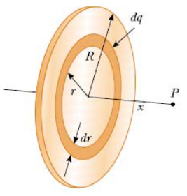
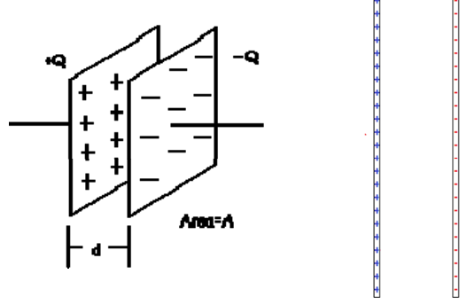
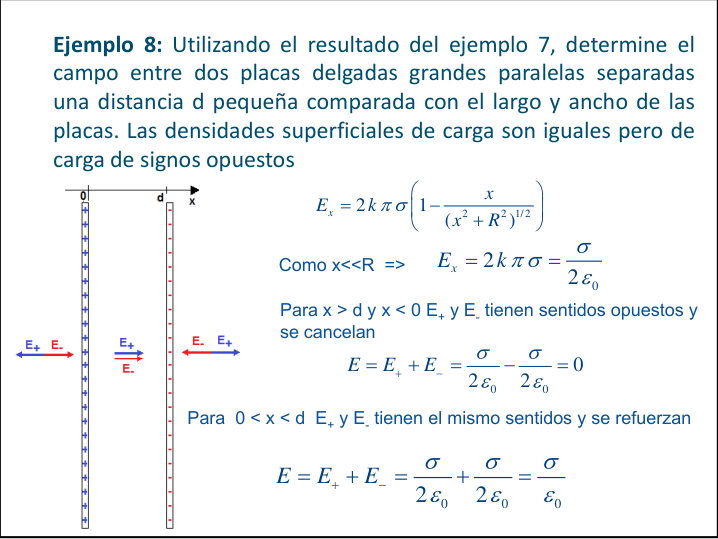
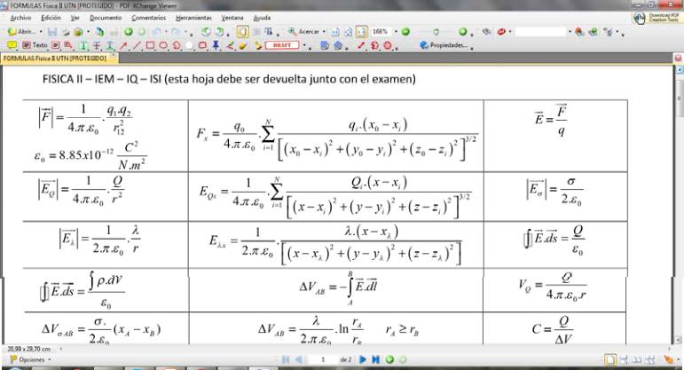

# Ejemplo 7: campo eléctrico de un disco

Ejemplo 7: Campo eléctrico creado por una distribución uniforme de carga en
forma de disco de radio R, en un punto de su eje.



```math
dq=\sigma\,dA=2\pi\sigma\,r\,dr
```

```math
dE_x=k\frac{x\,dq}{(x^2+r^2)^{3/2}}=kx\pi\sigma\frac{2r\,dr}{(x^2+r^2)^{3/2}}
```

```math
E_x=kx\pi\sigma\int_0^R\frac{d(r^2)}{(x^2+r^2)^{3/2}}
```

```math
E_x=kx\pi\sigma\left.\frac{(-2)}{(x^2+r^2)^{1/2}}\right|_0^R
```

```math
E_x=2k\pi\sigma\left(1-\frac x{(x^2+R^2)^{1/2}}\right)
```

## Ejemplo 8: dos placas paralelas

Ejemplo 8: Utilizando el resultado del ejemplo 7, determine el campo entre dos
placas delgadas grandes paralelas separadas una distancia d pequeña comparada
con el largo y ancho de las placas. Las densidades superficiales de carga son
iguales pero de carga de signos opuestos



Ejemplo 8: Utilizando el resultado del ejemplo 7, determine el campo entre dos
placas delgadas grandes paralelas separadas una distancia d pequeña comparada
con el largo y ancho de las placas. Las densidades superficiales de carga son
iguales pero de carga de signos opuestos



```math
E_x=2k\pi\sigma\left(1-\frac x{(x^2+R^2)^{1/2}}\right)
```

Como x\<<R ⇒

```math
E_x=2k\pi\sigma=\frac\sigma{2\varepsilon_0}
```

Para x > d y x < 0 E₊ y E₋ tienen sentidos opuestos y se cancelan

```math
E=E_++E_-=\frac\sigma{2\varepsilon_0}-\frac\sigma{2\varepsilon_0}=0
```

Para 0 < x < d E₊ y E₋ tienen el mismo sentidos y se refuerzan

```math
E=E_++E_-=\frac\sigma{2\varepsilon_0}+\frac\sigma{2\varepsilon_0}=\frac\sigma{\varepsilon_0}
```

## Hoja de fórmulas mostrada en la diapositiva

FISICA II – IEM – IQ – ISI (esta hoja debe ser devuelta junto con el examen)



Expresiones visibles, en orden de filas de izquierda a derecha:

```math
|\vec F|=\frac1{4.\pi.\varepsilon_0}.\frac{q_1.q_2}{r_{12}^2}
```

```math
\varepsilon_0=8.85\times10^{-12}\frac{C^2}{N.m^2}
```

```math
F_x=\frac{q_0}{4.\pi.\varepsilon_0}.\sum_{i=1}^N\frac{q_i.(x_0-x_i)}{\left[(x_0-x_i)^2+(y_0-y_i)^2+(z_0-z_i)^2\right]^{3/2}}
```

```math
\vec E=\frac{\vec F}q
```

```math
|\vec E_Q|=\frac1{4.\pi.\varepsilon_0}.\frac Q{r^2}
```

```math
E_{Qx}=\frac1{4.\pi.\varepsilon_0}.\sum_{i=1}^N\frac{Q_i.(x-x_i)}{\left[(x-x_i)^2+(y-y_i)^2+(z-z_i)^2\right]^{3/2}}
```

```math
|\vec E_\sigma|=\frac\sigma{2.\varepsilon_0}
```

```math
|\vec E_\lambda|=\frac1{2.\pi.\varepsilon_0}.\frac\lambda r
```

```math
E_{\lambda x}=\frac1{2.\pi.\varepsilon_0}.\frac{\lambda.(x-x_\lambda)}{\left[(x-x_\lambda)^2+(y-y_\lambda)^2+(z-z_\lambda)^2\right]}
```

```math
\mathop{∯}\vec E.\overrightarrow{ds}=\frac Q{\varepsilon_0}
```

```math
\mathop{∯}\vec E.\overrightarrow{ds}=\frac{\int\rho.dV}{\varepsilon_0}
```

```math
\Delta V_{AB}=-\int_A^B\vec E.\overrightarrow{dl}
```

```math
V_Q=\frac Q{4.\pi.\varepsilon_0.r}
```

```math
\Delta V_{\sigma AB}=\frac\sigma{2.\varepsilon_0}.(x_A-x_B)
```

```math
\Delta V_{AB}=\frac\lambda{2.\pi.\varepsilon_0}.\ln\frac{r_A}{r_B}\qquad r_A\ge r_B
```

```math
C=\frac Q{\Delta V}
```

## Procedencia y observaciones de transcripción

- Original:
  `2019/1er Parcial/2018 UT I - Fuerza Eléctrica y Campo Elécrtico.pdf`, páginas
  28, 29 de 42.
- SHA-256: `326bb078ddbf25b43f166e198c175106027b686dde0d0ea9688c025795f46ca7`.
- El nombre del archivo indica 2018; ubicación canónica 2019. No consta autor ni
  fecha completa en estas páginas.
- Herramientas: PyMuPDF4LLM y Poppler para extracción; todas las expresiones y
  figuras cotejadas visualmente. Medios por recorte/render PyMuPDF; la captura
  de fórmulas y la figura oculta de líneas se recuperan desde sus franjas raster
  originales.
- Se conserva el límite R al integrar d(r²), la repetición del enunciado 8, «x >
  d y x < 0» y «el mismo sentidos». La captura de la inferior de 29 está
  dividida en tres franjas: se recompone su contenido original y se transcriben
  las 16 expresiones visibles, sin completar fórmulas fuera de la pantalla. La
  integral cerrada doble de esa captura usa el símbolo Unicode compatible con
  GitHub; las demás diapositivas tienen integrales cerradas simples.
