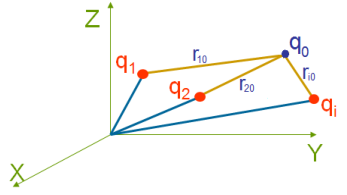
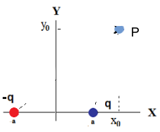
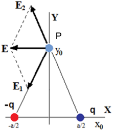

# PRINCIPIO DE SUPERPOSICIÓN: sistemas discretos

A la hora de aplicar el principio de superposición debemos tener en cuenta dos
casos:

1. Campo eléctrico creado en un punto r₀ arbitrario de coordenadas (x₀,y₀,z₀)
   por una distribución discreta de carga [cargas puntuales qᵢ (xᵢ,yᵢ,zᵢ)]

En este caso se calcula el campo eléctrico sumando vectorialmente los campos
eléctricos creados por cada una de las cargas puntuales en el punto elegido.



```math
\vec E=\sum_i k\frac{q_i}{r_{i0}^2}\breve r_{i0}
```

Si se conocen las coordenadas (xᵢ, yᵢ, zᵢ) de las cargas, podemos expresar:

```math
\begin{aligned}
\vec E&=E_x\breve i+E_y\breve j+E_z\breve k=\sum_i k\frac{q_i}{r_{i0}^2}\breve r_{i0}=\sum_i k\frac{q_i}{r_{i0}^3}\vec r_{i0}=\\
&=\sum_i k\frac{q_i\left[(x_0-x_i)\breve i+(y_0-y_i)\breve j+(z_0-z_i)\breve k\right]}{\left[(x_0-x_i)^2+(y_0-y_i)^2+(z_0-z_i)^2\right]^{3/2}}
\end{aligned}
```

```math
\breve r_{i0}=\frac{\vec r_{i0}}{r_{i0}}=\frac{(x_0-x_i)\breve i+(y_0-y_i)\breve j+(z_0-z_i)\breve k}{r_{i0}}
```

Componentes del campo eléctrico

```math
\begin{cases}
E_x=k\displaystyle\sum_i\dfrac{q_i(x_0-x_i)}{\left[(x_0-x_i)^2+(y_0-y_i)^2+(z_0-z_i)^2\right]^{3/2}}\\
E_y=k\displaystyle\sum_i\dfrac{q_i(y_0-y_i)}{\left[(x_0-x_i)^2+(y_0-y_i)^2+(z_0-z_i)^2\right]^{3/2}}\\
E_z=k\displaystyle\sum_i\dfrac{q_i(z_0-z_i)}{\left[(x_0-x_i)^2+(y_0-y_i)^2+(z_0-z_i)^2\right]^{3/2}}
\end{cases}
```

```math
\begin{cases}
E_x=k\displaystyle\sum_i\dfrac{q_i(x_0-x_i)}{\left[(x_0-x_i)^2+(y_0-y_i)^2+(z_0-z_i)^2\right]^{3/2}}\\
E_y=k\displaystyle\sum_i\dfrac{q_i(y_0-y_i)}{\left[(x_0-x_i)^2+(y_0-y_i)^2+(z_0-z_i)^2\right]^{3/2}}\\
E_z=k\displaystyle\sum_i\dfrac{q_i(z_0-z_i)}{\left[(x_0-x_i)^2+(y_0-y_i)^2+(z_0-z_i)^2\right]^{3/2}}
\end{cases}
```

Para generalizar en función de x, y, z (en vez de x₀, y₀, z₀)

```math
\begin{cases}
E_x=k\displaystyle\sum_i\dfrac{q_i(x-x_i)}{\left[(x-x_i)^2+(y-y_i)^2+(z-z_i)^2\right]^{3/2}}\\
E_y=k\displaystyle\sum_i\dfrac{q_i(y-y_i)}{\left[(x-x_i)^2+(y-y_i)^2+(z-z_i)^2\right]^{3/2}}\\
E_z=k\displaystyle\sum_i\dfrac{q_i(z-z_i)}{\left[(x-x_i)^2+(y-y_i)^2+(z-z_i)^2\right]^{3/2}}
\end{cases}
```

## Cálculo de campo de sistemas discretos

Ejemplo

Ejemplo 1: Campo eléctrico de dos cargas q de igual valor y distinto signo
(Dipolo). Separadas una distancia 2a.

```math
P(x_0,y_0);q(a,0);-q(-a,0);
```



```math
E_x=k\left(\frac{q(x_0-a)}{\left[(x_0-a)^2+(y_0)^2\right]^{3/2}}-\frac{q(x_0+a)}{\left[(x_0+a)^2+(y_0)^2\right]^{3/2}}\right)
```

```math
E_y=k\left(\frac{q y_0}{\left[(x_0-a)^2+(y_0)^2\right]^{3/2}}-\frac{q y_0}{\left[(x_0+a)^2+(y_0)^2\right]^{3/2}}\right)
```

```math
\vec E=E_x\breve i+E_y\breve j\qquad E=\sqrt{E_x^2+E_y^2}\qquad\theta=\tan^{-1}\left[\frac{E_y}{E_x}\right]
```

A la hora de los cálculos, usar las funciones Pol y Rec de la calculadora!!!

Si q₀ esta en (0,y₀) y la distancia entre cargas es a:

```math
P(0,y_0);q(a/2,0);-q_0(-a/2,0);
```



```math
\begin{cases}
E_x=k\left(\dfrac{-q(a/2)}{\left[(a/2)^2+(y_0)^2\right]^{3/2}}-\dfrac{q(a/2)}{\left[(a/2)^2+(y_0)^2\right]^{3/2}}\right)\\
E_x=-k\dfrac{a q}{\left[(a/2)^2+(y_0)^2\right]^{3/2}}\\
E_y=k\left(\dfrac{q y_0}{\left[(a/2)^2+(y_0)^2\right]^{3/2}}-\dfrac{q y_0}{\left[(a/2)^2+(y_0)^2\right]^{3/2}}\right)=0
\end{cases}
```

El producto aq se denomina momento dipolar eléctrico. Se le asigna carácter
vectorial y **su orientación es de la carga negativa a la positiva**.

```math
\vec E=E_x\breve i=-k\frac{a q}{\left[(a/2)^2+(y_0)^2\right]^{3/2}}\breve i
```

```math
\vec p=q\vec a
```

vector momento dipolar eléctrico

## Procedencia y observaciones de transcripción

- Original:
  `2019/1er Parcial/2018 UT I - Fuerza Eléctrica y Campo Elécrtico.pdf`, páginas
  20, 21, 23, 24 de 42.
- SHA-256: `326bb078ddbf25b43f166e198c175106027b686dde0d0ea9688c025795f46ca7`.
- El nombre del archivo indica 2018; ubicación canónica 2019. No consta autor ni
  fecha completa en estas páginas.
- Herramientas: PyMuPDF4LLM y Poppler para extracción; todas las expresiones y
  figuras cotejadas visualmente. Medios conservados por recorte/render PyMuPDF.
- Cubre la inferior de 20, ambas de 21 y 23 y superior de 24. La repetición de
  componentes en 21 se mantiene. Se conserva -q₀ en la lista de coordenadas de
  24 aunque la figura rotule -q. El ejemplo usa 2a en 23 y a en 24; no se
  unifican.
