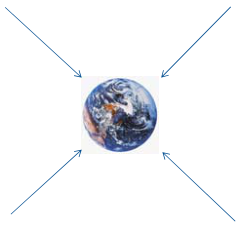
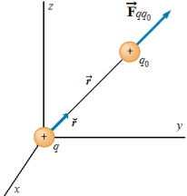

# CAMPO ELÉCTRICO



## Concepto físico de campo

- Las cargas eléctricas no precisan de ningún medio material para ejercer su
  influencia sobre otras, de ahí que las fuerzas eléctricas sean consideradas
  fuerzas de acción a distancia (Fuerzas de Campo).
- Cuando en la naturaleza se da una situación de este tipo, se recurre a la idea
  de campo para facilitar la descripción en términos físicos de la influencia
  que uno o más cuerpos ejercen sobre el espacio que les rodea.
- **La noción física de campo se corresponde con la de un espacio dotado de
  propiedades medibles, con valor definido en cada punto del espacio.**



```math
\vec F_{q q_o}=k\frac{q q_o}{r^2}\breve r
```

Se define la intensidad de campo eléctrico en un punto como la fuerza por unidad
de carga positiva en ese punto.

```math
\vec E=\frac{\vec F}{q_o}
```

```math
\begin{cases}\vec E=k\dfrac q{r^2}\breve r\\\vec F=q_o\vec E\end{cases}
```

La dirección y sentido del campo eléctrico coincide con el de la fuerza
eléctrica para una carga de prueba positiva.

No depende de la carga de prueba.

```math
[E]=\frac{[F]}{[q]}=\frac{Newton}{Coulomb}
```

## Características

- El campo E es un vector orientado a lo largo de la recta que une la carga
  fuente q con el punto P donde se mide el campo. Su sentido depende del signo
  de la carga q que origina el campo: si es positiva el sentido es alejándose de
  q, si es negativa el sentido es de P hacia q.
- La dirección y sentido del campo coinciden con los de la fuerza que actuaría
  sobre una carga de prueba **positiva** colocada en el punto.
- El campo depende de la posición, es decir es una propiedad local.

## Procedencia y observaciones de transcripción

- Original:
  `2019/1er Parcial/2018 UT I - Fuerza Eléctrica y Campo Elécrtico.pdf`, páginas
  18, 19, 20 de 42.

- SHA-256: `326bb078ddbf25b43f166e198c175106027b686dde0d0ea9688c025795f46ca7`.

- El nombre del archivo indica 2018; ubicación canónica 2019. No consta autor ni
  fecha completa en estas páginas.

- Herramientas: PyMuPDF4LLM y Poppler para extracción; todas las expresiones y
  figuras cotejadas visualmente. Medios conservados por recorte/render PyMuPDF.

- Cubre las dos diapositivas de 18 y 19 y la superior de 20. El dibujo de Tierra
  no trae explicación y no se inventa. Se conserva el subíndice o de la carga de
  prueba y los versores con breve.

- La figura de campo puntual o de anillo se recompone desde las franjas raster
  incrustadas, conservando posiciones y máscaras de transparencia, para excluir
  restos de texto vecino sin cortar ejes ni etiquetas.
