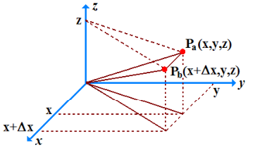

# Relación entre el campo eléctrico E y el potencial V

```math
\left.\begin{aligned}
\mathrm{Si}\quad a=\infty&\Rightarrow V_a=V_\infty=0\\
\mathrm y\quad b=P&\Rightarrow V_b=V(P)=V_P
\end{aligned}\right\}\Rightarrow V_P=-\int_\infty^P\vec E\cdot\overrightarrow{dl}
```

Conocido el campo eléctrico E, podemos calcular el potencial V (en principio)
utilizando esta expresión. Veamos el problema inverso:

**¿Es posible conocido V, determinar el campo eléctrico E?**

Como V es la integral de línea del campo E, es de esperar que E sea alguna forma
de derivada de V (operación inversa de la integración) con signo cambiado.



La diferencia de potencial entre dos puntos próximos Pₐ(x, y, z) y Pᵦ(x+Δx, y,
z) esta dada por:

```math
V(x+\Delta x,y,z)-V(x,y,z)=-\int_x^{x+\Delta x}\vec E\cdot\overrightarrow{dl}
```

```math
\vec E\cdot\overrightarrow{dl}=(E_x\hat i+E_y\hat j+E_z\hat k)\cdot(dx\hat i+0\hat j+0\hat k)=E_x\,dx
```

```math
V(x+\Delta x,y,z)-V(x,y,z)=-\int_x^{x+\Delta x}E_x\,dx
```

Si Δx es pequeño, Eₓ es prácticamente constante dentro del intervalo de
integración (rigurosamente cierto en el límite Δx→0

```math
V(x+\Delta x,y,z)-V(x,y,z)\cong-E_x\,\Delta x
```

```math
\mathop{\mathrm{Lim}}_{\Delta x\to0}\left[\frac{V(x+\Delta x,y,z)-V(x,y,z)}{\Delta x}\right]=-E_x
```

El termino de la izquierda de la igualdad es la derivada parcial de V con
respecto a x, por lo que

```math
-\frac{\partial V}{\partial x}=E_x
```

De manera similar obtenemos para los ejes y y z las relaciones:

```math
\begin{cases}
E_x=-\dfrac{\partial V}{\partial x}\\
E_y=-\dfrac{\partial V}{\partial y}\\
E_z=-\dfrac{\partial V}{\partial z}
\end{cases}
\Rightarrow
\left\{\begin{aligned}
\vec E&=E_x\hat i+E_y\hat j+E_z\hat k=\\
&=-\frac{\partial V}{\partial x}\hat i-\frac{\partial V}{\partial y}\hat j-\frac{\partial V}{\partial z}\hat k=-\vec\nabla V\\
\vec E&=-\vec\nabla V
\end{aligned}\right.
```

El operador $`\vec\nabla`$ es el Gradiente. Si hay simetría esférica, V =V(r)
solo depende de r, y E tendrá solamente componente radial dada por

```math
E_r=-\frac{dV}{dr}
```

## Procedencia y observaciones de transcripción

- Original:
  `2019/1er Parcial/2017 UT II - Energía Electrostatica. Potencial electrico.pdf`,
  páginas 12, 13 de 16 (PDF original, dos diapositivas por página salvo la
  última).
- SHA-256: `3e220eba27f223b646b95bb01387049e32d8a38191b146cb7d8e0bcb5eb7ece5`.
- El nombre del archivo indica 2017; se conserva bajo 2019 por su ubicación
  canónica. No consta autor en estas diapositivas.
- Herramientas: PyMuPDF4LLM y Poppler para extracción; cotejo visual de todas
  las páginas, ecuaciones y figuras. Medios originales conservados por recorte y
  render con PyMuPDF. La extracción automática no conserva todas las ecuaciones.
- Se conserva el paréntesis sin cierre en el texto de la diapositiva 25 y la
  notación Lim con mayúscula. La expresión vectorial final se repite como en el
  original.
