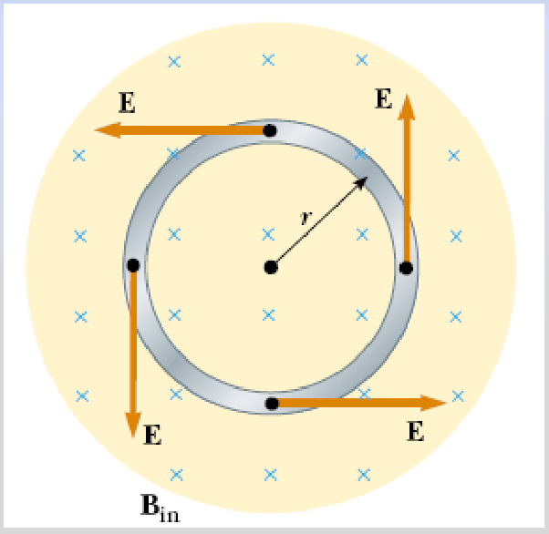

# Campo eléctrico inducido: versión Electromagnetismo

Unidad Temática VII — Electromagnetismo

## Fem inducida y campos eléctricos



Un flujo magnético variable produce en una espira una fem y una corriente
inducidas.

Sabemos que si circula una corriente debe existir en el interior del conductor
un campo eléctrico E, es decir: se crea un campo eléctrico debido al flujo
magnético variable.

E esta en el plano perpendicular a B por lo que se espera que sea perpendicular
a este ultimo y tangente al circulo de radio r. De acuerdo a al Ley de Lenz toma
la dirección del dibujo ya que necesita ser capaz de producir una corriente que
se oponga al cambio original en B.

Si B cambia en el tiempo se induce en la espira una fem

```math
\varepsilon=-\frac{d\phi_B}{dt}
```

La corriente inducida en la espira implica la existencia de un campo eléctrico E
tangente a la espira en todos sus puntos.

El trabajo realizado para mover una carga de prueba “q” a lo largo de la espira
(una vuelta completa) es

```math
W=q\varepsilon
```

El trabajo lo realiza la fuerza eléctrica F=q E es

```math
W=\oint\vec F\cdot\overrightarrow{dl}=qE\oint dl=qE\,2\pi r
```

Estas dos expresiones para W deben ser iguales.

```math
\begin{cases}W=q\varepsilon\\\displaystyle W=\int\vec F\cdot\overrightarrow{dl}=qE\,2\pi r\end{cases}\Rightarrow q\varepsilon=qE\,2\pi r\Rightarrow
```

Campo eléctrico no conservativo inducido en la espira

```math
E=\frac{\varepsilon}{2\pi r}
```

No es conservativo porque

```math
\oint\vec E\overrightarrow{dl}=\varepsilon
```

Para que sea conservativo

```math
\oint\vec E\overrightarrow{dl}=0
```

```math
\phi_B=BA=B\pi r^2\Rightarrow\varepsilon=-\frac{d\phi_B}{dt}=-\pi r^2\frac{dB}{dt}
```

```math
E=-\frac1{2\pi r}\frac{d\phi_B}{dt}=-\frac r2\frac{dB}{dt}
```

El campo magnético variable crea un campo eléctrico

## Procedencia y observaciones de transcripción

- Original: `2019/2do Parcial/2019 UT VII Electromagnetismo.pdf`, páginas 32–34
  de 62. No consta fecha impresa; 2019 es del nombre del archivo.
- SHA-256: `eff3447774cadfcb2726a6caabbe8e257782276fce3e67dda465673d5ef67a6a`.
- Herramientas: PyMuPDF4LLM, Poppler y recortes PyMuPDF; páginas, expresiones y
  figuras del tramo cotejadas visualmente.
- Se conservan «De acuerdo a al Ley» y las fórmulas sin punto escalar de página
  34\. La figura aparece sólo en página 32; las páginas 33 y 34 contienen el
  desarrollo escrito.
