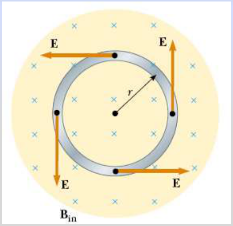

# Campo eléctrico inducido en una espira

Unidad Temática VII — Electromagnetismo

Un campo magnético variable genera un campo eléctrico.

## Fem inducida y campos eléctricos



Un flujo magnético variable produce en una espira una fem y una corriente
inducidas.

Sabemos que si circula una corriente debe existir en el interior del conductor
un campo eléctrico E, es decir: se crea un campo eléctrico debido al flujo
magnético variable.

Este campo eléctrico no es conservativo.

Si B cambia en el tiempo se induce en la espira una fem

```math
\varepsilon=-\frac{d\phi_B}{dt}
```

La corriente inducida en la espira implica la existencia de un campo eléctrico E
tangente a la espira en todos sus puntos.


El trabajo realizado para mover una carga de prueba q lo largo de la espira es

```math
W=q\varepsilon
```

El trabajo lo realiza la fuerza eléctrica F=q E, por tanto:

```math
W=\oint\vec F\cdot\overrightarrow{dl}=qE\oint dl=qE\,2\pi r
```

Estas dos expresiones para W deben ser iguales.


```math
\begin{cases}W=q\varepsilon\\\displaystyle W=\int\vec F\cdot\overrightarrow{dl}=qE\,2\pi r\end{cases}\Rightarrow q\varepsilon=qE\,2\pi r\Rightarrow
```

Campo eléctrico no conservativo inducido en la espira

```math
E=\frac{\varepsilon}{2\pi r}
```

```math
\phi_B=BA=B\pi r^2\Rightarrow\varepsilon=-\frac{d\phi_B}{dt}=-\pi r^2\frac{dB}{dt}
```

```math
E=-\frac1{2\pi r}\frac{d\phi_B}{dt}=-\frac r2\frac{dB}{dt}
```

El campo magnético variable crea un campo eléctrico

## Procedencia y observaciones de transcripción

- Original:
  `2019/2do Parcial/2019 UT VII - Fenómenos de Inducción Electromagnética.pdf`,
  páginas 31–34 de 67. Fecha impresa: 14/05/2019.
- SHA-256: `cbefa338a0f56f56079880a84f05a963257a6473febd8da50f944a67f2210a8f`.
- Herramientas: PyMuPDF4LLM, Poppler y recortes PyMuPDF; páginas y ecuaciones
  del tramo cotejadas visualmente; sin soluciones añadidas.
- Se conserva la frase «q lo largo» de página 33 y la integral simple de la
  expresión de trabajo de página 34, frente a las integrales cerradas de la
  anterior. La misma espira se repite en las tres páginas y en la nota.
