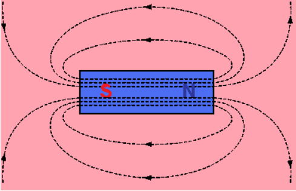
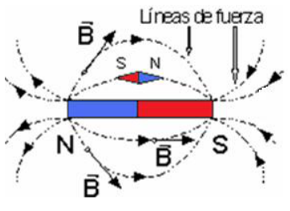

# Campo magnético: líneas de fuerza e intensidad

Unidad Temática V — Fuerzas Magnéticas sobre cargas y elementos de corriente

## Simulación

[Click acá](https://phet.colorado.edu/es/simulation/legacy/magnets-and-electromagnets)

## El Campo Magnético

El hecho de que las fuerzas magnéticas sean fuerzas de acción a distancia
permite recurrir a la idea física de campo para describir la influencia de un
imán sobre el espacio que les rodea. Se recurre a la noción de líneas de fuerza
para representar la estructura del campo. En cada punto las líneas de fuerza del
campo magnético indican la dirección en la que se orientará una pequeña brújula
(considerada como un elemento de prueba) situada en tal punto.

- Por convenio se considera que: las líneas de fuerza salen del polo Norte y se
  dirigen al polo Sur.
- Las líneas de campo magnético son cerradas. No existen fuentes ni sumideros de
  B

## La intensidad del campo magnético

Como sucede en otros campos de fuerza, el campo magnético queda definido
matemáticamente si se conoce el valor que toma en cada punto una magnitud
vectorial que recibe el nombre de intensidad de campo.

La intensidad del campo magnético, también denominada inducción magnética, se
representa por la letra B, y es un vector tal que en cada punto coincide en
dirección y sentido con los de la línea de fuerza magnética correspondiente. Las
brújulas, al alinearse a lo largo de las líneas de fuerza del campo magnético,
indican la dirección y el sentido de la intensidad del campo B.

## Procedencia y observaciones de transcripción

- Original:
  `2019/2do Parcial/2019 UT V - Fuerzas Magnéticas sobre cargas y elementos de corriente.pdf`,
  páginas 9–11 de 42.
- SHA-256: `383fdb6f46e1627fbe65cf259b89a480bd4b4cc61821cbfc466fa3e4a63ceb29`.
  2019 corresponde al nombre del archivo; no consta fecha impresa en estas
  páginas.
- Herramientas: PyMuPDF4LLM, Poppler y recortes PyMuPDF; páginas, expresiones y
  diagramas del tramo cotejados visualmente. No se añaden soluciones.
- Se conserva la URL de la simulación indicada por el original; no se ejecuta
  ningún applet.
