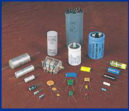
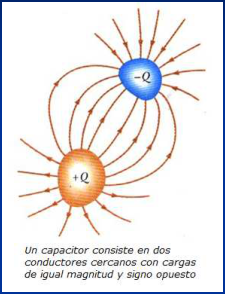
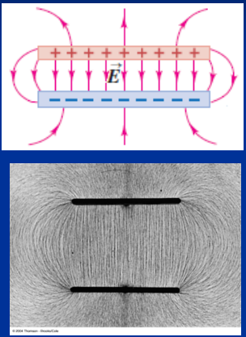
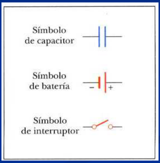
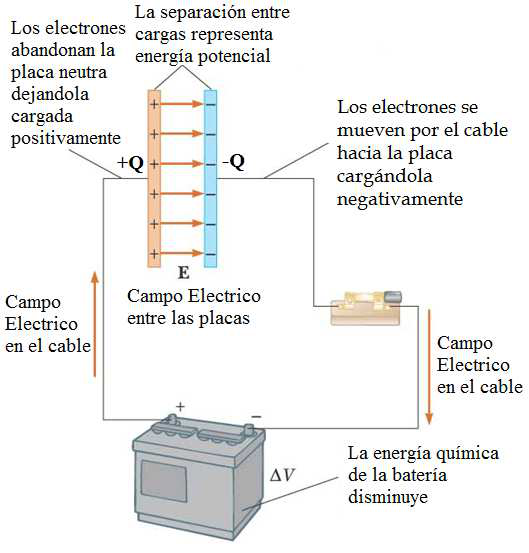
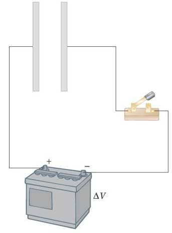

# Unidad Temática III: Capacidad. Propiedades Eléctricas de la Materia

## CONTENIDOS

Capacidad eléctrica. Condensadores: planos, cilíndricos, esféricos. Asociación
de condensadores.. Energía en condensadores y campos eléctricos. Dieléctricos.
Polarización y susceptibilidad eléctrica. Relación entre el vector Polarización
y las cargas de Polarización Generalización de la ley de Gauss. Vector
desplazamiento. Rigidez dieléctrica. Aplicaciones. Energía en presencia de
dieléctricos.

## OBJETIVOS DE LA UNIDAD

Que el alumno logre:

- Comprender el concepto de capacitancia.
- Calcular capacitancias.
- Comprender la utilidad y aplicaciones de los capacitores en circuitos
  eléctricos como elemento de almacenamiento temporal de carga y de energía.
- Comprender las propiedades y comportamiento de los materiales dieléctricos.
- Calcular la capacitancia equivalente en asociaciones de capacitores en serie y
  en paralelo.
- Comprender y entender la influencia de un dieléctrico como material de relleno
  en el espacio entre placas de los capacitores.

## INTRODUCCION

- El condensador (capacitor) es uno de los diferentes tipos de dispositivos que
  se utilizan en circuitos eléctricos de los aparatos de TV, PCs y otros
  aparatos.
- Los condensadores proporcionan un almacenamiento temporal de energía y de
  carga en circuitos.
- La propiedad que caracteriza las posibilidades de almacenamiento de energía de
  un condensador es su capacidad eléctrica.



## CONDENSADORES Y CAPACIDAD

Un condensador es un dispositivo formado por dos conductores cercanos y aislados
entre sí, los que independientemente de su forma son denominados "placas".



En funcionamiento las dos placas poseen el mismo valor de carga pero de signos
contrarios.

Capacitor de placas plano paralelas



Símbolos de representación en circuitos



Un condensador puede ser cargado conectando sus placas a los terminales de una
batería.



Rótulos del diagrama: Los electrones abandonan la placa neutra dejandola cargada
positivamente; La separación entre cargas representa energía potencial; Los
electrones se mueven por el cable hacia la placa cargándola negativamente; Campo
Electrico en el cable; Campo Electrico entre las placas; Campo Electrico en el
cable; La energía química de la batería disminuye.



- Si la batería permanece conectada hasta que se establece el equilibrio, la
  diferencia de potencial ΔV entre las placas es la misma que entre los
  terminales de la batería
- La batería transfiere +Q a la placa conectada al terminal positivo y -Q a la
  placa conectada al terminal negativo. **La carga neta del condensador es
  cero.**
- Si utilizamos baterías de diferentes potenciales ΔV₁, ΔV₂, ΔV₃,…, obtendremos
  en el capacitor diferentes cargas Q₁, Q₂, Q₃,….

Si efectuamos Los cocientes

```math
\frac{Q_1}{V_1}=\frac{Q_2}{V_2}=\frac{Q_3}{V_3}=\ldots=Cte.
```

Definimos

```math
C=\frac Q{\Delta V}
```

(1)

Capacidad de un condensador

Por convenio todas las magnitudes de la Ecuación (1) se toman positivas.

**Por tanto la capacidad C será siempre positiva.**

## Unidades (S.I.)

```math
[C]=\frac{[Q]}{[V]}=\frac{Coulomb}{Volt}=Faradio=F
```

Submultiplos

- mF: milifaradio, $`1mF=10^{-3}F`$
- μF: microfaradio, $`1\mu F=10^{-6}F`$
- nF: nanofaradio, $`1nF=10^{-9}F`$
- pF: picofaradio, $`1pF=10^{-12}F`$

## Procedencia y observaciones de transcripción

- Original:
  `2019/1er Parcial/2018 PF UT III - Capacidad. Prop electr de la Materia.pptx.pdf`,
  páginas 1, 2, 3, 4, 5 de 26, dos diapositivas por página salvo el cierre.
- SHA-256: `ac23675b753c3d9349b89600ea349edcbc8dfe56058b3c78a09e873777616145`.
- Fecha impresa: 28/03/2018. Ubicación canónica: material 2019. No consta autor
  en estas páginas.
- Herramientas: PyMuPDF4LLM y Poppler para extracción; cotejo visual de texto,
  expresiones, tablas y figuras. Medios conservados mediante recorte/render
  PyMuPDF, excepto las dos imágenes de carga por batería extraídas directamente
  del PDF.
- La capa textual duplica palabras por sombras de PowerPoint; se transcribe una
  sola vez el texto visible. En la diapositiva 7 dos imágenes se superponen y
  tapan rótulos: se extraen ambas imágenes raster originales, recuperando los
  rótulos desde la imagen incrustada completa, sin reconstruirlos. Se conservan
  la puntuación doble y la ausencia de punto entre Polarización y
  Generalización.
