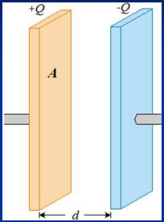
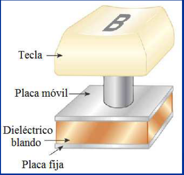
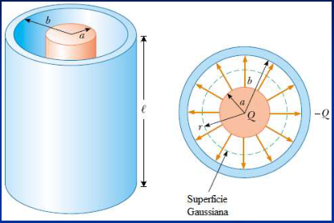
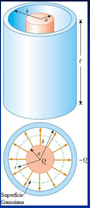
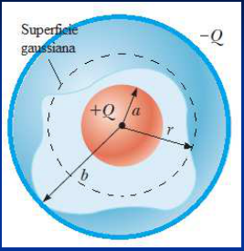

# Capacidad del condensador de placas plano-paralelas



```math
|\sigma|=Q/A\Rightarrow E=\frac{|\sigma|}{\varepsilon_0}=\frac Q{\varepsilon_0 A}
```

y

```math
\Delta V=Ed=\frac{Qd}{\varepsilon_0 A}
```

```math
C=\frac Q{\Delta V}=\frac Q{\dfrac{Qd}{\varepsilon_0 A}}=\frac{\varepsilon_0 A}d
```

Capacidad del Condensador de placas plano paralelas

## Tamaño de un capacitor de 1 F

Un capacitor de placas paralelas tiene una capacitancia de 1.0 F. Si las placas
tienen una separación de 1.0 mm, ¿cuál es el área de las placas?

A es del orden de 100 Km² !!!!!!!

Las placas paralelas de un capacitor con vacío están separadas una distancia de
5.00 mm y tienen 2.00 m2 de área. Se aplica una diferencia de potencial de
10,000 V (10.0 kV) a través del capacitor. Calcule a) la capacitancia, b) la
carga en cada placa y c) la magnitud del campo eléctrico en el espacio entre
ellas.

## Aplicación

Algunos teclados de computadora las teclas están montadas sobre capacitores,
como se muestra en la figura. Al apretar la tecla la distancia d entre placas
disminuye y …???



```math
V=Ed
```

V disminuye

```math
C=\frac{\varepsilon_0 A}d
```

C aumenta

## Capacitor cilíndrico





## Capacitor esférico



## Procedencia y observaciones de transcripción

- Original:
  `2019/1er Parcial/2018 PF UT III - Capacidad. Prop electr de la Materia.pptx.pdf`,
  páginas 6, 7, 8, 9 de 26, dos diapositivas por página salvo el cierre.
- SHA-256: `ac23675b753c3d9349b89600ea349edcbc8dfe56058b3c78a09e873777616145`.
- Fecha impresa: 28/03/2018. Ubicación canónica: material 2019. No consta autor
  en estas páginas.
- Herramientas: PyMuPDF4LLM y Poppler para extracción; cotejo visual de texto,
  expresiones, tablas y figuras. Medios conservados mediante recorte/render
  PyMuPDF, excepto las dos imágenes de carga por batería extraídas directamente
  del PDF.
- Cubre las diapositivas 11–17. Las diapositivas 15–17 solo contienen figuras,
  sin fórmulas de capacidad cilíndrica o esférica: no se agregan. Se conserva m2
  en la línea de base del ejercicio 13, la coma de 10,000 V y las afirmaciones V
  disminuye/C aumenta. No se resuelven los ejercicios sin desarrollo.
