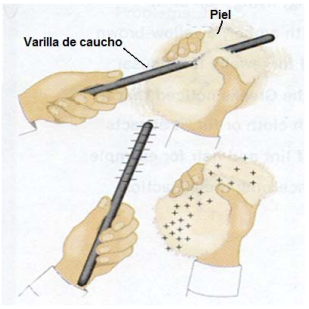
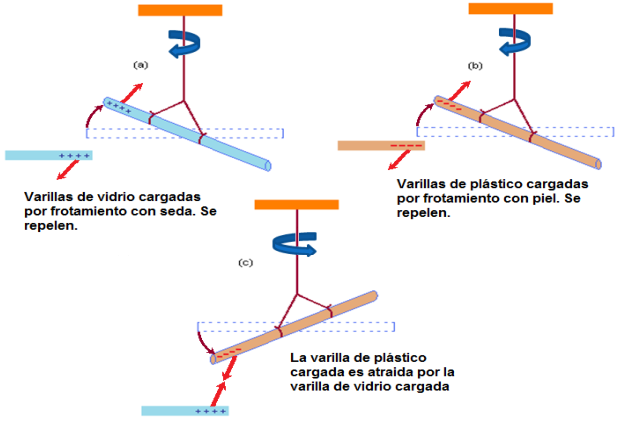
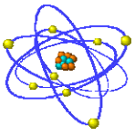
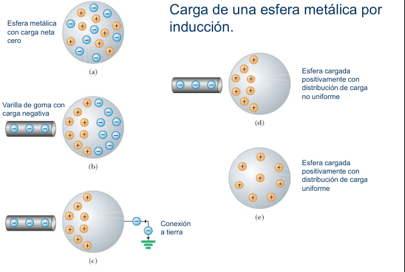

# CARGA ELECTRICA Y MATERIA. ELECTRIZACIÓN



- Cuando a un cuerpo se lo dota de propiedades eléctricas se dice que ha sido
  electrizado.
- Electrización: se llama así al afecto de ganar o perder cargas eléctricas.
- La electrización por frotamiento (efecto triboelectrico) permitió, a través de
  unas cuantas experiencias fundamentales sentar las bases de lo que denominamos
  actualmente Electrostática.

Las experiencias de electrización pusieron de manifiesto que:

**Cargas eléctricas de distinto signo se atraen y cargas eléctricas de igual
signo se repelen.**



Rótulos de las experiencias:

- Varillas de vidrio cargadas por frotamiento con seda. Se repelen.
- Varillas de plástico cargadas por frotamiento con piel. Se repelen.
- La varilla de plástico cargada es atraída por la varilla de vidrio cargada

## QUE SE OBSERVABA?

- Cuando una varilla es cargada al ser frotada con un tejido, la carga que
  adquiere la varilla es opuesta al tipo de carga que adquiere la tela.
- Mediciones cuantitativas indican que la cantidad de carga de tipo opuesto que
  adquieren es la misma.

Modelo:

- En la materia existen dos tipos de carga eléctrica, que denominamos positiva y
  negativa. Los objetos no cargados, en realidad poseen la misma cantidad de
  carga de cada tipo, de manera que la carga neta es cero. Cuando son cargados
  por frotamiento, ceden una parte de la carga de uno de los tipos al otro
  cuerpo, quedando uno con exceso de carga positiva y el otro con exceso de
  carga negativa (la misma cantidad).
- Objetos con carga del mismo signo se repelen.
- Objeto con carga de signo diferente se atraen.

Como resultado adicional, obtenemos la Ley de Conservación de la carga:

**La carga eléctrica no puede ser creada ni destruida, únicamente puede ser
transferida.**

Si mediante algún proceso son creadas partículas cargadas, ellas siempre son
creadas de a pares, que tienen igual cantidad de carga eléctrica pero de signo
opuesto, de modo que la carga neta creada es cero.

## CARGA ELÉCTRICA

Es una magnitud fundamental de la física, responsable de la interacción
electromagnética.

En el S.I. La unidad de carga es el Culombio (C) que se define como la cantidad
de carga que fluye por un punto de un conductor en un segundo cuando la
corriente en el mismo es de 1 A.

Submúltiplos del Culombio

```math
1\,nC=10^{-9}\,C
```

```math
1\,\mu C=10^{-6}\,C
```

```math
1\,mC=10^{-3}\,C
```

## La estructura atómica. Cuantización de la carga

Los átomos están formados fundamentalmente por tres tipos de partículas:
protones, neutrones y electrones.

Atomo

- Np protones c/u con carga +e
- Nn neutrones sin carga
- Ne electrones c/u con carga -e



En estado natural Np = Ne ⇒ Carga eléctrica neta nula

Protones y neutrones conforman el núcleo, de carga +

Los electrones “orbitan” (nubes o capas electrónicas) alrededor del núcleo.

Protones y neutrones se hallan unidos entre sí por efecto de unas fuerzas mucho
más intensas que las de la repulsión electrostática ( las fuerzas nucleares )
formando un todo compacto. Si solo existieran las fuerzas eléctricas el núcleo
sería inestable.

El numero de nucleones varia, dependiendo del elemento químico de que se trate.
El numero de protones y neutrones es aproximadamente el mismo.(P/ej. El Al
contiene en su núcleo 13 protones y 14neutrones). El protón y el neutrón tienen
aproximadamente la misma masa, que es unas 2000 veces mayor que la del electrón.

```math
m_e=9{,}1093897\ 10^{-31}\,\mathrm{kg}
```

```math
m_p=1{,}672623\ 10^{-27}\,\mathrm{kg}
```

```math
m_n=1{,}6749286\ 10^{-27}\,\mathrm{kg}
```

- La masa del núcleo de un átomo es del orden de 4000 veces la masa del conjunto
  de sus electrones.
- El tamaño del núcleo es mucho menor que el de la nube electrónica. El tamaño
  típico del núcleo es del orden de $`5\ 10^{-15}\,m`$ y el de la nube
  electrónica de $`2\ 10^{-10}\,m`$.
- Una característica de la carga eléctrica en el modelo atómico es la
  cuantización de la carga.

**En 1909 Robert Millikan (1868-1953) descubrió que las cargas eléctricas se
presentan siempre en múltiplos enteros de una cantidad fundamental de carga.**

```math
e=1.6\times10^{-19}\,C\quad\text{en el SI}
```

⇒ Protón: +e; Electrón: -e

- Los electrones se encuentran ligados al núcleo por fuerzas de naturaleza
  eléctrica.
- Cuando un electrón logra escapar de dicha influencia, el átomo pierde la
  neutralidad eléctrica y se convierte en un ion positivo, al ser Np >Ne.
- Cuando un electrón adicional es incorporado a un átomo neutro es Ne > Np.
  Entonces el ion formado es negativo.


La electrización por frotamiento se explica del siguiente modo: por efecto de la
fricción, los electrones externos de los átomos del paño de lana son liberados y
cedidos a la barra de plástico, con lo cual ésta queda cargada negativamente y
aquél positivamente.

En términos análogos puede explicarse la electrización del vidrio por la seda.

En cualquiera de estos fenómenos se pierden o se ganan electrones, pero el
número de electrones cedidos por uno de los cuerpos en contacto es igual al
número de electrones aceptado por el otro, de ahí que en conjunto no hay
producción ni destrucción de carga eléctrica.

Esta es la explicación, desde la teoría atómica, del principio de conservación
de la carga eléctrica

## Características de la carga

i) **Dualidad de la carga:** Todas las partículas cargadas son o positivas o
negativas, las de un mismo signo se repelen mientras que las de signo contrario
se atraen.

ii) **Conservación de la carga:** En cualquier proceso físico, la carga total de
un sistema aislado se conserva. Es decir, la suma algebraica de cargas positivas
y negativas presente en cierto instante no varía.

iii) **Cuantización de la carga:** La carga eléctrica siempre se presenta como
un múltiplo entero de una carga fundamental, que es la del electrón.

## Carga de una esfera metálica por inducción



Rótulos: Esfera metálica con carga neta cero; Varilla de goma con carga
negativa; Conexión a tierra; Esfera cargada positivamente con distribución de
carga no uniforme; Esfera cargada positivamente con distribución de carga
uniforme.

## Materiales aislantes, conductores y semiconductores

Materiales:

- conductores: Permiten fácilmente el flujo de carga eléctrica. Los metales son
  en general buenos conductores de la electricidad. Conductores típicos: Cobre y
  Aluminio, Plata, Oro.
- Aislantes (dieléctricos): No permiten que la carga fluya fácilmente. Los no
  metales, en general son buenos aislantes y malos conductores. Aislantes
  típicos: mica, aire seco, madera, baquelita, cerámicas, gomas, plásticos.

Generalmente, cuando una carga se mueve a través de un material, son los
electrones los que se desplazan, por lo que se denominan portadores de carga.

Los átomos de las sustancias conductoras poseen electrones externos muy
débilmente ligados al núcleo en un estado de semilibertad que les otorga una
gran movilidad. En las sustancias aislantes, los núcleos atómicos retienen con
fuerza todos sus electrones, lo que hace que su movilidad sea escasa.

## Procedencia y observaciones de transcripción

- Original:
  `2019/1er Parcial/2018 UT I - Fuerza Eléctrica y Campo Elécrtico.pdf`, páginas
  4, 5, 6, 7, 8, 9, 10 de 42.
- SHA-256: `326bb078ddbf25b43f166e198c175106027b686dde0d0ea9688c025795f46ca7`.
- El nombre del archivo indica 2018; ubicación canónica 2019. No consta autor ni
  fecha completa en estas páginas.
- Herramientas: PyMuPDF4LLM y Poppler para extracción; texto y figuras cotejados
  contra todas las páginas declaradas. Figuras conservadas por recorte/render
  PyMuPDF. Se omiten solo fragmentos duplicados por la capa de extracción, no
  contenido visible.
- Se conservan «afecto», «Objeto ... se atraen», los valores de masas, la
  afirmación sobre masa nuclear y el título con semiconductores aunque no tenga
  definición específica. No se actualizan constantes ni se añaden explicaciones.
  El mismo dibujo de átomo aparece en las páginas 7 y 8 y se referencia en ambos
  lugares.
