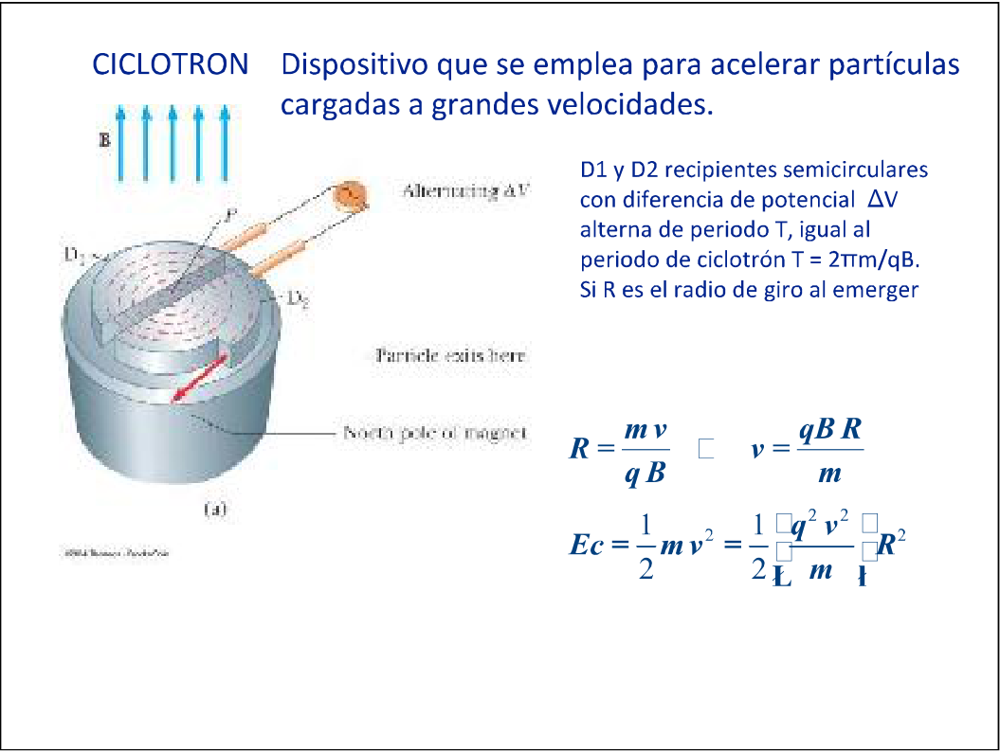

# Ciclotrón — variante impresa

> Transcripción de la diapositiva 26 con corrección editorial solicitada por el
> usuario. La aclaración marcada con * al pie distingue la corrección del
> contenido original.

## CICLOTRON

Dispositivo que se emplea para acelerar partículas cargadas a grandes
velocidades.

D1 y D2 recipientes semicirculares con diferencia de potencial ΔV alterna de
periodo T, igual al periodo de ciclotrón T = 2πm/qB. Si R es el radio de giro al
emerger

```math
R=\frac{mv}{qB}\quad\Longrightarrow\quad v=\frac{qBR}{m}
```

```math
Ec=\frac12mv^2=\frac12m\left(\frac{qBR}{m}\right)^2=\frac{q^2B^2R^2}{2m}
```

\* Fórmulas corregidas editorialmente a pedido del usuario: se sustituye la
velocidad para expresar la energía cinética de salida en función del campo
magnético B y del radio de salida R, conservando R en el resultado final. El
original muestra v² donde corresponde B² en el numerador final y presenta
errores de renderizado en el símbolo intermedio y los delimitadores. La flecha y
los paréntesis expresan la interpretación matemática; no son glifos recuperados
del PDF.

El esquema del ciclotrón y los sectores deteriorados se conservan en este
recorte del original:



## Procedencia y límites de lectura

- Original: `2019/2do Parcial/UT 5 4 pag.pdf`, hoja 7, casillero 2 (diapositiva
  26 por orden de lectura).
- SHA-256: `134d9de661dcefd039d315a0e669b89c38bf02859d1d2d0806f15569b5006764`.
- Segunda impresión cotejada: `2019/2do Parcial/UT 5 6 pag.pdf`, hoja 5,
  casillero 2. SHA-256 del original canónico comprobado el 26/10/2026:
  `c45aa79791cd6f055c74c6598e6a5e277a144bf55f8e14cd23bdb65c997881b2`. La copia
  de trabajo conservada tiene SHA-256
  `d80e499c858b45d8146a3e18152de704cefbb9d0009ea7f3717141f3543e7d9c`. El
  original tiene rotación 270° y la copia 0°; las siete páginas tienen píxeles
  idénticos al igualar la rotación. No consta cuándo divergieron sus identidades
  binarias.
- Inspección de imágenes PDF con PyMuPDF, comparación con Poppler y los renders
  completos; recorte de la diapositiva como evidencia del daño. No hay texto ni
  fuentes embebidas recuperables en estas hojas de la primera impresión. Las dos
  impresiones conservan los defectos.
- Corrección editorial autorizada por el usuario: sustitución de la velocidad en
  la energía cinética, cambio de v² a B² en el numerador final y notación
  matemática legible. El recorte conserva la errata y los defectos originales;
  la aclaración con * documenta la intervención.
