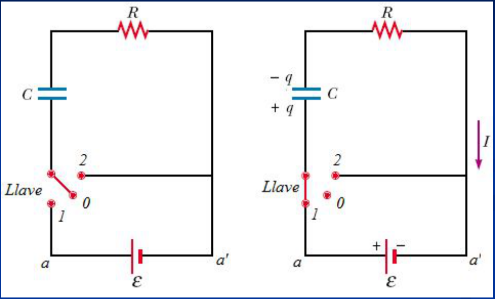
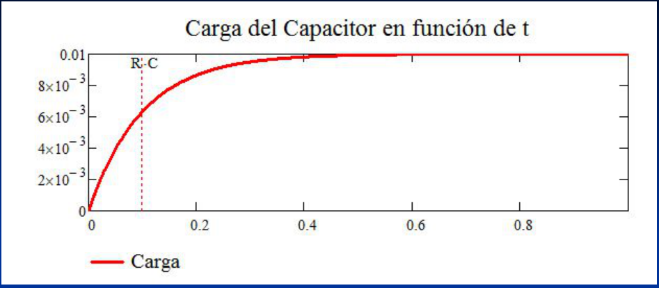
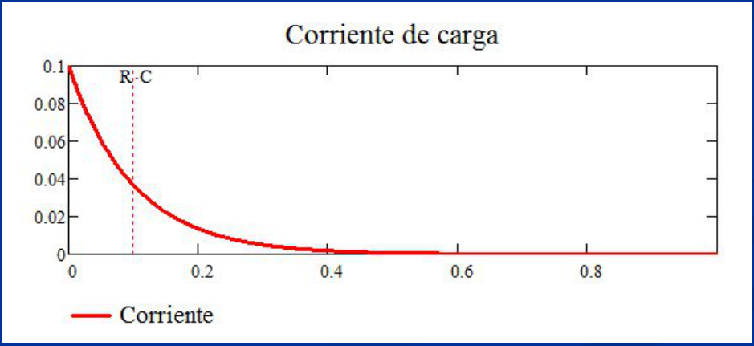
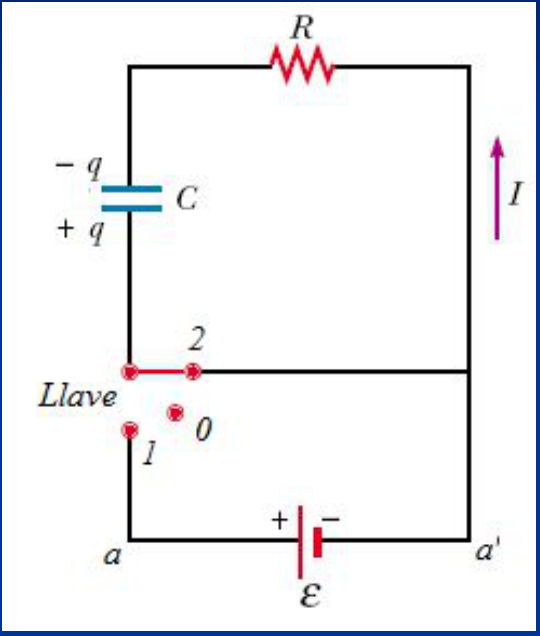

# Circuitos RC

## Carga y descarga de un condensador



En t = 0 con Llave en 0 el capacitor esta descargado [Q(t = 0) = 0] (cond. ini).
Con Llave en 1 se establece una corriente I, y el capacitor C comienza a
cargarse

```math
-\frac q C-IR+\varepsilon=0
```

Ley de las mallas

pero

```math
I=\frac{dq}{dt}\Rightarrow R\frac{dq}{dt}+\frac1Cq=\varepsilon
```

EDO de 1er orden

```math
R\frac{dq}{dt}=\left(\varepsilon-\frac1Cq\right)\Rightarrow R\frac{dq}{\left(\varepsilon-\frac1Cq\right)}=dt
```

Si efectuamos el cambio de variable

```math
\left(\varepsilon-\frac q C\right)=u\Rightarrow-\frac{dq}C=du\Rightarrow dq=-C\,du
```

```math
-RC\frac{du}u=dt
```

integrando

```math
\ln(u)=\frac{-1}{RC}t+Cte1
```

```math
u=e^{-t/(RC)}e^{Cte1}=Cte2\,e^{-t/(RC)}
```

remplazando u

```math
\varepsilon-\frac q C=Cte2\,e^{-t/(RC)}\Rightarrow q(t)=C\left(\varepsilon-Cte2\,e^{-t/(RC)}\right)
```

```math
\mathrm{Si}\quad t=0\Rightarrow q(0)=0\Rightarrow Cte2=\varepsilon
```

```math
q(t)=C\varepsilon\left(1-e^{-t/(RC)}\right)\quad\mathrm y\quad i(t)=\frac{dq}{dt}=\frac\varepsilon R e^{-t/(RC)}
```





```math
\varepsilon=10\qquad C=0.001\qquad R=100
```

## Descarga

Con el capacitor cargado y la llave en 0 en t = 0 [Q(t = 0) = q₀] (cond. ini).
Al conectar la llave en 2 se establece una corriente I, y el capacitor C
comienza a descargarse.



```math
-\frac q C-iR=0\Rightarrow\frac{dq}q=-\frac1{RC}dt
```

```math
\int_{q_0}^q\frac{dq}q=-\frac1{RC}\int_0^t dt
```

```math
\ln\left(\frac q{q_0}\right)=-\frac t{RC}
```

```math
q(t)=q_0e^{-t/(RC)}
```

```math
i(t)=\frac{dq}{dt}=-\frac{q_0}{RC}e^{-t/(RC)}
```

## Fin de la Clase

## Procedencia y observaciones de transcripción

- Original: `2019/1er Parcial/2017 UT IV - Electrocinética.ppt.pdf`, páginas 50,
  51, 52, 53, 54, 55 de 55.
- SHA-256: `5593bcdeb59339b25f4dfee074beac1812300dcec491fb423777a4e776ba1399`.
- El nombre del archivo indica 2017; se conserva bajo 2019 por su ubicación
  canónica. No consta autor en estas páginas.
- Herramientas: PyMuPDF4LLM, PyMuPDF y Poppler; cotejo visual de texto,
  fórmulas, tablas y diagramas. Figuras originales conservadas por recorte y
  render.
- Se mantienen Cte1/Cte2, «remplazando» y las condiciones iniciales con Q
  mayúscula frente a q en las ecuaciones. Los parámetros de las gráficas no
  traen unidades; no se agregan. La página 55 contiene únicamente «Fin de la
  Clase».
