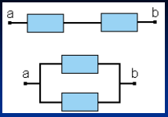
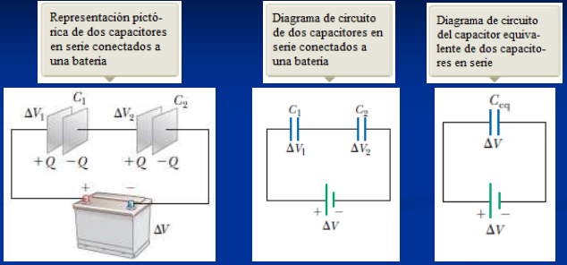
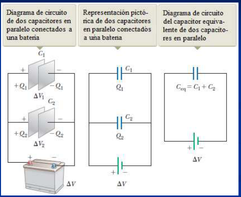
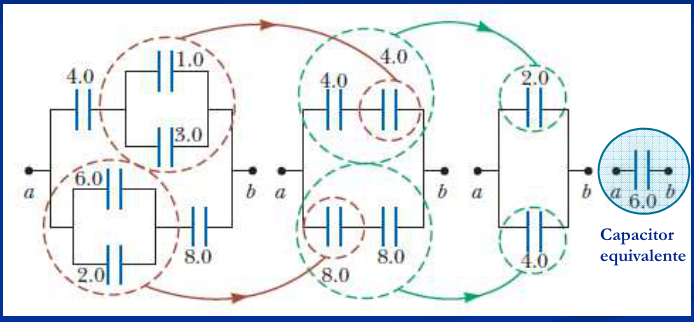

# Condensadores en Serie y en Paralelo



Reglas generales:

- La diferencia de potencial entre los extremos de un cierto número de
  “dispositivos eléctricos” conectados en serie es la suma de las diferencias de
  potencial entre los extremos de cada dispositivo individual.
- La diferencia de potencial entre los extremos de varios componentes de un
  circuito conectados en paralelo es la misma para todos ellos.

## Capacidad equivalente

La capacidad equivalente de un conjunto de condensadores conectados entre si es
la capacidad de un único condensador que cuando sustituye al conjunto produce el
mismo efecto exterior.

## Condensadores en serie



Para producir el mismo efecto que C₁ y C₂, Ceq deberá poseer una carga Q en cada
una de sus placas para la misma diferencia de potencial ΔV.

```math
\Delta V=\Delta V_1+\Delta V_2\qquad Q_1=Q_2=Q
```

```math
\begin{cases}
C_{eq}=\dfrac Q V\Rightarrow V=\dfrac Q{C_{eq}}\\
C_1=\dfrac{Q_1}{V_1}=\dfrac Q{V_1}\Rightarrow V_1=\dfrac Q{C_1}\\
C_2=\dfrac{Q_2}{V_2}=\dfrac Q{V_2}\Rightarrow V_2=\dfrac Q{C_2}
\end{cases}
\Rightarrow\begin{cases}V=V_1+V_2\\\dfrac Q{C_{eq}}=\dfrac Q{C_1}+\dfrac Q{C_2}\end{cases}
```

```math
\frac1{C_{eq}}=\frac1{C_1}+\frac1{C_2}\Rightarrow C_{eq}=\frac{C_1C_2}{C_1+C_2}
```

Para n Condensadores en serie

```math
\frac1{C_{eq}}=\frac1{C_1}+\frac1{C_2}+\ldots+\frac1{C_n}=\sum_{i=1}^n\frac1{C_i}
```

## Condensadores en paralelo



```math
V=V_1=V_2\qquad Q=Q_1+Q_2
```

```math
V=V_1=V_2\qquad Q=Q_1+Q_2
```

```math
C_{eq}=\frac Q V=\frac{Q_1+Q_2}V=\frac{Q_1}V+\frac{Q_2}V
```

pero

```math
C_1=\frac{Q_1}{V_1}=\frac{Q_1}V\quad\mathrm y\quad C_2=\frac{Q_2}{V_2}=\frac{Q_2}V
```

```math
C_{eq}=C_1+C_2
```

Para n condensadores conectados en paralelo:

```math
C_{eq}=C_1+C_2+\ldots+C_n=\sum_{i=1}^n C_i
```

## Determinación de la capacitancia equivalente de un sistema de capacitores en serie y paralelo



Capacitor equivalente

## Procedencia y observaciones de transcripción

- Original:
  `2019/1er Parcial/2018 PF UT III - Capacidad. Prop electr de la Materia.pptx.pdf`,
  páginas 9, 10, 11, 12 de 26, dos diapositivas por página salvo el cierre.
- SHA-256: `ac23675b753c3d9349b89600ea349edcbc8dfe56058b3c78a09e873777616145`.
- Fecha impresa: 28/03/2018. Ubicación canónica: material 2019. No consta autor
  en estas páginas.
- Herramientas: PyMuPDF4LLM y Poppler para extracción; cotejo visual de texto,
  expresiones, tablas y figuras. Medios conservados mediante recorte/render
  PyMuPDF, excepto las dos imágenes de carga por batería extraídas directamente
  del PDF.
- Cubre las diapositivas 18–24, incluida la mitad inferior de la página 9. Se
  conserva la repetición de V y Q entre las diapositivas 22 y 23. La reducción
  gráfica no declara unidades; no se añaden ni se completa una solución
  algebraica inexistente.
