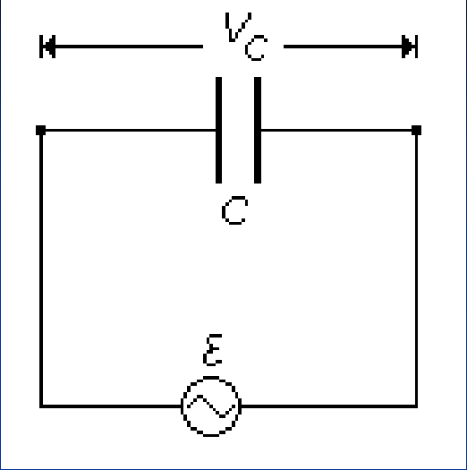
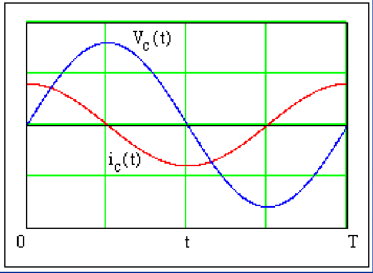
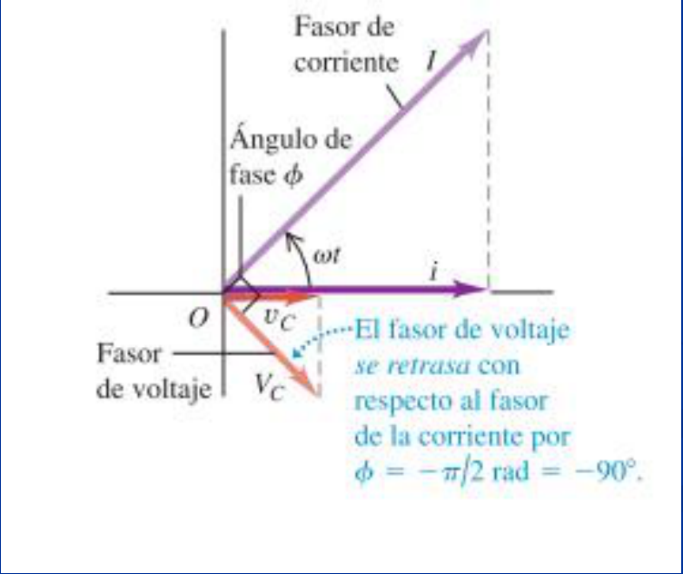

# Corriente alterna: capacidad y reactancia (2019)

Unidad Temática IX — Corriente Alterna

Cuando un capacitor se conecta a una batería, las placas del capacitor
rápidamente adquieren cargas iguales y opuestas, pero no fluye corriente estable
en el circuito (un capacitor evita el flujo de corriente continua). Pero si se
conecta a una fuente alterna de voltaje, una corriente alterna fluirá de manera
continua. Esto puede ocurrir porque, cuando el voltaje de ca se enciende por
primera vez la carga comienza a fluir y una placa adquiere carga negativa y la
otra carga positiva. Pero, cuando el voltaje se invierte a si mismo, las cargas
fluyen en el sentido opuesto. Por ende, para un voltaje alterno aplicado, en el
circuito esta presente una corriente ca de manera continua.



Para alimentar el circuito se emplea una fuente

```math
V_{(t)}=V\cos(\omega t)
```

La corriente en el circuito se puede expresar como

```math
i=\frac{dQ}{dt}
```

En cada instante se cumple la relación

```math
C=\frac{Q_{(t)}}{V_{(t)}}\Rightarrow Q_{(t)}=CV_{(t)}
```

Reemplazando queda

```math
i_{(t)}=\frac{dQ}{dt}=C\frac{dV_{(t)}}{dt}=C\frac{d(V\cos(\omega t))}{dt}
```

```math
i_{(t)}=-\omega CV\mathop{\mathrm{sen}}\nolimits(\omega t)
```

De acuerdo a las relaciones entre las funciones seno y coseno

```math
-\mathop{\mathrm{sen}}\nolimits(\alpha)=\cos\left(\alpha+\frac\pi2\right)
```

La corriente podemos expresarla como

```math
i_{(t)}=\omega CV\cos\left(\omega t+\frac\pi2\right)
```

Comparando la dependencia temporal de la corriente en el circuito con la fuerza
electromotriz de la fuente existe un desfasaje en π/2 entre ellas



La corriente alcanza primero su máximo en t=0 y la tensión lo hace en t=T/4 . La
tensión está atrasada en (π/2) (Podemos decir también que la corriente está
adelantada en (π/2). Esto se refleja en el correspondiente diagrama de fasores.



La amplitud de la corriente o valor máximo será:

```math
I=\omega CV
```

Para escribir esta expresion similar a la de un resistor, donde $`V=IR`$

```math
V=\frac I{\omega C}
```

Donde

```math
X_c=\frac1{\omega C}
```

Reactancia Capacitiva

```math
V=IX_c
```

Unidad de la reactancia capacitiva en el SI es el Ohm

La reactancia capacitiva es inversamente proporcional a la capacitancia C y a la
frecuencia angular ω ; cuanto mayores sean la capacitancia y la frecuencia,
menor será la reactancia capacitiva Xc . Los capacitores tienden a pasar
corriente de alta frecuencia y a bloquear las corrientes de baja frecuencia y la
cd; exactamente al contrario de los inductores. Un dispositivo que permite que
pasen señales de alta frecuencia en forma preferencial se llama filtro de paso
alto

## Procedencia y observaciones de transcripción

- Original: `2019/3er Parcial/2019 UT IX Corriente Alterna.pdf`, páginas 14–18
  de 49. Versión identificada como 2019 en el nombre y la carpeta; no se observa
  fecha de clase impresa en estas diapositivas.
- SHA-256: `f133b469afdff28ace1fe5e90db8e5fd4a8e3c166e4d987cc3f3f31166dff3e1`.
- Herramientas: preflight y extracción PyMuPDF4LLM, Poppler y recortes PyMuPDF.
  Páginas, expresiones y figuras del tramo cotejadas visualmente.
- Se conserva el paréntesis sin cerrar de la página 17. Las expresiones usan
  coseno, mientras el gráfico de la página 16 y la descripción de máximos de la
  17 conservan el origen temporal mostrado en la fuente; no se corrigen ni se
  redibujan.
