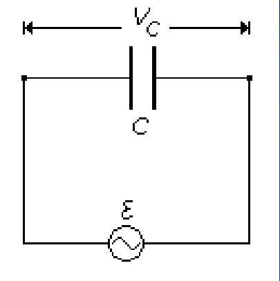
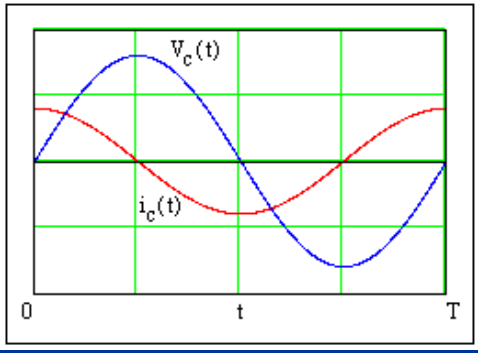
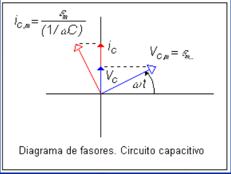

# Corriente alterna en un circuito capacitivo

Unidad Temática IX — Corriente Alterna

La caída de potencial a través de C es igual al potencial entregado por la fem,
por lo que



```math
\begin{cases}\displaystyle V_C=\frac qC\\V_C=\varepsilon_m\sin(\omega t)\\q=CV_C=C\varepsilon_m\sin(\omega t)\end{cases}
```

```math
i_C=\frac{dq}{dt}=\frac{d(CV_C)}{dt}=\omega C\varepsilon_m\cos(\omega t)=\frac{\varepsilon_m}{(1/\omega C)}\cos(\omega t)=\frac{\varepsilon_m}{X_C}\cos(\omega t)
```

```math
X_C=1/\omega C
```

Reactancia capacitiva

```math
\begin{cases}\displaystyle V_C=\varepsilon_m\sin(\omega t)=V_{C,m}\mathop{\mathrm{sen}}\nolimits(\omega t)\\\displaystyle i_C=\frac{\varepsilon_m}{X_C}\cos(\omega t)=i_{C,m}\cos(\omega t)\end{cases}
```

donde

```math
i_{C,m}=\frac{\varepsilon_m}{X_C}\qquad V_{C,m}=i_{C,m}X_C
```





La corriente alcanza primero su máximo en t=0 y la tensión lo hace en t=T/4.
Hemos supuesto fase inicial nula. La tensión está atrasada en (π/2) (Podemos
decir también que la corriente está adelantada en (π/2). Esto se refleja en el
correspondiente diagrama de fasores.

## Procedencia y observaciones de transcripción

- Original: `2019/3er Parcial/2017 UT IX Corriente Alterna.pdf`, páginas 12–13
  de 34. Fecha impresa: 13/06/2018; el archivo se llama 2017 y está archivado en
  2019\.
- SHA-256: `9e7ec2ad4e867b5dc688982d6b052f2b16e926ee1adcfc55f7007697c05cf263`.
- Herramientas: preflight PyMuPDF4LLM, Poppler y recortes PyMuPDF. Páginas,
  expresiones y figuras del tramo cotejadas visualmente.
- Se conservan sin/cos/sen y la notación X_C=1/ωC del original. La frase final
  mantiene el paréntesis sin cerrar de la página 13.
