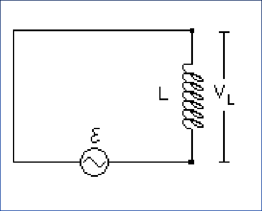
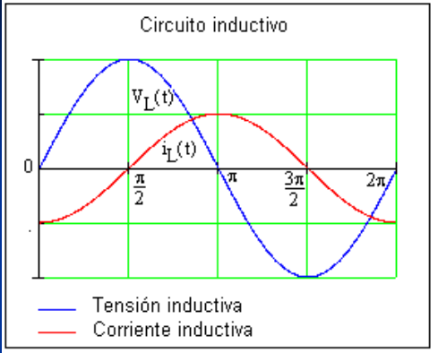
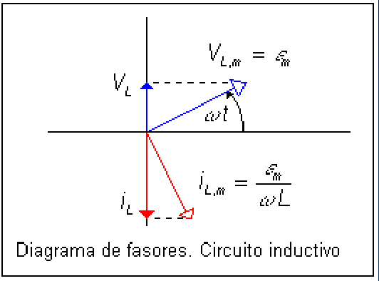

# Corriente alterna en un circuito inductivo

Unidad Temática IX — Corriente Alterna

La caída de potencial a través de L es igual al potencial entregado por la fem,
por lo que:



```math
\begin{cases}V_L=\varepsilon_m\sin(\omega t)\\\displaystyle V_L=L\frac{di_L}{dt}\end{cases}
```

```math
\frac{di_L}{dt}=\frac{\varepsilon_m}L\sin(\omega t)
```

```math
i_L=\int di_L=\frac{\varepsilon_m}L\int\sin(\omega t)\,dt=-\left(\frac{\varepsilon_m}{\omega L}\right)\cos(\omega t)
```

```math
i_L=-\left(\frac{\varepsilon_m}{X_L}\right)\cos(\omega t)
```

```math
X_L=\omega L
```

reactancia inductiva





En la representación grafica de la corriente y la tensión observamos que la
corriente alcanza el máximo después que la tensión, por tanto en el diagrama de
fasores correspondiente Vₗ adelanta a iₗ en π/2 (90°).

```math
V_{L,m}=i_{L,m}X_L
```

## Procedencia y observaciones de transcripción

- Original: `2019/3er Parcial/2017 UT IX Corriente Alterna.pdf`, páginas 14–15
  de 34. Fecha impresa: 13/06/2018; el archivo se llama 2017 y está archivado en
  2019\.
- SHA-256: `9e7ec2ad4e867b5dc688982d6b052f2b16e926ee1adcfc55f7007697c05cf263`.
- Herramientas: preflight PyMuPDF4LLM, Poppler y recortes PyMuPDF. Páginas,
  expresiones y figuras del tramo cotejadas visualmente.
- Se conserva la notación del original sin añadir desarrollos ni soluciones.
