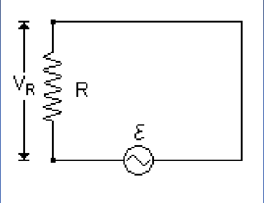
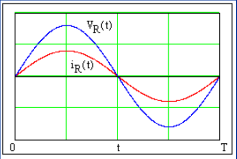
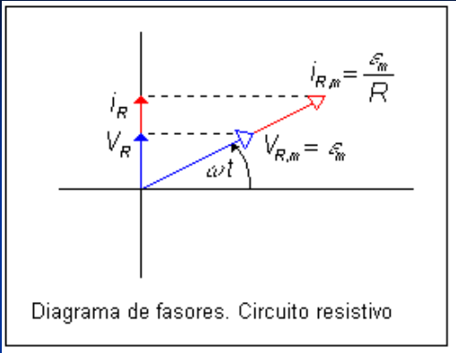

# Corriente alterna en un circuito resistivo

Unidad Temática IX — Corriente Alterna

La caída de potencial a través de R es igual al potencial entregado por la fem,
por lo que



```math
\begin{cases}V_R=\varepsilon_m\sin(\omega t)\\V_R=i_RR\end{cases}\Rightarrow i_R=\frac{V_R}R=\frac{\varepsilon_m}R\sin(\omega t)=i_{Rmax}\sin(\omega t)
```



En el gráfico observamos que Vᵣ e iᵣ alcanzan sus máximos y mínimos
simultáneamente, lo que indica corriente y tensión están en fase



En el diagrama de fasores para el circuito resistivo los fasores de la tensión y
la corriente son colineales. Las proyecciones sobre el eje vertical dan los
valores instantáneos.

```math
\begin{cases}V_R=V_{R,m}\sin(\omega t)\\i_R=i_{R,m}\sin(\omega t)\end{cases}
```

donde

```math
\varepsilon_m=V_{R,m}=i_{R,m}R
```

```math
i_{R,m}=\frac{V_{R,m}}R=\frac{\varepsilon_m}R
```

## Procedencia y observaciones de transcripción

- Original: `2019/3er Parcial/2017 UT IX Corriente Alterna.pdf`, páginas 10–11
  de 34. Fecha impresa: 13/06/2018; el archivo se llama 2017 y está archivado en
  2019\.
- SHA-256: `9e7ec2ad4e867b5dc688982d6b052f2b16e926ee1adcfc55f7007697c05cf263`.
- Herramientas: preflight PyMuPDF4LLM, Poppler y recortes PyMuPDF. Páginas,
  expresiones y figuras del tramo cotejadas visualmente.
- Se conserva la notación del original sin añadir desarrollos ni soluciones.
