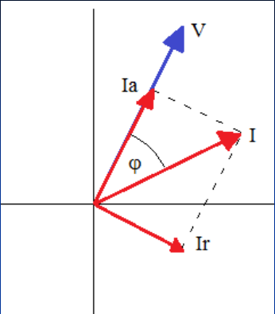

# Corrientes y potencias: diapositiva posterior al cierre

Unidad Temática IX — Corriente Alterna



Ia: corriente activa

Ir: corriente reactiva

```math
\left.\begin{aligned}Ia&=I\sin(\varphi)\\Ir&=I\cos(\varphi)\end{aligned}\right\}\ I^2=Ia^2+Ir^2
```

```math
P=V\,Ia=V\,I\sin(\varphi)\qquad\text{Potencia activa}
```

```math
Q=V\,Ir=V\,I\cos(\varphi)\qquad\text{Potencia reactiva}
```

## Potencia aparente

```math
S=V\,I=V\sqrt{Ia^2+Ir^2}=\sqrt{V\,Ia^2+V\,Ir^2}=\sqrt{P^2+Q^2}
```

```math
S^2=P^2+Q^2
```

## Observación sobre las expresiones originales

La página asigna seno a Ia y P, y coseno a Ir y Q, aunque el diagrama sitúa el
ángulo entre V e I. Además, el paso intermedio bajo la raíz contiene V sin
elevar al cuadrado. Se conservan literalmente estas expresiones; no se
introducen correcciones en el texto transcrito.

## Procedencia y observaciones de transcripción

- Original: `2019/3er Parcial/2017 UT IX Corriente Alterna.pdf`, páginas 34 de
  34\. Fecha impresa: 13/06/2018; el archivo se llama 2017 y está archivado en
  2019\.
- SHA-256: `9e7ec2ad4e867b5dc688982d6b052f2b16e926ee1adcfc55f7007697c05cf263`.
- Herramientas: preflight PyMuPDF4LLM, Poppler y recortes PyMuPDF. Páginas,
  expresiones y figuras del tramo cotejadas visualmente.
- Se conserva la diapositiva situada después de «Fin de la Clase», incluidas las
  inconsistencias identificadas por separado.
