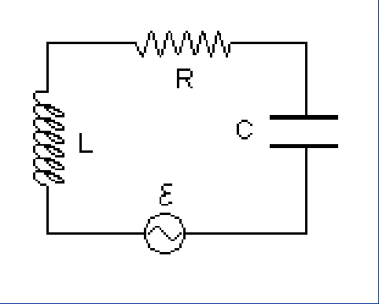
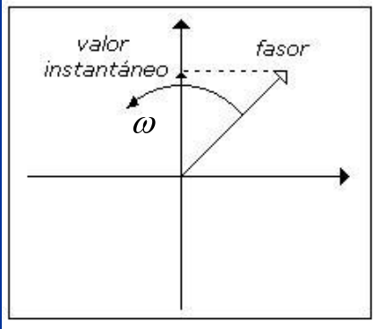

# Ecuación del circuito RLC y fasores

Unidad Temática IX — Corriente Alterna

## Corrientes alternas



Conocidas la fem, L, R y C queremos determinar i(t). Aplicando la ley de las
mallas y recordando que

```math
I=\frac{dQ}{dt}
```

```math
\varepsilon-L\frac{dI}{dt}-RI-\frac1CQ=0\Rightarrow L\frac{d^2Q}{dt^2}+R\frac{dQ}{dt}+\frac1CQ=\varepsilon_{max}\mathop{\mathrm{sen}}\nolimits(\omega t)
```

Ecuación diferencial ordinaria de 2° orden, inhomogénea

## Fasores

Para el análisis del funcionamiento del circuito recurriremos a lo que se
denomina diagrama de fasores.

Gráficamente representamos a un fasor por una flecha con la punta vacía, que
gira en sentido antihorario con frecuencia angular ω (constante) alrededor del
origen. Se los utiliza para representar cantidades alternantes.



Propiedades de los fasores:

1. La longitud del fasor es proporcional al valor máximo de la cantidad
   alternante que representa.
1. La proyección del fasor sobre el eje vertical representa el valor instantáneo
   de la cantidad alternante de que se trate.

## Procedencia y observaciones de transcripción

- Original: `2019/3er Parcial/2017 UT IX Corriente Alterna.pdf`, páginas 8–9 de
  34\. Fecha impresa: 13/06/2018; el archivo se llama 2017 y está archivado en
  2019\.
- SHA-256: `9e7ec2ad4e867b5dc688982d6b052f2b16e926ee1adcfc55f7007697c05cf263`.
- Herramientas: preflight PyMuPDF4LLM, Poppler y recortes PyMuPDF. Páginas,
  expresiones y figuras del tramo cotejadas visualmente.
- Se conserva la notación del original sin añadir desarrollos ni soluciones.
