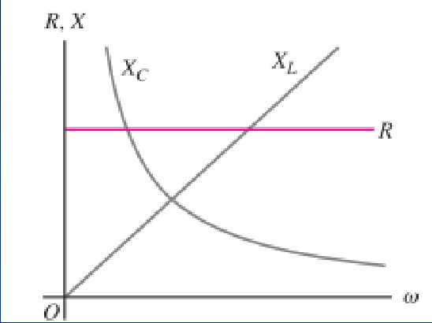
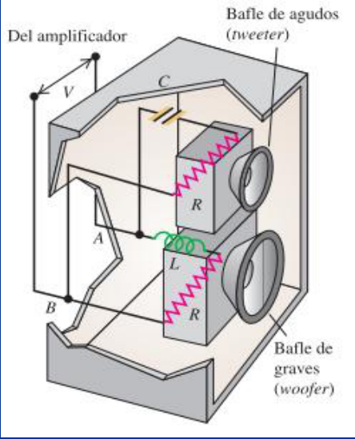

# Corriente alterna: comparación de elementos y filtros (2019)

Unidad Temática IX — Corriente Alterna

## Comparación de los elementos de un circuito de CA

En las relaciones de las amplitudes de corriente y voltaje correspondientes a
los tres elementos de circuito que acabamos de estudiar., se puede observar que
el voltaje y la corriente instantáneos son proporcionales en un resistor, donde
hay una diferencia de fase de cero entre vr e i . El voltaje y la corriente
instantáneos no son proporcionales en un inductor ni en un capacitor ya que en
ambos casos hay una diferencia de fase de 90° .

La figura ilustra el modo en que varían la resistencia de un resistor y las
reactancias de un inductor y un capacitor con la frecuencia angular ω

La resistencia R es independiente de la frecuencia, mientras que las reactancias
XL y XC no lo son. Si ω=0, que es el caso de un circuito de cd, no hay corriente
a través de un capacitor porque XC tiende a infinito, y no hay efecto inductivo
porque XL=0. En el límite ω tiende a infinito, XL también tiende a infinito, y
la corriente a través de un inductor disminuye hasta casi desaparecer (la fem
autoinducida se opone a los cambios de la corriente). En este mismo límite,
tanto XC como el voltaje a través del capacitor tienden a cero; la corriente
cambia de sentido tan rápido que no se acumula carga en ninguna placa.

## Elementos del circuito con CA

| Elemento de circuito | Relación de amplitudes | Cantidad de circuito | Fase de v |
| -- | -- | -- | -- |
| Resistor | $`V_R=IR`$ | R | En fase con i |
| Inductor | $`V_L=IX_L`$ | $`X_L=\omega L`$ | Se adelanta 90° a i |
| Capacitor | $`V_C=IX_C`$ | $`X_C=1/\omega C`$ | Se retrasa 90° con respecto a i |

## Ejemplo

Los sonidos de baja frecuencia son producidos por el woofer, o bafle de graves
que es un altavoz de diámetro grande, mientras que el tweeter, o bafle de
agudos, es un altavoz de diámetro pequeño que produce sonidos de alta
frecuencia.

## Procedencia y observaciones de transcripción

- Original: `2019/3er Parcial/2019 UT IX Corriente Alterna.pdf`, páginas 24–26
  de 49. Versión identificada como 2019 en el nombre y la carpeta; no se observa
  fecha de clase impresa en estas diapositivas.
- SHA-256: `f133b469afdff28ace1fe5e90db8e5fd4a8e3c166e4d987cc3f3f31166dff3e1`.
- Herramientas: preflight y extracción PyMuPDF4LLM, Poppler y recortes PyMuPDF.
  Páginas, expresiones y figuras del tramo cotejadas visualmente.
- La tabla incorporada como imagen en la página 26 se transcribe a Markdown,
  conservando X_C=1/ωC. Se mantienen los gráficos y las etiquetas del ejemplo.
