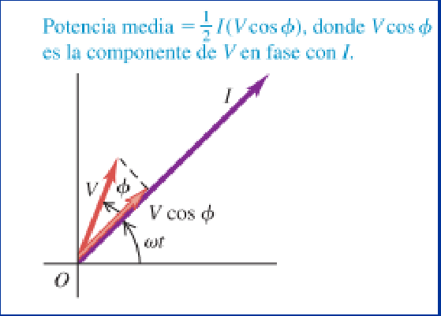

# Corriente alterna: potencia general y su factor (2019)

Unidad Temática IX — Corriente Alterna

## Potencia de un circuito de CA

En cualquier circuito de ca, con cualquier combinación de resistores,
capacitores e inductores, el voltaje v a través de todo el circuito tiene un
ángulo de fase Φ con respecto a la corriente i. Así, la potencia instantánea p
está dada por

```math
p=vi=[V\cos(\omega t+\phi)][I\cos\omega t]
```

Podemos deducir una expresión de la potencia media Pmed con la ayuda de la
identidad del coseno de la suma de dos ángulos:

```math
p=[V(\cos\omega t\cos\phi-\mathop{\mathrm{sen}}\nolimits\omega t\mathop{\mathrm{sen}}\nolimits\phi][I\cos\omega t]
```

```math
p=VI\cos\phi\cos^2\omega t-VI\mathop{\mathrm{sen}}\nolimits\phi\cos\omega t\mathop{\mathrm{sen}}\nolimits\omega t
```

El valor medio de coseno al cuadrado de ωt (en un ciclo) es igual a ½. El valor
medio de $`\cos\omega t\,\mathop{\mathrm{sen}}\nolimits\omega t`$ es cero porque
este producto es igual a $`\frac12\mathop{\mathrm{sen}}\nolimits2\omega t`$,
cuyo promedio en un ciclo es cero. Por lo tanto, la potencia media Pmed es

```math
P_{med}=\frac12 VI\cos\phi=V_{rms}I_{rms}\cos\phi
```

Potencia media en un circuito general de ca

Cuando v e i están en fase, de manera que $`\Phi=0`$, la potencia media es igual
a $`\frac12 VI=V_{rms}I_{rms}`$, cuando v e i están 90° fuera de fase, la
potencia media es igual a cero.



En el caso general, cuando v tiene un ángulo de fase Φ con respecto a i, la
potencia media es igual al producto de $`\frac12 I`$ por $`V\cos\Phi`$ , la
componente del fasor de voltaje que está en fase con el fasor de corriente.

El factor $`\cos\Phi`$ se llama factor de potencia del circuito

En el caso de una resistencia

```math
\phi=0\Rightarrow\cos\phi=1
```

```math
P_{med}=V_{rms}I_{rms}
```

En el caso de un inductor o capacitor

```math
\phi=\pm90^\circ\Rightarrow\cos\phi=0
```

```math
P_{med}=0
```

En el caso de un circuito LRC

```math
\cos\phi=\frac RZ
```

Por lo general, en los circuitos de potencia no es deseable un factor bajo de
potencia (un gran ángulo Φ de retraso o adelanto). La razón es que para una
diferencia de potencial dada, se necesita una corriente grande que suministre
una cantidad determinada de potencia. Esto da como resultado grandes pérdidas
por efecto Joule en las líneas de transmisión. La compañía de energía eléctrica
tal vez cobre una tarifa más alta a un cliente con bajo factor de potencia.
Muchos tipos de maquinaria de ca toman una corriente retrasada; es decir, la
corriente en la maquinaria está retrasada con respecto al voltaje aplicado. Por
consiguiente, el voltaje se adelanta a la corriente, de manera que $`\Phi\gt0`$
y $`\cos\Phi\lt1`$. El factor de potencia se puede corregir para aproximarlo al
valor ideal de 1 conectando un capacitor en paralelo con la carga. La corriente
que toma el capacitor se adelanta al voltaje (es decir, el voltaje a través del
capacitor va con retraso en relación con la corriente), lo que compensa la
corriente retrasada en el otro ramal del circuito. El capacitor en sí no absorbe
potencia neta de la línea.

## Potencia activa, reactiva y aparente

Las páginas 44 y 45 reproducen las diapositivas ya transcritas en las notas
siguientes, incluidas sus expresiones originales y observaciones de
inconsistencias:

- [Potencia activa, reactiva y aparente](corriente-alterna-potencias-activa-reactiva-aparente-2018-06-13.md).
- [Corrientes y potencias](corriente-alterna-corrientes-potencias-anexo-2018-06-13.md).

La correspondencia y el SHA-256 de esta fuente se registran como procedencia
adicional de ambas notas; las páginas 44–45 fueron cotejadas completas.

## Procedencia y observaciones de transcripción

- Original: `2019/3er Parcial/2019 UT IX Corriente Alterna.pdf`, páginas 40–45
  de 49. Versión identificada como 2019 en el nombre y la carpeta; no se observa
  fecha de clase impresa en estas diapositivas.
- SHA-256: `f133b469afdff28ace1fe5e90db8e5fd4a8e3c166e4d987cc3f3f31166dff3e1`.
- Herramientas: preflight y extracción PyMuPDF4LLM, Poppler y recortes PyMuPDF.
  Páginas, expresiones y figuras del tramo cotejadas visualmente.
- Se mantiene el paréntesis sin cerrar en la segunda expresión de la página 40.
  Las páginas 44–45 son imágenes de diapositivas: se cotejaron con las
  transcripciones enlazadas sin duplicar las notas ni corregir sus erratas.
