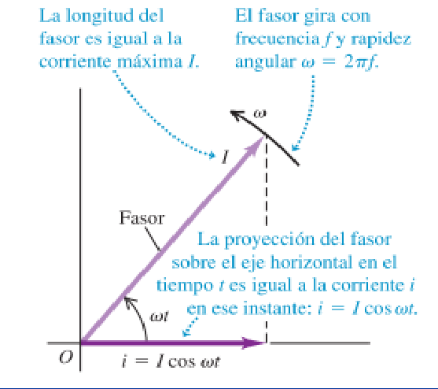

# Corriente alterna: fasores (2019)

Unidad Temática IX — Corriente Alterna

Para el análisis del funcionamiento del circuito recurriremos a lo que se
denomina diagrama de fasores. Gráficamente representamos a un fasor por una
flecha con la punta vacía, que gira en sentido antihorario con frecuencia
angular $`\omega`$ alrededor del origen. Se los utiliza para representar
cantidades alternantes.

## Propiedades de los fasores

1. La longitud del fasor es proporcional al valor máximo de la cantidad
   alternante que representa.
1. La proyección del fasor sobre el eje horizontal representa el valor
   instantáneo de la cantidad alternante de que se trate.

## Procedencia y observaciones de transcripción

- Original: `2019/3er Parcial/2019 UT IX Corriente Alterna.pdf`, páginas 11–11
  de 49. Versión identificada como 2019 en el nombre y la carpeta; no se observa
  fecha de clase impresa en estas diapositivas.
- SHA-256: `f133b469afdff28ace1fe5e90db8e5fd4a8e3c166e4d987cc3f3f31166dff3e1`.
- Herramientas: preflight y extracción PyMuPDF4LLM, Poppler y recortes PyMuPDF.
  Páginas, expresiones y figuras del tramo cotejadas visualmente.
- Se conserva la proyección sobre el eje horizontal de esta versión, distinta de
  la proyección vertical de la versión fechada13/06/2018.
