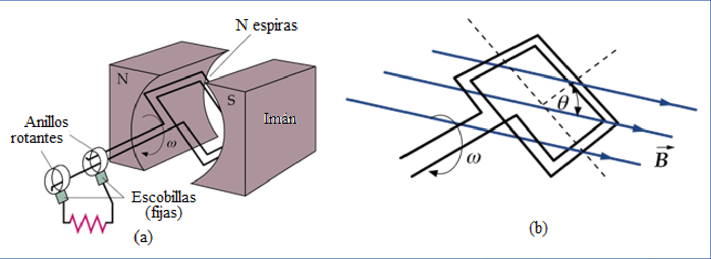
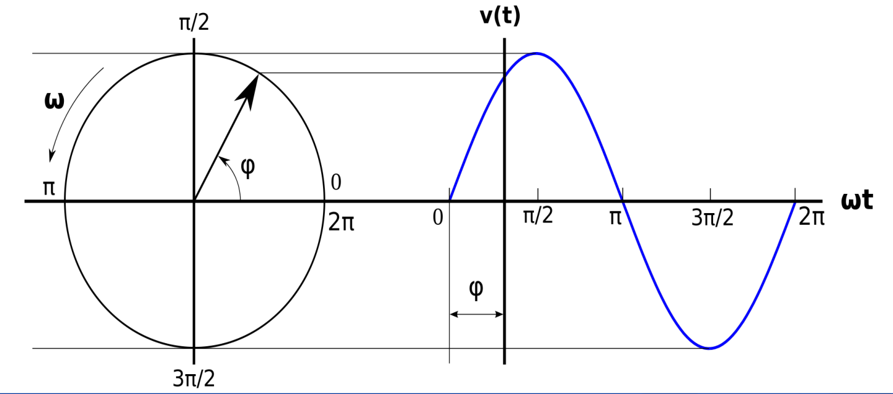
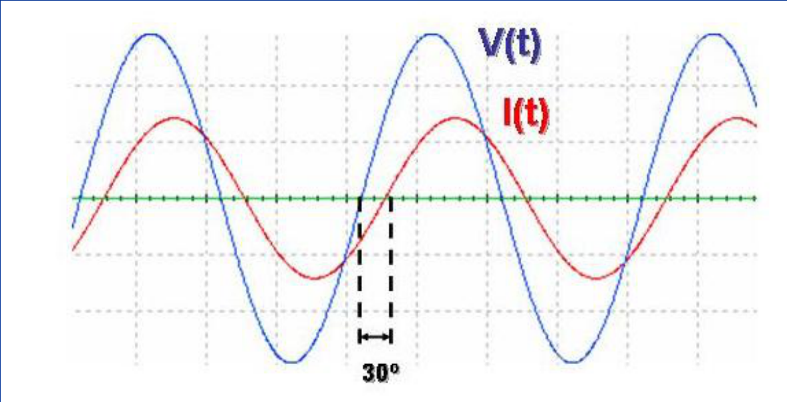

# Corriente alterna: generador y fem (2019)

Unidad Temática IX — Corriente Alterna

## Ejemplo de corriente alterna

El Generador de Corriente Alterna más sencillo es una espira que gira con
velocidad angular constante en un campo magnético uniforme





La fem y la corriente del circuito vienen dadas por las expresiones generales:

Fem alterna

```math
V(t)=V\cos(\omega t)=V\cos2\pi ft
```

Donde:

- $`V(t)`$: Fem o voltaje instantáneo
- V: valor máximo o amplitud de la fem
- $`\omega`$: pulsación o frecuencia angular = $`2\pi f`$
- f: numero de oscilaciones completas realizadas por segundo

Se trata de una señal que depende del tiempo en forma periódica, si este tipo de
fem es empleada para excitar un circuito que contenga elementos lineales
(resistencias, inductores y condensadores), por el circulara una corriente
eléctrica que variara con el tiempo también en forma periódica.

Corriente alterna

```math
i(t)=I\cos(\omega t)
```

## Representación gráfica de la fem y la corriente instantáneas en función del tiempo



## Procedencia y observaciones de transcripción

- Original: `2019/3er Parcial/2019 UT IX Corriente Alterna.pdf`, páginas 7–10 de
  49\. Versión identificada como 2019 en el nombre y la carpeta; no se observa
  fecha de clase impresa en estas diapositivas.
- SHA-256: `f133b469afdff28ace1fe5e90db8e5fd4a8e3c166e4d987cc3f3f31166dff3e1`.
- Herramientas: preflight y extracción PyMuPDF4LLM, Poppler y recortes PyMuPDF.
  Páginas, expresiones y figuras del tramo cotejadas visualmente.
- La página 8 contiene solo una figura. Se conserva la expresión general sin
  fase de la página 9 y el gráfico de la página 10 con 30°; no se los armoniza
  silenciosamente.
