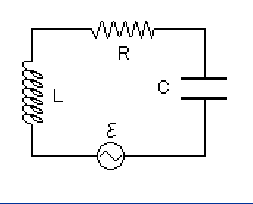
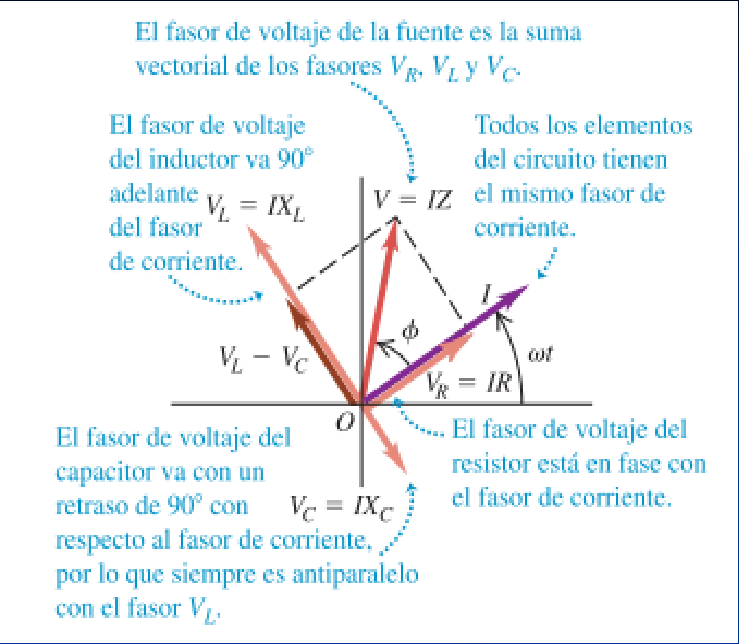

# Corriente alterna: impedancia y fase (2019)

Unidad Temática IX — Corriente Alterna

## Circuito RLC. Análisis con fasores. Impedancia



La fem y la corriente del circuito vienen dadas por las expresiones generales:

```math
V(t)=V\cos(\omega t)\qquad\text{Fem alterna}
```

```math
i(t)=I\cos(\omega t)\qquad\text{Corriente alterna}
```

```math
V=V_R+V_C+V_L
```

Utilizaremos el diagrama de fasores del circuito, teniendo en cuenta que al ser
la corriente común a los tres elementos, los desfasajes se aplican a las
tensiones.

Queremos determinar I y $`\phi`$.



La suma algebraica de las proyecciones sobre el eje horizontal de los fasores
VL, VR y VC da como resultado Vt. La suma vectorial de los fasores VL, VR y VC
da como resultado el fasor de amplitud V, cuya proyección sobre el eje
horizontal da la tensión instantánea Vt .

El diagrama se reitera en la página 29:


Aplicando Pitágoras

```math
\begin{aligned}V&=\sqrt{V_R^2+(V_L-V_C)^2}\\&=\sqrt{(IR)^2+(IX_L-IX_C)^2}\\&=I\sqrt{R^2+(X_L-X_C)^2}=IZ\end{aligned}
```

```math
Z=\sqrt{R^2+(X_L-X_C)^2}=\sqrt{R^2+\left(\omega L-\frac1{\omega C}\right)^2}
```

Impedancia

```math
[Z]=\text{Ohm en el SI}
```

```math
I=\frac VZ=\frac V{\sqrt{R^2+(X_L-X_C)^2}}=\frac V{\sqrt{R^2+\left(\omega L-\frac1{\omega C}\right)^2}}
```

Determinamos I en función de los datos

Determinemos ahora la diferencia de fase $`\phi`$

```math
\tan(\phi)=\frac{V_L-V_C}{V_R}=\frac{I(X_L-X_C)}{IR}=\frac{X_L-X_C}R=\frac{\omega L-1/\omega C}R
```

La diferencia de fase no depende de V

- $`\displaystyle X_L\gt X_C\Rightarrow V`$ se adelanta en $`\phi`$ a I, y
  $`\phi`$ positivo
- $`\displaystyle X_L\lt X_C\Rightarrow V`$ se atrasa en $`\phi`$ a I, y
  $`\phi`$ negativo

## Procedencia y observaciones de transcripción

- Original: `2019/3er Parcial/2019 UT IX Corriente Alterna.pdf`, páginas 27–30
  de 49. Versión identificada como 2019 en el nombre y la carpeta; no se observa
  fecha de clase impresa en estas diapositivas.
- SHA-256: `f133b469afdff28ace1fe5e90db8e5fd4a8e3c166e4d987cc3f3f31166dff3e1`.
- Herramientas: preflight y extracción PyMuPDF4LLM, Poppler y recortes PyMuPDF.
  Páginas, expresiones y figuras del tramo cotejadas visualmente.
- Se conservan las expresiones generales sin fase de la página 27 y el
  desarrollo del ángulo posterior, las proyecciones horizontales y la repetición
  de la figura.
