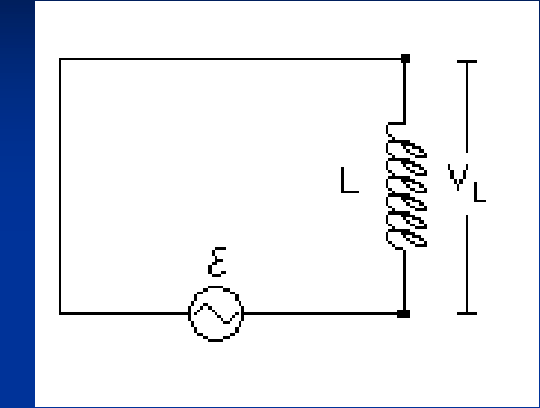
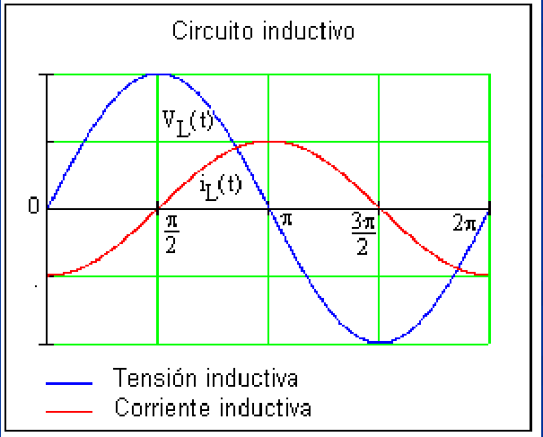
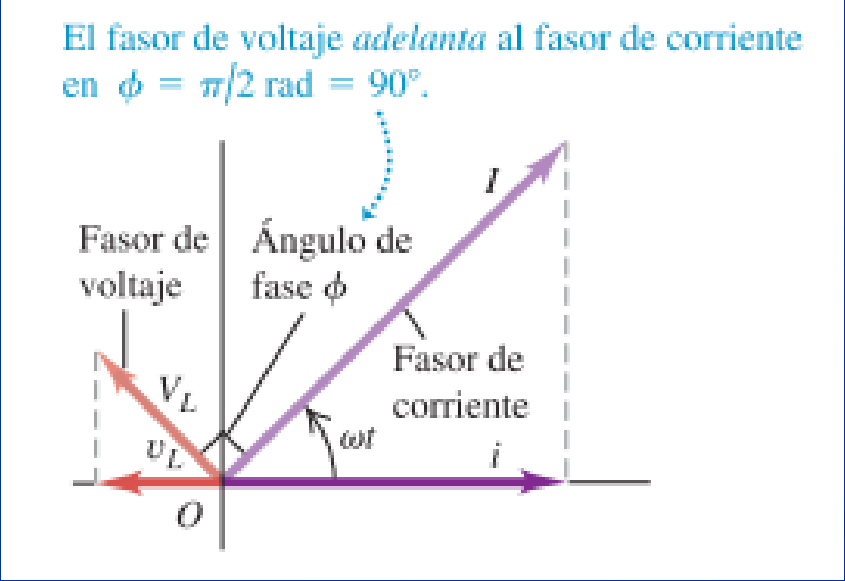

# Corriente alterna: inductancia y reactancia (2019)

Unidad Temática IX — Corriente Alterna



Para alimentar el circuito se emplea una fuente

```math
V_{(t)}=V\cos(\omega t)
```

Se debe cumplir

```math
V_{(t)}=L\frac{di}{dt}
```

```math
\frac{di}{dt}=\frac1L V_{(t)}=\frac VL\cos(\omega t)
```

```math
i_{(t)}=\frac VL\int\cos(\omega t)\,dt=\frac V{\omega L}\mathop{\mathrm{sen}}\nolimits(\omega t)
```

De acuerdo a las relaciones entre las funciones seno y coseno

```math
\mathop{\mathrm{sen}}\nolimits(\alpha)=\cos\left(\alpha-\frac\pi2\right)
```

La corriente podemos expresarla como

```math
i_{(t)}=\frac V{\omega L}\cos\left(\omega t-\frac\pi2\right)
```

Comparando la dependencia temporal de la corriente en el circuito con la fuerza
electromotriz de la fuente existe un desfasaje en $`-\pi/2`$ entre ellas



En la representación grafica de la corriente y la tensión observamos que la
corriente alcanza el máximo después que la tensión , por tanto en el diagrama de
fasores correspondiente VL adelanta a I en π/2 (90º).



La amplitud de la corriente o valor máximo será:

```math
I=\frac V{\omega L}
```

Para escribir esta expresion similar a la de un resistor, donde $`V=IR`$

```math
V=I\omega L
```

Donde

```math
X_L=\omega L
```

Reactancia Inductiva

```math
V=IX_L
```

Unidad de la reactancia inductiva en el SI es el Ohm

La reactancia inductiva X L en realidad es una descripción de la fem
autoinducida que se opone a cualquier cambio en la corriente a través del
inductor. La reactancia inductiva y la fem autoinducida se incrementan cuando la
variación de la corriente es más rápida (es decir, con el incremento de la
frecuencia angular ω ) y cuando la inductancia L aumenta.

Si se aplica un voltaje oscilante de una amplitud dada V L entre las terminales
del inductor, la corriente resultante tendrá una amplitud más pequeña I para
valores más grandes de X L . Como X L es proporcional a la frecuencia, un
voltaje de alta frecuencia aplicado al inductor sólo genera una corriente
pequeña, mientras que un voltaje de baja frecuencia de la misma amplitud origina
una corriente más grande. Los inductores se usan en ciertas aplicaciones de
circuitos, tales como los sistemas de suministro de energía eléctrica y los
filtros de interferencias de radio, para bloquear altas frecuencias al mismo
tiempo que se permite el paso de frecuencias bajas o de cd. Un dispositivo de
circuito que usa un inductor para este propósito se llama filtro de paso bajo

## Procedencia y observaciones de transcripción

- Original: `2019/3er Parcial/2019 UT IX Corriente Alterna.pdf`, páginas 19–23
  de 49. Versión identificada como 2019 en el nombre y la carpeta; no se observa
  fecha de clase impresa en estas diapositivas.
- SHA-256: `f133b469afdff28ace1fe5e90db8e5fd4a8e3c166e4d987cc3f3f31166dff3e1`.
- Herramientas: preflight y extracción PyMuPDF4LLM, Poppler y recortes PyMuPDF.
  Páginas, expresiones y figuras del tramo cotejadas visualmente.
- Se conserva el gráfico original de la página 20 y su origen temporal, sin
  modificarlo para ajustarlo a las expresiones basadas en coseno. Se transcriben
  las explicaciones de filtro de paso bajo.
