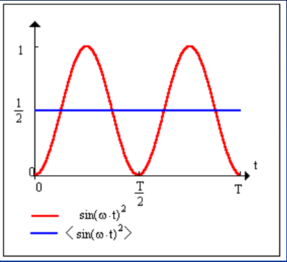

# Corriente alterna: potencia y factor de potencia

Unidad Temática IX — Corriente Alterna

## Potencia en un circuito de corriente alterna

En un circuito RLC solo se disipa potencia en la resistencia, por lo que solo
consideraremos este elemento.

Fem estacionaria

```math
P=\frac{\varepsilon_m^2}R
```

Fem alterna

```math
P(t)=\frac{(\varepsilon_m\sin(\omega t))^2}R
```

depende del tiempo.

La potencia instantánea P(t) puede ser cero en determinados momentos, lo que
interesa es la potencia media Pₘ.



```math
P_m=\langle P\rangle=\left\langle\frac{(\varepsilon_m\sin(\omega t))^2}R\right\rangle=\frac{\varepsilon_m^2}R\left\langle\sin^2(\omega t)\right\rangle
```

```math
\left\langle\sin^2(\omega t)\right\rangle=\frac12
```

```math
P_m=\frac{\varepsilon_m^2}{2R}=\frac{\varepsilon_m^2}{(\sqrt2)^2}\cdot\frac1R=\left(\frac{\varepsilon_m}{\sqrt2}\right)^2\frac1R=\frac{\varepsilon_{eff}^2}R
```

$`\varepsilon_{eff}`$: Tensión eficaz.

Si utilizamos valores eficaces de ε, V e i la disipación promedio será igual en
los circuitos de corriente alterna que en los de corriente continua en los que
la fem es constante e igual al valor $`\varepsilon_{eff}`$.

Los instrumentos de medida miden en c.a. directamente valores eficaces.

```math
\varepsilon_{eff}=\frac{\varepsilon_m}{\sqrt2}\qquad V_{eff}=\frac{V_m}{\sqrt2}\qquad i_{eff}=\frac{i_m}{\sqrt2}\qquad\text{valores eficaces}
```

Para el circuito RLC podemos escribir para la potencia instantánea

```math
\begin{aligned}P(t)&=\varepsilon(t)\cdot i(t)=\varepsilon_m\sin(\omega t)\cdot i_m\sin(\omega t+\varphi)\\&=\varepsilon_m i_m\sin(\omega t)\cdot[\sin(\omega t)\cos(\varphi)+\cos(\omega t)\sin(\varphi)]\\&=\varepsilon_m i_m\sin^2(\omega t)\cos(\varphi)+\varepsilon_m i_m\sin(\omega t)\cos(\omega t)\sin(\varphi)\end{aligned}
```

La potencia media es:

```math
P_m=\langle P(t)\rangle=\varepsilon_m i_m\cos(\phi)\left\langle\sin^2(\omega t)\right\rangle+\varepsilon_m i_m\sin(\phi)\langle\sin(\omega t)\cos(\omega t)\rangle
```

pero

```math
\begin{cases}\displaystyle\left\langle\sin^2(\omega t)\right\rangle=1/2\\\displaystyle\langle\sin(\omega t)\cos(\omega t)\rangle=\frac1T\int_0^T\sin(\omega t)\cos(\omega t)\,dt=0\end{cases}
```

```math
P_m=\langle P(t)\rangle=\frac12\varepsilon_m i_m\cos(\varphi)=\frac{\varepsilon_m}{\sqrt2}\frac{i_m}{\sqrt2}\cos(\varphi)=\varepsilon_{eff}i_{eff}\cos(\varphi)
```

El termino $`\cos(\phi)`$ recibe el nombre de factor de potencia, y se debe a
que la corriente y la tensión no están en fase. En el caso de un circuito
resistivo puro es $`\varphi=0`$, resultando $`\cos(\varphi)=1`$

```math
P_m=\varepsilon_{eff}\cdot i_{eff}\qquad\text{carga resistiva}
```

## Procedencia y observaciones de transcripción

- Original: `2019/3er Parcial/2017 UT IX Corriente Alterna.pdf`, páginas 25–28
  de 34. Fecha impresa: 13/06/2018; el archivo se llama 2017 y está archivado en
  2019\.
- SHA-256: `9e7ec2ad4e867b5dc688982d6b052f2b16e926ee1adcfc55f7007697c05cf263`.
- Herramientas: preflight PyMuPDF4LLM, Poppler y recortes PyMuPDF. Páginas,
  expresiones y figuras del tramo cotejadas visualmente.
- Se conserva la notación del original sin añadir desarrollos ni soluciones.
