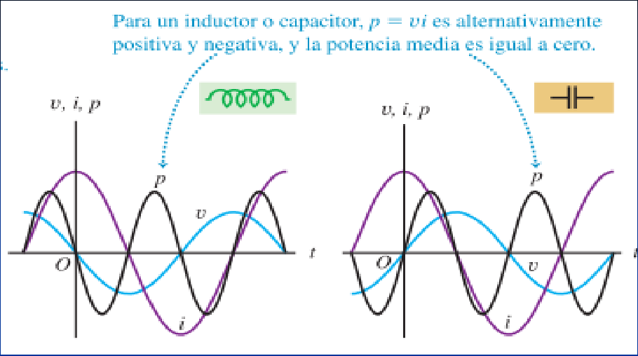
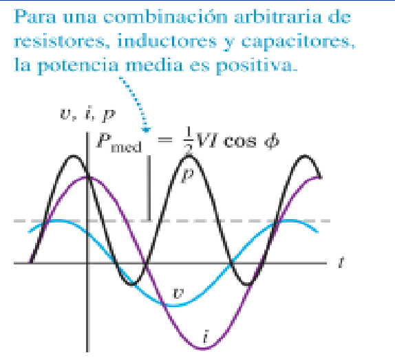

# Corriente alterna: potencia de inductancia y capacitor (2019)

Unidad Temática IX — Corriente Alterna

## Potencia de una inductancia y un capacitor

Se conecta la fuente a un inductor L. El voltaje v=v L se adelanta 90° a la
corriente. Cuando se multiplican las curvas de v e i, el producto vi es negativo
durante la mitad del ciclo cuando v e i tienen signos opuestos. La curva de
potencia, es simétrica con respecto al eje horizontal; es positiva la mitad del
tiempo y negativa la otra mitad, y la potencia media es igual a cero. Cuando p
es positiva, la energía se suministra para establecer el campo magnético en el
inductor; cuando p es negativa, el campo desaparece y el inductor devuelve
energía a la fuente. La transferencia neta de energía en un ciclo es igual a
cero.

Conectamos la fuente a un capacitor C. El voltaje v=vC se retrasa 90° con
respecto a la corriente. De nuevo, la potencia media es igual a cero. Se
suministra energía para cargar el capacitor y se devuelve a la fuente cuando el
capacitor se descarga. La transferencia neta de energía en un ciclo es, una vez
más, igual a cero.



Para un inductor o capacitor, $`p=vi`$ es alternativamente positiva y negativa,
y la potencia media es igual a cero.



Para una combinación arbitraria de resistores, inductores y capacitores, la
potencia media es positiva.

```math
P_{med}=\frac12 VI\cos\phi
```

## Procedencia y observaciones de transcripción

- Original: `2019/3er Parcial/2019 UT IX Corriente Alterna.pdf`, páginas 38–39
  de 49. Versión identificada como 2019 en el nombre y la carpeta; no se observa
  fecha de clase impresa en estas diapositivas.
- SHA-256: `f133b469afdff28ace1fe5e90db8e5fd4a8e3c166e4d987cc3f3f31166dff3e1`.
- Herramientas: preflight y extracción PyMuPDF4LLM, Poppler y recortes PyMuPDF.
  Páginas, expresiones y figuras del tramo cotejadas visualmente.
- Se conservan ambos gráficos de la página 39 y sus leyendas. La expresión de
  potencia media incluida en la segunda figura se transcribe a LaTeX.
