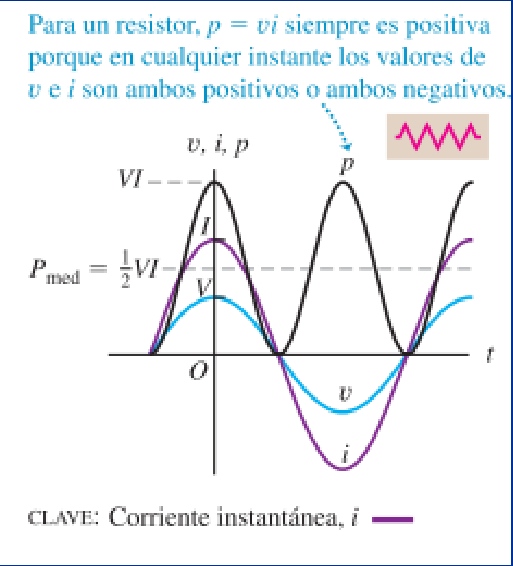

# Corriente alterna: potencia y resistencia (2019)

Unidad Temática IX — Corriente Alterna

## Potencia en un circuito de corriente alterna

En un circuito RLC solo se disipa potencia en la resistencia, por lo que solo
consideraremos este elemento.

Fem estacionaria

```math
\Rightarrow P=\frac{V^2}R
```

Fem alterna

```math
P(t)=\frac{(V_0\cos(\omega t))^2}R
```

(depende del tiempo)

La potencia instantánea P(t) puede ser cero en determinados momentos, lo que
interesa es la potencia media Pm

La corriente alterna desempeña un papel central en los sistemas para distribuir,
convertir y usar energía eléctrica, por lo que es importante estudiar las
relaciones de potencia en los circuitos de ca. Para un circuito de ca con
corriente instantánea i y amplitud de corriente I, consideraremos uno de sus
elementos a través del cual la diferencia de potencial instantánea es v, con
amplitud de voltaje V. La potencia instantánea p entregada a este elemento de
circuito es $`p=vi`$ Primero veamos lo que esto significa para los elementos
individuales de circuito.

Supondremos que en cada caso

```math
i=I\cos(\omega t)
```

## Potencia de una resistencia

El elemento de circuito es una resistencia pura R, así que $`v=v_r`$ está en
fase con i

```math
P=vi
```



Para un resistor, $`p=vi`$ siempre es positiva porque en cualquier instante los
valores de v e i son ambos positivos o ambos negativos.

La curva de potencia correspondiente a un resistor es simétrica con respecto a
un valor igual a la mitad de su valor máximo VI, así que la potencia media Pmed
es

```math
P_{med}=\frac12 VI
```

```math
P_{med}=\frac V{\sqrt2}\frac I{\sqrt2}=V_{rms}I_{rms}
```

## Procedencia y observaciones de transcripción

- Original: `2019/3er Parcial/2019 UT IX Corriente Alterna.pdf`, páginas 35–37
  de 49. Versión identificada como 2019 en el nombre y la carpeta; no se observa
  fecha de clase impresa en estas diapositivas.
- SHA-256: `f133b469afdff28ace1fe5e90db8e5fd4a8e3c166e4d987cc3f3f31166dff3e1`.
- Herramientas: preflight y extracción PyMuPDF4LLM, Poppler y recortes PyMuPDF.
  Páginas, expresiones y figuras del tramo cotejadas visualmente.
- Se mantienen los símbolos P/p y V/V₀ del original. El gráfico y su leyenda se
  conservan sin reinterpretar los signos.
