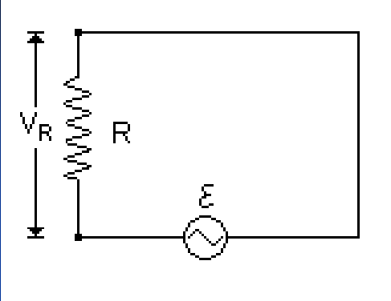
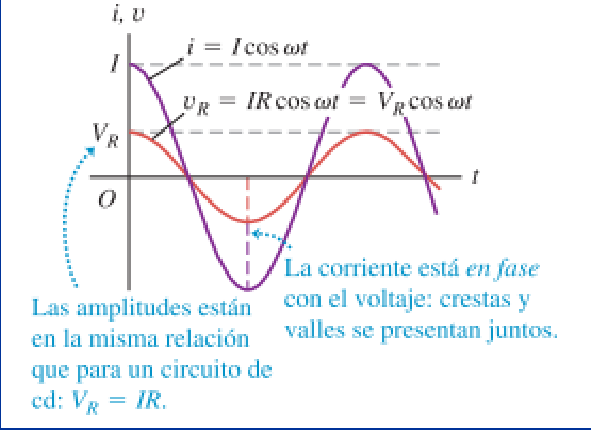
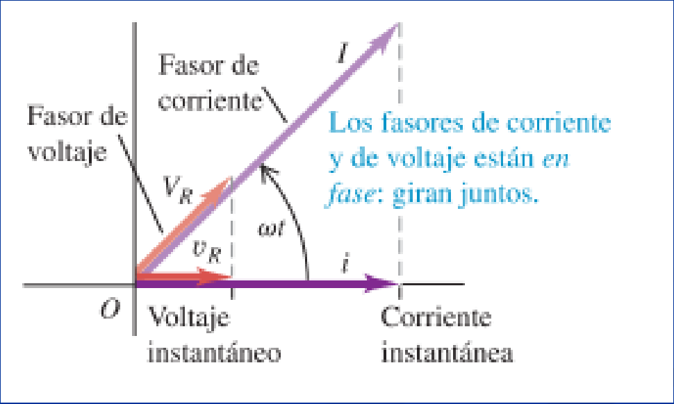

# Corriente alterna: circuito resistivo (2019)

Unidad Temática IX — Corriente Alterna



En el circuito se emplea una fuente para alimentar el circuito

```math
V_{(t)}=V\cos(\omega t)
```

En cada instante se cumple la ley de Ohm, por lo tanto se puede expresar la
relación:

```math
V_{(t)}=Ri_{(t)}\Rightarrow i_{(t)}=\frac{V_{(t)}}R=\frac VR\cos(\omega t)=I\cos(\omega t)
```



En el gráfico observamos que VR e i alcanzan sus máximos y mínimos
simultáneamente, lo que indica corriente y tensión están en fase

En el diagrama de fasores para el circuito resistivo los fasores de la tensión y
la corriente son colineales. Las proyecciones sobre el eje horizontal dan los
valores instantáneos.



## Procedencia y observaciones de transcripción

- Original: `2019/3er Parcial/2019 UT IX Corriente Alterna.pdf`, páginas 12–13
  de 49. Versión identificada como 2019 en el nombre y la carpeta; no se observa
  fecha de clase impresa en estas diapositivas.
- SHA-256: `f133b469afdff28ace1fe5e90db8e5fd4a8e3c166e4d987cc3f3f31166dff3e1`.
- Herramientas: preflight y extracción PyMuPDF4LLM, Poppler y recortes PyMuPDF.
  Páginas, expresiones y figuras del tramo cotejadas visualmente.
- Se conserva la notación del original sin añadir desarrollos ni soluciones.
