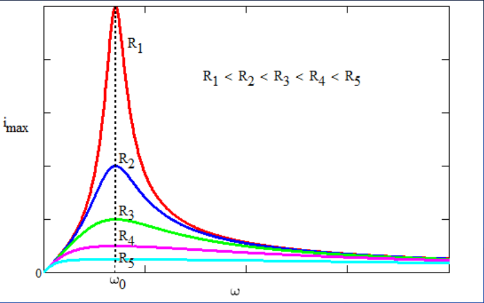

# Corriente alterna: resonancia

Unidad Temática IX — Corriente Alterna

- Si cambiamos la frecuencia de la fuente, cambiarán las reactancias del
  circuito, la impedancia y el ángulo de fase.
- En la frecuencia para la cual la corriente y el voltaje están en fase
  ($`\cos\Phi`$ es máximo), se dice que el circuito está en resonancia.
- Esto corresponde al caso en que $`X_C=X_L`$ y, por tanto, Z es mínima así que
  la amplitud de la corriente también es máxima. Por tanto la potencia que
  entrega la fuente es máxima
- A qué frecuencia ocurre esto? De $`X_C=X_L`$, despejamos $`\omega_r`$
- Este fenómeno es exactamente igual al fenómeno de resonancia mecánica. Los
  principios físicos fundamentales se manifiestan en diversos sistemas

La impedancia es mínima cuando en

```math
Z=\sqrt{R^2+(X_L-X_C)^2}=\sqrt{R^2+\left(\omega L-\frac1{\omega C}\right)^2}
```

se cumple que

```math
X_L=X_C\Rightarrow\omega_rL=\frac1{\omega_r C}\Rightarrow\omega_r=\sqrt{\frac1{LC}}
```

A esta frecuencia la impedancia es solo resistiva

Si $`Z=R`$, el angulo de fase $`\phi=0`$, y la corriente es máxima e igual a:

```math
i_m=\frac{\varepsilon_m}R
```



Si representamos la corriente máxima en función de la frecuencia obtenemos las
curvas de la figura de la izquierda. Se observa que cuanto menor es la
resistencia, más grande es el máximo cuando ω=ω₀. Los valores de L y C son los
mismos para todas las curvas. La condición se denomina condición de resonancia.

## Cierre

Fin de la Clase

## Procedencia y observaciones de transcripción

- Original: `2019/3er Parcial/2017 UT IX Corriente Alterna.pdf`, páginas 30–33
  de 34. Fecha impresa: 13/06/2018; el archivo se llama 2017 y está archivado en
  2019\.
- SHA-256: `9e7ec2ad4e867b5dc688982d6b052f2b16e926ee1adcfc55f7007697c05cf263`.
- Herramientas: preflight PyMuPDF4LLM, Poppler y recortes PyMuPDF. Páginas,
  expresiones y figuras del tramo cotejadas visualmente.
- La página 33 contiene el cierre «Fin de la Clase»; la página 34 posterior se
  conserva en una nota independiente.
