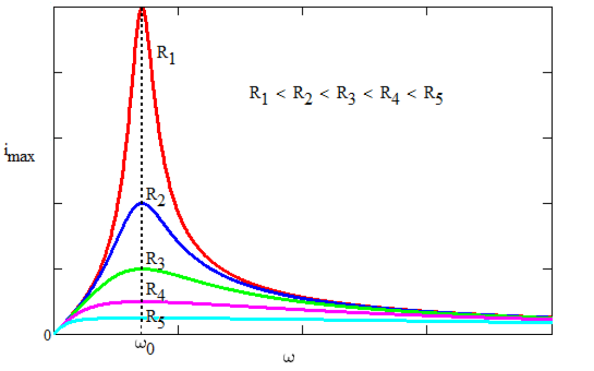

# Corriente alterna: resonancia (2019)

Unidad Temática IX — Corriente Alterna

- Si cambiamos la frecuencia de la fuente, cambiarán las reactancias del
  circuito, la impedancia y el ángulo de fase.
- En la frecuencia para la cual la corriente y el voltaje están en fase
  ($`\cos\Phi`$ es máximo), se dice que el circuito está en resonancia.
- Esto corresponde al caso en que $`X_c=X_l`$. y, por tanto, Z es mínima así que
  la amplitud de la corriente también es máxima. Por tanto la potencia que
  entrega la fuente es máxima
- A qué frecuencia ocurre esto? De $`X_c=X_l`$., despejamos $`\omega_d`$
- Este fenómeno es exactamente igual al fenómeno de resonancia mecánica. Los
  principios físicos fundamentales se manifiestan en diversos sistemas

La impedancia es mínima cuando en

```math
Z=\sqrt{R^2+(X_L-X_C)^2}=\sqrt{R^2+\left(\omega L-\frac1{\omega C}\right)^2}
```

se cumple que

```math
X_L=X_C\Rightarrow\omega L=\frac1{\omega C}\Rightarrow\omega=\sqrt{\frac1{LC}}
```

A esta frecuencia la impedancia es solo resistiva

$`Z=R`$, el angulo de fase $`\phi=0`$, y la corriente es máxima e igual a

```math
i_m=\frac{\varepsilon_m}R
```



Si representamos la corriente máxima en función de la frecuencia obtenemos las
curvas de la figura. Se observa que cuanto menor es la resistencia, más grande
es el máximo cuando ω=ω0 . Los valores de L y C son los mismos para todas las
curvas. La condición se denomina condición de resonancia.

## Cierre

Fin de la Clase

## Procedencia y observaciones de transcripción

- Original: `2019/3er Parcial/2019 UT IX Corriente Alterna.pdf`, páginas 46–49
  de 49. Versión identificada como 2019 en el nombre y la carpeta; no se observa
  fecha de clase impresa en estas diapositivas.
- SHA-256: `f133b469afdff28ace1fe5e90db8e5fd4a8e3c166e4d987cc3f3f31166dff3e1`.
- Herramientas: preflight y extracción PyMuPDF4LLM, Poppler y recortes PyMuPDF.
  Páginas, expresiones y figuras del tramo cotejadas visualmente.
- Se conserva ω_d de la página 46, ω sin subíndice y εm/im de la 47, pese a la
  notación V/I del desarrollo anterior. La página 49 es el cierre.
