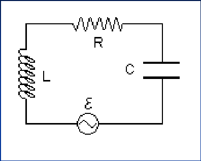
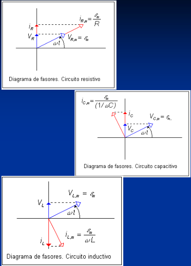
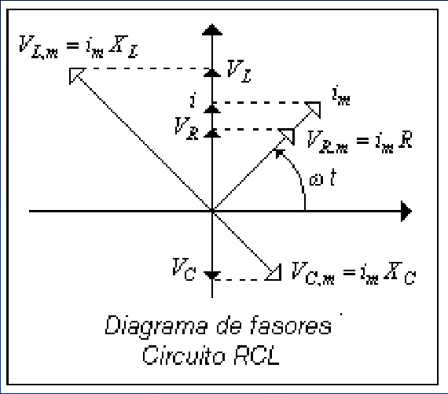
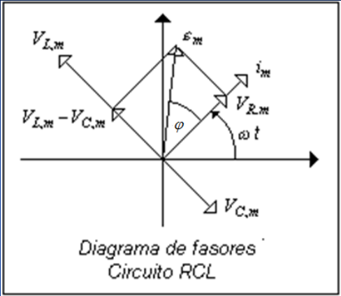
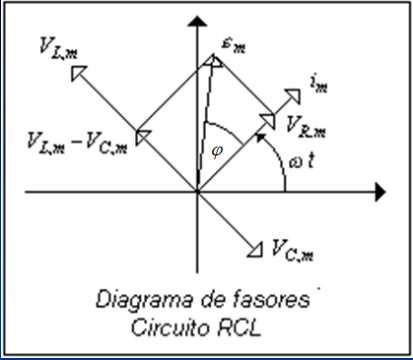

# Circuito RLC: impedancia y desfasaje

Unidad Temática IX — Corriente Alterna

## Análisis con fasores. Impedancia

La fem y la corriente del circuito vienen dadas por las expresiones generales:



```math
\varepsilon(t)=\varepsilon_{max}\sin(\omega t)\qquad\text{Fem alterna}
```

```math
i(t)=i_{max}\sin(\omega t+\varphi)\qquad\text{Corriente alterna}
```

```math
\varepsilon=V_R+V_C+V_L
```

Utilizaremos el diagrama de fasores del circuito, teniendo en cuenta que al ser
la corriente común a los tres elementos, los desfasajes se aplican a las
tensiones.

Queremos determinar $`i_{max}`$ y $`\varphi`$.





La suma algebraica de las proyecciones sobre el eje vertical de los fasores
$`V_{L,m}`$, $`V_{R,m}`$ y $`V_{C,m}`$ da como resultado $`\varepsilon`$. La
suma vectorial de los fasores $`V_{L,m}`$, $`V_{R,m}`$ y $`V_{C,m}`$ da como
resultado el fasor de amplitud $`\varepsilon_m`$, cuya proyección sobre el eje
vertical da la tensión instantánea $`\varepsilon`$.



Aplicando Pitágoras

```math
\begin{aligned}\varepsilon_m&=\sqrt{V_{R,m}^2+(V_{L,m}-V_{C,m})^2}\\&=\sqrt{(i_mR)^2+(i_mX_L-i_mX_C)^2}\\&=i_m\sqrt{R^2+(X_L-X_C)^2}=i_mZ\end{aligned}
```

```math
Z=\sqrt{R^2+(X_L-X_C)^2}=\sqrt{R^2+\left(\omega L-\frac1{\omega C}\right)^2}
```

Impedancia

```math
[Z]=\text{Ohm en el SI}
```

```math
i_m=\frac{\varepsilon_m}{Z}=\frac{\varepsilon_m}{\sqrt{R^2+(X_L-X_C)^2}}=\frac{\varepsilon_m}{\sqrt{R^2+\left(\omega L-\frac1{\omega C}\right)^2}}
```

Determinamos $`i_{max}`$ en función de los datos.

Determinemos ahora la diferencia de fase $`\varphi`$.



```math
\tan(\varphi)=\frac{V_{L,m}-V_{C,m}}{V_{R,m}}=\frac{i_m(X_L-X_C)}{i_mR}=\frac{X_L-X_C}R=\frac{\omega L-1/\omega C}R
```

La diferencia de fase no depende de $`\varepsilon_m`$.

- $`\displaystyle X_L\gt X_C\Rightarrow\varepsilon_m`$ se adelanta en
  $`\varphi`$ a $`i_m`$, y $`\varphi`$ positivo.
- $`\displaystyle X_L\lt X_C\Rightarrow\varepsilon_m`$ se atrasa en $`\varphi`$
  a $`i_m`$, y $`\varphi`$ negativo.

## Procedencia y observaciones de transcripción

- Original: `2019/3er Parcial/2017 UT IX Corriente Alterna.pdf`, páginas 16–19
  de 34. Fecha impresa: 13/06/2018; el archivo se llama 2017 y está archivado en
  2019\.
- SHA-256: `9e7ec2ad4e867b5dc688982d6b052f2b16e926ee1adcfc55f7007697c05cf263`.
- Herramientas: preflight PyMuPDF4LLM, Poppler y recortes PyMuPDF. Páginas,
  expresiones y figuras del tramo cotejadas visualmente.
- Se mantienen las convenciones de fase y la leyenda «Circuito RCL» del
  original. El diagrama se reitera en las páginas 18 y 19.
