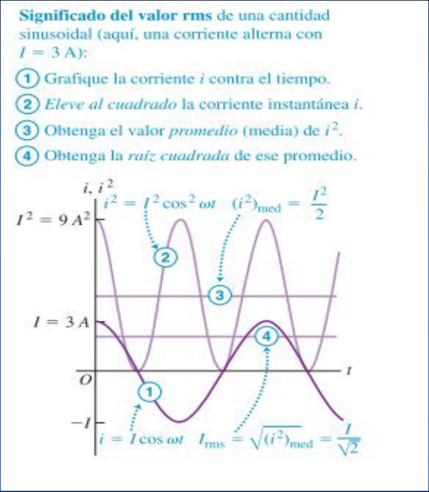

# Corriente alterna: valores eficaces y rms (2019)

Unidad Temática IX — Corriente Alterna

En alterna el valor medio de la tensión y de la corriente a lo largo de un ciclo
es cero ya que toman sucesivamente valores de igual magnitud pero de signo
contrario. Esto no significa que su efecto sea el mismo que tendría una tensión
o una corriente nula. Por ejemplo, la disipación de energía en una resistencia
por efecto Joule es independiente del sentido en que circula la intensidad. Para
tener en cuenta este hecho se promedia a menudo el cuadrado de los valores
instantáneos y se toma la raíz cuadrada. El resultado es el valor eficaz de la
magnitud correspondiente (o valor rms en inglés). Este es el valor que dan los
voltímetros y amperímetros de c.a, mientras que en un osciloscopio leemos
normalmente el valor máximo de la tensión

Este procedimiento define la corriente eficaz, que se denota con Irms. Aun
cuando i sea negativa, i al cuadrado siempre será positiva, por lo que Irms
nunca es igual a cero (a menos que i fuera cero en todo instante).

Si la corriente instantánea está dada por

```math
i=I_0\cos(\omega t)
```

```math
i^2=I_0^2\cos^2(\omega t)
```

El valor medio de la corriente instantánea es

```math
(i^2)_m=(I_0^2\cos^2\omega t)_m=\frac12 I_0^2
```

La raíz cuadrada de esto es Irms .

```math
I_{rms}=\frac{I_0}{\sqrt2}=0.707I_0
```

De la misma manera, el valor cuadrático medio de un voltaje sinusoidal con
amplitud (máximo valor) V0 es

```math
V_{rms}=\frac{V_0}{\sqrt2}=0.707V_0
```

## Significado del valor rms de una cantidad sinusoidal

(aquí, una corriente alterna con $`I=3\,\mathrm A`$):

1. Grafique la corriente i contra el tiempo.
1. Eleve al cuadrado la corriente instantánea i.
1. Obtenga el valor promedio (media) de $`i^2`$.
1. Obtenga la raíz cuadrada de ese promedio.

```math
I^2=9\,\mathrm A^2\qquad I=3\,\mathrm A
```

```math
i^2=I^2\cos^2\omega t\qquad(i^2)_{med}=\frac{I^2}2
```

```math
i=I\cos\omega t\qquad I_{rms}=\sqrt{(i^2)_{med}}=\frac I{\sqrt2}
```



El valor eficaz de una corriente alterna, es el valor que tendría una corriente
continua que produciría la misma potencia que dicha corriente alterna, al
aplicarla sobre una misma resistencia

## Procedencia y observaciones de transcripción

- Original: `2019/3er Parcial/2019 UT IX Corriente Alterna.pdf`, páginas 31–34
  de 49. Versión identificada como 2019 en el nombre y la carpeta; no se observa
  fecha de clase impresa en estas diapositivas.
- SHA-256: `f133b469afdff28ace1fe5e90db8e5fd4a8e3c166e4d987cc3f3f31166dff3e1`.
- Herramientas: preflight y extracción PyMuPDF4LLM, Poppler y recortes PyMuPDF.
  Páginas, expresiones y figuras del tramo cotejadas visualmente.
- Se conserva la frase «El valor medio de la corriente instantánea» aunque la
  fórmula promedia i². El texto y las expresiones de la imagen de la página 34
  se transcriben además de conservar el gráfico.
