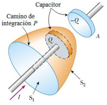
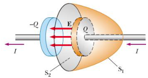

# Corriente de desplazamiento y ley de Ampere-Maxwell

Unidad temática VI — Campo de Inducción Magnética. Propiedades.

Fecha impresa: 08/05/2019.

## Forma General de la Ley de Ampere. Corriente de Desplazamiento



Consideremos una corriente no estacionaria I que esta cargando un capacitor. La
carga +Q esta cambiando, pero no existe ninguna corriente de conducción entre
las placas.

Si consideramos S₁

```math
\Rightarrow\oint\vec B\cdot\overrightarrow{dl}=\mu_0I
```

Si consideramos S₂

```math
\Rightarrow\oint\vec B\cdot\overrightarrow{dl}=0\quad????
```

La ley de Ampere tal como la formulamos no prevé la existencia de corrientes y
discontinuidades en el circuito. Maxwell resuelve esta situación postulando la
existencia de una corriente ficticia a la denomina corriente de desplazamiento
Id

```math
I_d=\varepsilon_0\frac{d\phi_E}{dt}
```

donde

```math
\phi_E=\int\vec E\cdot\overrightarrow{dA}
```

Flujo eléctrico

Ley de Ampere - Maxwell

```math
\oint\vec B\cdot\overrightarrow{dl}=\mu_0(I+I_d)=\mu_0I+\mu_0\varepsilon_0\frac{d\phi_E}{dt}
```



```math
C=\frac{\varepsilon_0A}d\Rightarrow V=\frac qC=\frac{qd}{\varepsilon_0A}
```

```math
E=\frac Vd=\frac q{\varepsilon_0A}
```

```math
\phi_E=\int_{S_2}\vec E\cdot\overrightarrow{dA}=EA=\frac q{\varepsilon_0}\qquad I_d=\varepsilon_0\frac{d\phi_E}{dt}=\frac{dq}{dt}\equiv I
```

La corriente de desplazamiento I_d que “atraviesa” S₂ es igual a la corriente I
que atraviesa S₁. Si consideramos S₂, I_d es el origen del campo magnético en el
limite de la superficie. Físicamente I_d se origina debido al campo eléctrico E
variable.

Los campos eléctricos variables producen campos magnéticos.

## Forma diferencial de la ley de Ampere-Maxwell

```math
\oint\vec B\cdot\overrightarrow{dl}=\mu_0(I+I_d)=\mu_0I+\mu_0\varepsilon_0\frac{d\phi_E}{dt}
```

Teorema de Stokes

```math
\begin{cases}\displaystyle\oint\vec B\cdot\overrightarrow{dl}=\int(\nabla\times\vec B)\cdot\overrightarrow{dA}\\\displaystyle\mu_0(I+I_d)=\mu_0\int\vec J\cdot\overrightarrow{dA}+\mu_0\varepsilon_0\frac d{dt}\left[\int\vec E\cdot\overrightarrow{dA}\right]\end{cases}
```

```math
\Rightarrow\nabla\times\vec B=\mu_0\vec J+\mu_0\varepsilon_0\frac{\partial\vec E}{\partial t}
```

## Procedencia y observaciones de transcripción

- Original:
  `2019/2do Parcial/2019 UT VI - Campo de Inducción Magnética. Propiedades.pdf`,
  páginas PDF 14–16 de 16, diapositivas 28–31 de 31.
- SHA-256: `b9bb8ec5e8acfa36814e15207ee532a00e566ff5ea72bd139eff27ae0b2d634f`.
- Herramientas: PyMuPDF4LLM, Poppler y recortes PyMuPDF; cotejo visual de todas
  las páginas y expresiones de este tramo. Se conservan figuras, etiquetas y
  erratas del original.
- Se conservan los cuatro signos de interrogación de la diapositiva 28 y la
  frase «corriente ficticia a la denomina». La página 14 se comparte con el
  ejemplo de flujo.
