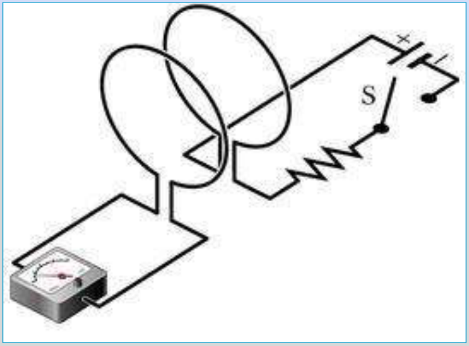
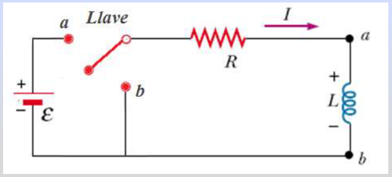
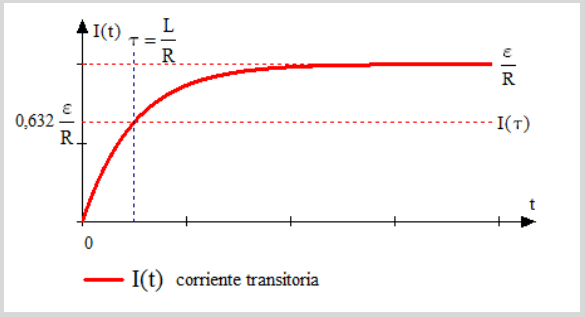
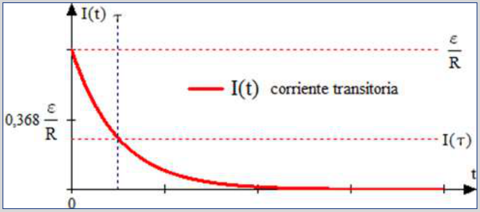

# Corrientes transitorias en un circuito LR

Unidad Temática VII — Electromagnetismo

## Corrientes transitorias





En t = 0 es I = 0. Si llevamos la llave a la posición a y aplicamos 2da Ley de
Kirchhoff

```math
\varepsilon-IR-L\frac{dI}{dt}=0
```

```math
L\frac{dI}{dt}=\varepsilon-IR\Rightarrow\frac{dI}{\varepsilon-IR}=\frac1L\,dt
```

```math
u=\varepsilon-IR\Rightarrow du=-R\,dI
```

```math
-\frac{du}{Ru}=\frac1L\,dt\Rightarrow\frac{du}u=-\frac RL\,dt\Rightarrow\ln(u)=-\frac RL t+Cte_1
```

```math
u=e^{-\frac RLt}e^{Cte_1}=Cte_2e^{-\frac RLt}\Rightarrow\varepsilon-IR=Cte_2e^{-\frac RLt}
```

```math
I(t)=\frac\varepsilon R-\frac{Cte_2}R e^{-\frac RLt}\quad\text{pero}\quad I(0)=0=\frac\varepsilon R-\frac{Cte_2}R\Rightarrow\varepsilon=Cte_2
```

```math
I(t)=\frac\varepsilon R\left[1-e^{-\frac RLt}\right]=\frac\varepsilon R\left[1-e^{-\frac t\tau}\right]
```

donde τ=L/R es la constante de tiempo inductiva



Si no estuviera L, la corriente rápidamente alcanza su valor estacionario ε/R,
pero L establece una fem inducida $`\varepsilon_{ind}=L\,dI/dt`$ con polaridad
opuesta a la de la batería, que se opone al aumento de la corriente,.


Si una vez alcanzada la corriente estacionaria llevamos la llave Ll a la
posición b, la ecuación que describe el decaimiento de la corriente se obtiene
haciendo ε = 0 y tenemos:

```math
\frac{dI}{dt}+\frac RL I=0\quad\text{con }I(0)=I_0=\frac\varepsilon R
```

condición inicial

Cuya solución es

```math
I(t)=I_0e^{-\frac RLt}=I_0e^{-\frac t{\tau_L}}
```



## Procedencia y observaciones de transcripción

- Original:
  `2019/2do Parcial/2019 UT VII - Fenómenos de Inducción Electromagnética.pdf`,
  páginas 50–54 de 67. Fecha impresa: 14/05/2019.
- SHA-256: `cbefa338a0f56f56079880a84f05a963257a6473febd8da50f944a67f2210a8f`.
- Herramientas: PyMuPDF4LLM, Poppler y recortes PyMuPDF; todas las páginas,
  expresiones y figuras del tramo cotejadas visualmente. Se conserva el
  desarrollo original.
- Se conserva el signo de ε_ind=L dI/dt del texto, y «corriente,.» de página 52.
  La 53 contiene únicamente el circuito repetido.
