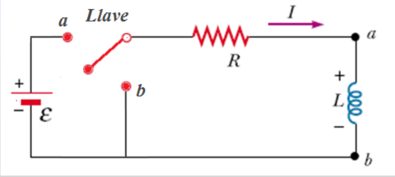
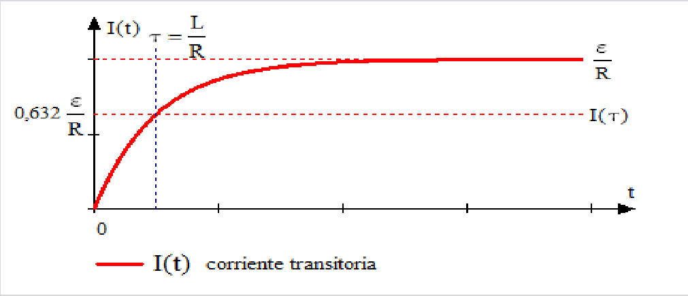
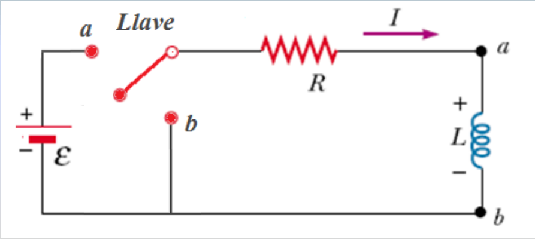
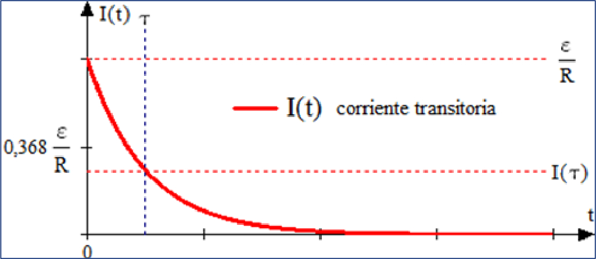

# Corrientes transitorias LR: versión Electromagnetismo

Unidad Temática VII — Electromagnetismo

Cualquier inductor tendra cierta resistencia. Esta situacion se representa
ilustrando su inductancia L y su resistencia R por separado



En el instante que se cierra el interruptor (posicion a) la corriente empieza a
fluir. Se le opone la fem inducida en el inductor. A traves de la resistencia
hay una caida de voltaje de magnitud IR, por lo tanto se reduce el voltaje
aplicado a traves de la inductancia y la corriente aumenta con menor rapidez. En
consecuencia la corriente se eleva gradualmente y tiende al valor estable
Imax=ε/R

Si aplicamos Kirchoff

```math
\varepsilon-IR-L\frac{dI}{dt}=0
```

Reordenando

```math
L\frac{dI}{dt}+RI=\varepsilon
```

Esta es una ecuacion diferencial lineal y se puede integrar

```math
\int_{I=0}^I\frac{dI}{\varepsilon-IR}=\int_0^t\frac{dt}L
```

```math
-\frac1R\ln\left(\frac{\varepsilon-IR}{\varepsilon}\right)=\frac tL
```

```math
I=\frac\varepsilon R(1-e^{-t/\tau})
```

Donde

```math
\tau=\frac LR
```

Constante de tiempo del circuito LR

La constante de tiempo representa el tiempo requerido para que la corriente I
alcance el 63% de su valor máximo.



Si no estuviera L, la corriente rápidamente alcanza su valor estacionario ε/R,
pero L establece una fem inducida $`\varepsilon_{ind}=L\,dI/dt`$ con polaridad
opuesta a la de la batería, que se opone al aumento de la corriente.



Si una vez alcanzada la corriente estacionaria llevamos la llave L a la posición
b, la ecuación diferencial se convierte en:

```math
L\frac{dI}{dt}+RI=0\quad\text{con }I(0)=I_0=\frac\varepsilon R
```

condición inicial

Reordenando

```math
\int_{I_0}^I\frac{dI}I=-\int_0^t\frac RL\,dt
```

Donde I=I0 en t=0 e I=I en el tiempo t

```math
\ln\frac I{I_0}=-\frac RLt
```

```math
I=I_0e^{-t/\tau}
```

```math
\tau=\frac LR
```

Constante de tiempo del circuito LR

La constante de tiempo representa el tiempo requerido para que la corriente I
alcance el 37% de su valor mínimo.



La corriente decae exponencialmente a cero

## Procedencia y observaciones de transcripción

- Original: `2019/2do Parcial/2019 UT VII Electromagnetismo.pdf`, páginas 46–49
  de 62. No consta fecha impresa; 2019 es del nombre del archivo.
- SHA-256: `eff3447774cadfcb2726a6caabbe8e257782276fce3e67dda465673d5ef67a6a`.
- Herramientas: PyMuPDF4LLM, Poppler y recortes PyMuPDF; páginas, expresiones y
  figuras del tramo cotejadas visualmente.
- Se conservan la expresión positiva ε_ind=L dI/dt, «Kirchoff» y «37% de su
  valor mínimo» de página49; no se corrigen silenciosamente.
