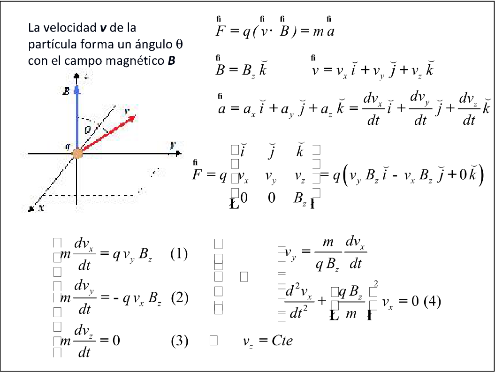
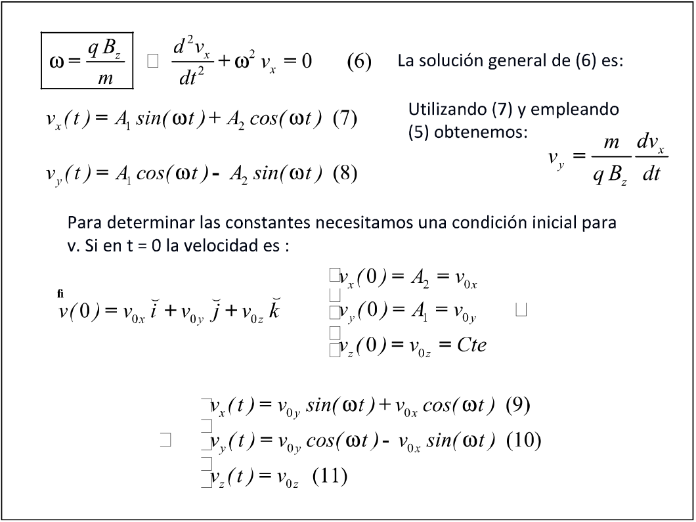
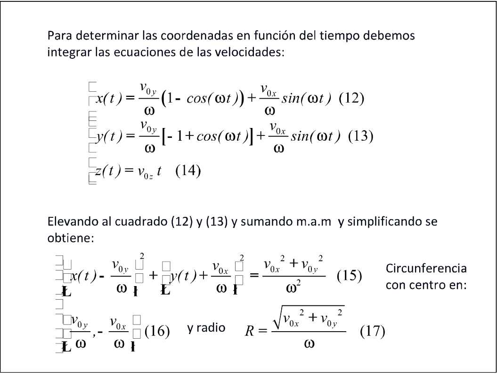

# Demostración de la trayectoria helicoidal — variante impresa

> Diapositivas 40–41: notación matemática normalizada tras el cotejo con el
> usuario. En la diapositiva 42, `□` señala sectores aún pendientes de revisión.

## Diapositiva 40

La velocidad v de la partícula forma un ángulo θ con el campo magnético B

```math
\vec F=q(\vec v\times\vec B)=m\vec a
```

```math
\vec B=B_z\hat k\qquad
\vec v=v_x\hat\imath+v_y\hat\jmath+v_z\hat k
```

```math
\vec a=a_x\hat\imath+a_y\hat\jmath+a_z\hat k
=\frac{dv_x}{dt}\hat\imath+\frac{dv_y}{dt}\hat\jmath+\frac{dv_z}{dt}\hat k
```

Desarrollando el producto vectorial:

```math
\vec F=q
\begin{vmatrix}
\hat\imath&\hat\jmath&\hat k\\
v_x&v_y&v_z\\
0&0&B_z
\end{vmatrix}
=q(v_yB_z\hat\imath-v_xB_z\hat\jmath+0\hat k)
```

Igualando las componentes de la fuerza magnética y de la fuerza neta:

```math
m\frac{dv_x}{dt}=qv_yB_z\qquad(1)
```

```math
m\frac{dv_y}{dt}=-qv_xB_z\qquad(2)
```

```math
m\frac{dv_z}{dt}=0\qquad(3)
```

De (1) se despeja la componente de la velocidad:

```math
v_y=\frac{m}{qB_z}\frac{dv_x}{dt}
```

Derivando esta relación respecto del tiempo y sustituyendo en (2):

```math
\frac{d^2v_x}{dt^2}+\left(\frac{qB_z}{m}\right)^2v_x=0\qquad(4)
```

De (3), la componente de la velocidad paralela al campo permanece constante:

```math
v_z=Cte
```



## Diapositiva 41

```math
\boxed{\omega=\frac{qB_z}{m}}\quad\Longrightarrow\quad
\frac{d^2v_x}{dt^2}+\omega^2v_x=0\qquad(6)
```

La solución general de (6) es:

```math
v_x(t)=A_1\sin(\omega t)+A_2\cos(\omega t)\qquad(7)
```

Utilizando (7) y la relación para la componente de la velocidad obtenemos:

```math
v_y=\frac{m}{qB_z}\frac{dv_x}{dt}
```

```math
v_y(t)=A_1\cos(\omega t)-A_2\sin(\omega t)\qquad(8)
```

Para determinar las constantes necesitamos una condición inicial para v. Si en t
= 0 la velocidad es:

```math
\vec v(0)=v_{0x}\hat\imath+v_{0y}\hat\jmath+v_{0z}\hat k
```

Las condiciones iniciales determinan las constantes:

```math
v_x(0)=A_2=v_{0x}
```

```math
v_y(0)=A_1=v_{0y}
```

```math
v_z(0)=v_{0z}=Cte
```

Sustituyendo las constantes, las componentes de la velocidad quedan:

```math
v_x(t)=v_{0y}\sin(\omega t)+v_{0x}\cos(\omega t)\qquad(9)
```

```math
v_y(t)=v_{0y}\cos(\omega t)-v_{0x}\sin(\omega t)\qquad(10)
```

```math
v_z(t)=v_{0z}\qquad(11)
```



## Diapositiva 42

Para determinar las coordenadas en función del tiempo debemos integrar las
ecuaciones de las velocidades:

Los delimitadores del grupo de coordenadas están deteriorados:

```math
x(t)=\frac{v_{0y}}{\omega}(1-\cos(\omega t))+
\frac{v_{0x}}{\omega}\sin(\omega t)\qquad(12)
```

```math
y(t)=\frac{v_{0y}}{\omega}[-1+\cos(\omega t)]+
\frac{v_{0x}}{\omega}\sin(\omega t)\qquad(13)
```

```math
z(t)=v_{0z}t\qquad(14)
```

Elevando al cuadrado (12) y (13) y sumando m.a.m y simplificando se obtiene:

```math
\square x(t)-\frac{v_{0y}}{\omega}\square^2+
\square y(t)+\frac{v_{0x}}{\omega}\square^2
=\frac{v_{0x}^{2}+v_{0y}^{2}}{\omega^2}\qquad(15)
```

Circunferencia con centro en:

```math
\square\frac{v_{0y}}{\omega},-\frac{v_{0x}}{\omega}\square\qquad(16)
```

y radio

```math
R=\frac{\sqrt{v_{0x}^{2}+v_{0y}^{2}}}{\omega}\qquad(17)
```



## Procedencia y límites de lectura

- Original: `2019/2do Parcial/UT 5 4 pag.pdf`, hoja 10 casillero 4 y hoja 11
  casilleros 1–2 (diapositivas 40–42 por orden de lectura).
- SHA-256: `134d9de661dcefd039d315a0e669b89c38bf02859d1d2d0806f15569b5006764`.
- Segunda impresión cotejada: `2019/2do Parcial/UT 5 6 pag.pdf`, hoja 7,
  casilleros 4–6; SHA-256
  `d80e499c858b45d8146a3e18152de704cefbb9d0009ea7f3717141f3543e7d9c`.
- Inspección de imágenes PDF con PyMuPDF, comparación con Poppler y los renders
  completos. No hay texto ni fuentes embebidas recuperables en estas hojas de la
  primera impresión; los defectos también aparecen en la segunda.
- Los recortes preservan los diagramas y permiten localizar cada glifo perdido.
  La diapositiva 40 usa notación normalizada tras el cotejo con el usuario. En
  41–42 se conservan la referencia a (5) sin número visible junto a la
  expresión, los coeficientes de (13) y el centro de (16), pendientes de
  revisión.
- Pendiente: revisar los símbolos y expresiones de la diapositiva 42.
