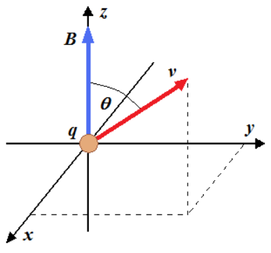

# Demostración de la trayectoria helicoidal

Unidad Temática V — Fuerzas Magnéticas sobre cargas y elementos de corriente

La velocidad v de la partícula forma un ángulo θ con el campo magnético B



```math
\vec F=q(\vec v\times\vec B)=m\vec a
```

```math
\vec B=B_z\breve k\qquad\vec v=v_x\breve\imath+v_y\breve\jmath+v_z\breve k
```

```math
\vec a=a_x\breve\imath+a_y\breve\jmath+a_z\breve k=\frac{dv_x}{dt}\breve\imath+\frac{dv_y}{dt}\breve\jmath+\frac{dv_z}{dt}\breve k
```

```math
\vec F=q\begin{pmatrix}\breve\imath&\breve\jmath&\breve k\\v_x&v_y&v_z\\0&0&B_z\end{pmatrix}=q(v_yB_z\breve\imath-v_xB_z\breve\jmath+0\breve k)
```

```math
\begin{cases}\displaystyle m\frac{dv_x}{dt}=qv_yB_z\quad(1)\\\displaystyle m\frac{dv_y}{dt}=-qv_xB_z\quad(2)\\\displaystyle m\frac{dv_z}{dt}=0\quad(3)\end{cases}
```

```math
\Rightarrow\begin{cases}\displaystyle v_y=\frac m{qB_z}\frac{dv_x}{dt}\\\displaystyle\frac{d^2v_x}{dt^2}+\left(\frac{qB_z}m\right)^2v_x=0\quad(4)\end{cases}\qquad v_z=Cte
```

```math
\omega=\frac{qB_z}m\Rightarrow\frac{d^2v_x}{dt^2}+\omega^2v_x=0\quad(6)
```

La solución general de (6) es:

```math
v_x(t)=A_1\sin(\omega t)+A_2\cos(\omega t)\quad(7)
```

Utilizando (7) y empleando (5) obtenemos:

```math
v_y=\frac m{qB_z}\frac{dv_x}{dt}
```

```math
v_y(t)=A_1\cos(\omega t)-A_2\sin(\omega t)\quad(8)
```

Para determinar las constantes necesitamos una condición inicial para v. Si en t
= 0 la velocidad es:

```math
\vec v(0)=v_{0x}\breve\imath+v_{0y}\breve\jmath+v_{0z}\breve k
```

```math
\begin{cases}v_x(0)=A_2=v_{0x}\\v_y(0)=A_1=v_{0y}\\v_z(0)=v_{0z}=Cte\end{cases}
```

```math
\Rightarrow\begin{cases}v_x(t)=v_{0y}\sin(\omega t)+v_{0x}\cos(\omega t)\quad(9)\\v_y(t)=v_{0y}\cos(\omega t)-v_{0x}\sin(\omega t)\quad(10)\\v_z(t)=v_{0z}\quad(11)\end{cases}
```

Para determinar las coordenadas en función del tiempo debemos integrar las
ecuaciones de las velocidades:

```math
\begin{cases}\displaystyle x(t)=\frac{v_{0y}}\omega(1-\cos(\omega t))+\frac{v_{0x}}\omega\sin(\omega t)\quad(12)\\\displaystyle y(t)=\frac{v_{0y}}\omega[-1+\cos(\omega t)]+\frac{v_{0x}}\omega\sin(\omega t)\quad(13)\\z(t)=v_{0z}t\quad(14)\end{cases}
```

Elevando al cuadrado (12) y (13) y sumando m.a.m y simplificando se obtiene:

```math
\left(x(t)-\frac{v_{0y}}\omega\right)^2+\left(y(t)+\frac{v_{0x}}\omega\right)^2=\frac{v_{0x}^2+v_{0y}^2}{\omega^2}\quad(15)
```

Circunferencia con centro en:

```math
\left(\frac{v_{0y}}\omega,-\frac{v_{0x}}\omega\right)\quad(16)
```

y radio

```math
R=\frac{\sqrt{v_{0x}^2+v_{0y}^2}}\omega\quad(17)
```

## Procedencia y observaciones de transcripción

- Original:
  `2019/2do Parcial/2019 UT V - Fuerzas Magnéticas sobre cargas y elementos de corriente.pdf`,
  páginas 39–42 de 42.
- SHA-256: `383fdb6f46e1627fbe65cf259b89a480bd4b4cc61821cbfc466fa3e4a63ceb29`.
  2019 corresponde al nombre del archivo; no consta fecha impresa en estas
  páginas.
- Herramientas: PyMuPDF4LLM, Poppler y recortes PyMuPDF; cotejo visual de todas
  las páginas, expresiones y figuras del tramo. Se conserva el contenido del
  original, sin resolver ejercicios vacíos.
- La página 39 es la carátula del anexo. Los versores se transcriben con breve,
  conservando su marca curva. La expansión vectorial usa el paréntesis matricial
  del original. Se mantiene la referencia a (5), aunque ese número no se ve
  junto a la expresión correspondiente.
- Se mantienen los coeficientes v₀y y v₀x de la ecuación (13), el centro de (16)
  y «sumando m.a.m» tal como aparecen, sin reparar la derivación ni sustituirla
  por una solución nueva.
