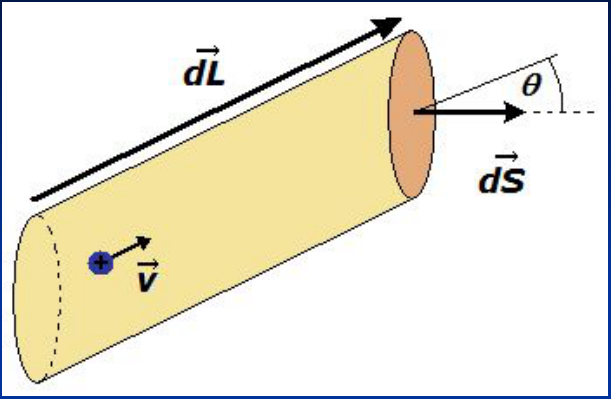
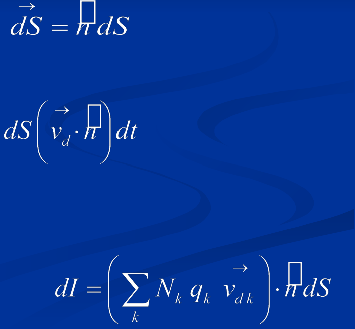
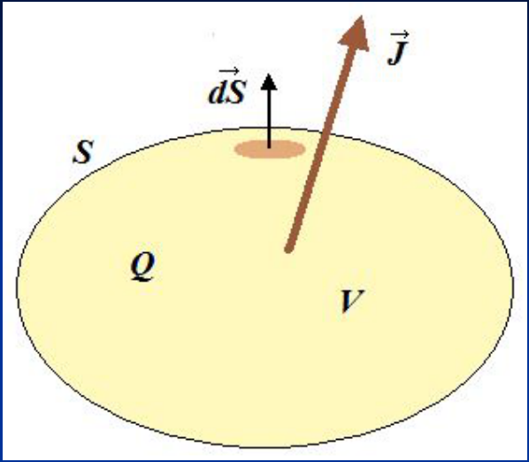

# Densidad de corriente eléctrica



```math
dQ=Nq\,dV=Nq\,\overrightarrow{dL}\cdot\overrightarrow{dS}
```

```math
\overrightarrow{dL}=\vec v_d\,dt
```

```math
\overrightarrow{dS}=\overset{\square}{n}\,dS
```

```math
dQ=Nq\left(\vec v_d\,dt\right)\left(\overset{\square}{n}\,dS\right)=Nq\,dS\left(\vec v_d\cdot\overset{\square}{n}\right)dt
```

```math
\Rightarrow dI=\frac{dQ}{dt}=Nq\left(\vec v_d\cdot\overset{\square}{n}\right)dS
```

Si hay más de un tipo de portador

```math
dI=\left(\sum_k N_k\,q_k\,\vec v_{d_k}\right)\cdot\overset{\square}{n}\,dS
```



El termino entre paréntesis es un vector con dimensiones de corriente eléctrica
por unidad de superficie, denominado vector densidad de corriente eléctrica J.
Esta definido en cada punto del conductor

```math
\vec J=\sum_k N_k\,q_k\,\vec v_{d_k}
```

```math
dI=\vec J\cdot\overset{\square}{n}\,dS\Rightarrow I=\int_S\vec J\cdot\overrightarrow{dS}
```

Sobre toda la superficie S del conductor

Si J es constante y paralela a dS en toda la superficie S del conductor

```math
I=J\,S
```

## Ecuación de continuidad



Si ρ(x,y,z,t) es la densidad de carga en V

```math
Q=\int_V\rho(x,y,z,t)\,dV
```

```math
I=\frac{dQ}{dt}=\frac d{dt}\int_V\rho(x,y,z,t)\,dV
```

```math
\frac{dQ}{dt}=\int_V\frac{\partial\rho(x,y,z,t)}{\partial t}\,dV\qquad\mathrm y\qquad I=\int_S\vec J\square\overrightarrow{dS}
```

Cuando J transporta carga fuera de V la carga disminuye es decir dQ/dt es
negativa, la relación es entonces.

```math
\frac{dQ}{dt}=-\int_S\vec J\square\overrightarrow{dS}\Rightarrow\int_V\frac{\partial\rho}{\partial t}\,dV=-\int_S\vec J\square\overrightarrow{dS}
```

Teorema de la divergencia

```math
\int_S\vec A\cdot\overrightarrow{dS}=\int_V\vec\nabla\cdot\vec A\,dV
```

```math
\int_V\frac{\partial\rho}{\partial t}\,dV=-\int_V\vec\nabla\cdot\vec J\,dV\Rightarrow\int_V\left(\frac{\partial\rho}{\partial t}+\vec\nabla\cdot\vec J\right)dV=0
```

Como el volumen V es arbitrario para que la integral sea nula debe ser nulo el
integrando, es decir se cumple que

```math
\frac{\partial\rho}{\partial t}+\vec\nabla\cdot\vec J=0
```

Ecuación de continuidad

## Procedencia y observaciones de transcripción

- Original: `2019/1er Parcial/2017 UT IV - Electrocinética.ppt.pdf`, páginas 8,
  9, 10, 11 de 55.
- SHA-256: `5593bcdeb59339b25f4dfee074beac1812300dcec491fb423777a4e776ba1399`.
- El nombre del archivo indica 2017; se conserva bajo 2019 por su ubicación
  canónica. No consta autor en estas páginas.
- Herramientas: PyMuPDF4LLM, PyMuPDF y Poppler; cotejo visual de texto,
  fórmulas, tablas y diagramas. Figuras originales conservadas por recorte y
  render.
- El PDF ya muestra cuadrados sobre n en las páginas 8–9 y entre J y dS en las
  páginas 10–11. Se reproducen como cuadrados; no se infiere el signo perdido.
  El recorte conserva su apariencia. Las integrales superficiales son simples,
  como en la fuente.
