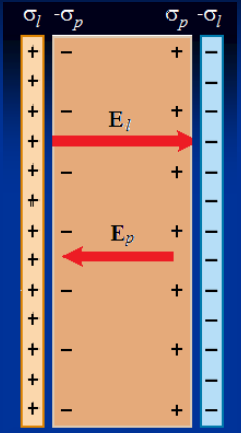

# Vector desplazamiento eléctrico



```math
\sigma_p=\pm P\Rightarrow E=E_0-E_p\lt E_0
```

sin dieléctrico

```math
E=E_0=\frac{\sigma_l}{\varepsilon_0}
```

con dieléctrico

```math
\Rightarrow E=\frac{\sigma_l-\sigma_p}{\varepsilon_0}=\frac{\sigma_l-P}{\varepsilon_0}
```

```math
\sigma_l=\varepsilon_0E+P
```

Definimos un nuevo campo vectorial creado por las cargas libres del conductor
denominado vector desplazamiento D

```math
\vec D=\varepsilon_0\vec E+\vec P
```

## Permitividad y susceptibilidad eléctrica

La polarización P es proporcional al campo eléctrico aplicado:

```math
\vec P=\chi_e\,\varepsilon_0\vec E
```

χₑ es una constante de proporcionalidad adimensional característica del material
denominada susceptibilidad eléctrica.

```math
\vec D=\varepsilon_0\vec E+\chi_e\,\varepsilon_0\vec E=(1+\chi_e)\varepsilon_0\vec E=\varepsilon\vec E
```

```math
\varepsilon=(1+\chi_e)\varepsilon_0
```

permitividad del material

```math
\kappa=\frac\varepsilon{\varepsilon_0}=(1+\chi_e)
```

permitividad relativa o constante dieléctrica

## Ley de Gauss generalizada

```math
\oint\vec E\cdot\overrightarrow{dS}=\frac{q_l+q_p}{\varepsilon_0}=\frac{q_l}{\varepsilon_0}-\frac1{\varepsilon_0}\oint\vec P\cdot\overrightarrow{dS}
```

```math
\oint\vec E\cdot\overrightarrow{dS}=\frac{q_l}{\varepsilon_0}-\frac1{\varepsilon_0}\oint\vec P\cdot\overrightarrow{dS}
```

```math
\varepsilon_0\oint\vec E\cdot\overrightarrow{dS}+\oint\vec P\cdot\overrightarrow{dS}=q_l
```

```math
\oint\left(\varepsilon_0\vec E+\vec P\right)\cdot\overrightarrow{dS}=q_l
```

El flujo del vector Desplazamiento eléctrico a través de una superficie cerrada
es igual a la carga libre neta encerrada en su interior

```math
\Phi=\oint\vec D\cdot\overrightarrow{dS}=\oint\varepsilon\vec E\cdot\overrightarrow{dS}=q_{libre}
```

⇓

```math
\oint\vec E\cdot\overrightarrow{dS}=\frac{q_{libre}}\varepsilon
```

## Fin de la UT III

## Procedencia y observaciones de transcripción

- Original:
  `2019/1er Parcial/2018 PF UT III - Capacidad. Prop electr de la Materia.pptx.pdf`,
  páginas 24, 25, 26 de 26, dos diapositivas por página salvo el cierre.
- SHA-256: `ac23675b753c3d9349b89600ea349edcbc8dfe56058b3c78a09e873777616145`.
- Fecha impresa: 28/03/2018. Ubicación canónica: material 2019. No consta autor
  en estas páginas.
- Herramientas: PyMuPDF4LLM y Poppler para extracción; cotejo visual de texto,
  expresiones, tablas y figuras. Medios conservados mediante recorte/render
  PyMuPDF, excepto las dos imágenes de carga por batería extraídas directamente
  del PDF.
- Cubre las diapositivas 47–51. Se conservan integrales simples cerradas, las
  repeticiones de la demostración y las letras l/p de carga libre y
  polarización. La página 26 contiene únicamente el cierre; no se infiere una
  diapositiva adicional en su mitad inferior vacía.
