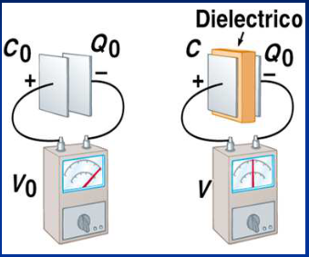
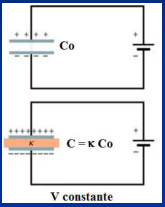
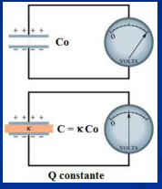
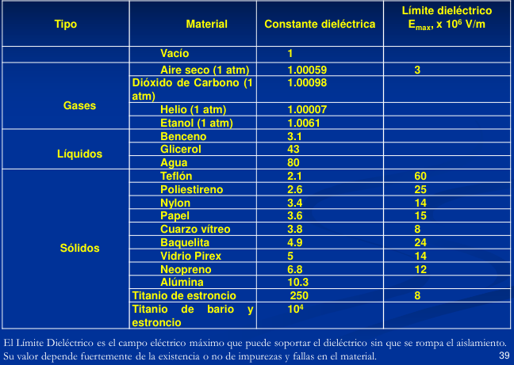

# Dieléctricos

Desde un punto de vista electrostático las sustancias pueden clasificarse en dos
clases: CONDUCTORES, en los cuales las cargas eléctricas pueden moverse
fácilmente de un lugar a otro y AISLADORES o DIELÉCTRICOS, en los cuales las
cargas se mueven con tal dificultad que podemos considerarlas fijas. A lo sumo,
sus posiciones de equilibrio podrán sufrir ligeras modificaciones; por ello
suponemos que en tales materiales la movilidad de los portadores de carga es
nula.

## Propiedades electrostáticas de los dieléctricos



Consideremos el siguiente experimento:

1. Conectamos el condensador a una batería y lo cargamos.
1. Lo desconectamos y medimos la diferencia de potencial entre placas , y
   obtenemos el valor ΔV₀.
1. Insertamos el dieléctrico entre las placas y medimos nuevamente la diferencia
   de potencial. Encontramos un valor ΔV menor que ΔV₀. Se cumple
   $`\Delta V\lt\Delta V_0`$.

Podemos expresar esto como:

```math
\Delta V_0=\kappa\,\Delta V\Rightarrow\Delta V=\frac1\kappa\Delta V_0
```

κ: constante dieléctrica, κ >1. ( puede depender de la temperatura y del campo
eléctrico)

**EL POTENCIAL DISMINUYE EN UN FACTOR (1/ κ) AL INTRODUCIR EL DIELÉCTRICO.**

La carga del capacitor no cambia y es Q₀ en ambos casos. Las capacidades son
entonces:

```math
C_0=\frac{Q_0}{\Delta V_0}\quad\mathrm y\quad C=\frac{Q_0}{\Delta V}
```

```math
\frac C{C_0}=\frac{\Delta V_0}{\Delta V}=\kappa\Rightarrow C=\kappa C_0
```

**LA CAPACIDAD AUMENTA κ VECES AL INTRODUCIR UN DIELÉCTRICO DE CONSTANTE κ.**

```math
C=\kappa C_0=\kappa\frac{\varepsilon_0 A}d=\frac{\varepsilon A}d\qquad\varepsilon=\kappa\varepsilon_0
```

Considerando el campo eléctrico entre placas

```math
\kappa=\frac{\Delta V_0}{\Delta V}=\frac{E_0d}{Ed}=\frac{E_0}E
```

```math
E=\frac1\kappa E_0
```

**EL CAMPO ELECTRICO DISMINUYE κ VECES AL INTRODUCIR UN DIELÉCTRICO DE CONSTANTE
κ.**

Considerando la energía almacenada

```math
U=\frac12Q\Delta V
```

```math
V_0=\frac{2U_0}{Q_0},\ V=\frac{2U}{Q_0}\Rightarrow\kappa=\frac{\Delta V_0}{\Delta V}=\frac{2U_0/Q_0}{2U/Q_0}=\frac{U_0}U
```

```math
U=\frac1\kappa U_0
```

**LA ENERGÍA SE REDUCE EN UN FACTOR (1/ κ) AL INTRODUCIR UN DIELECTRICO DE
CONSTANTE κ.**

Introducir un dieléctrico de constante elevada permite :

- Incrementar la capacitancia
- Un incremento del máximo potencial de operación
- Soporte mecánico entre placas, permitiendo disminuir la distancia entre placas
  sin peligro que se toquen, y adicionalmente aumentando la capacidad debido a
  la influencia de este factor.

Si no se desconecta el condensador de la fuente de alimentación y se introduce
el dieléctrico, permanecerá constante el potencial V₀ entre sus armaduras,
aumentando la capacidad en el mismo valor que en la primera experiencia: C = κ
C₀ , con lo que la carga ha tenido que aumentar: Q= κ Q₀.

## Al introducir el dieléctrico, lo que ocurre depende del circuito

(a) Conectado a Batería



```math
U=\frac12C\Delta V^2
```

C aumenta ⇒ U aumenta

(b) Aislado (circuito abierto)



```math
U=\frac{Q^2}{2C}
```

C aumenta ⇒ U disminuye

## Tabla: Propiedades de los materiales dieléctricos (T=20º)



<!-- markdownlint-disable MD060 -->

| Tipo | Material | Constante dieléctrica | Límite dieléctrico Eₘₐₓ × 10⁶ V/m |
| -- | -- | -- | -- |
|  | Vacío | 1 |  |
| Gases | Aire seco (1 atm) | 1.00059 | 3 |
| Gases | Dióxido de Carbono (1 atm) | 1.00098 |  |
| Gases | Helio (1 atm) | 1.00007 |  |
| Gases | Etanol (1 atm) | 1.0061 |  |
| Líquidos | Benceno | 3.1 |  |
| Líquidos | Glicerol | 43 |  |
| Líquidos | Agua | 80 |  |
| Sólidos | Teflón | 2.1 | 60 |
| Sólidos | Poliestireno | 2.6 | 25 |
| Sólidos | Nylon | 3.4 | 14 |
| Sólidos | Papel | 3.6 | 15 |
| Sólidos | Cuarzo vítreo | 3.8 | 8 |
| Sólidos | Baquelita | 4.9 | 24 |
| Sólidos | Vidrio Pirex | 5 | 14 |
| Sólidos | Neopreno | 6.8 | 12 |
| Sólidos | Alúmina | 10.3 |  |
| Sólidos | Titanio de estroncio | 250 | 8 |
| Sólidos | Titanio de bario y estroncio | $`10^4`$ |  |

<!-- markdownlint-enable MD060 -->

El Límite Dieléctrico es el campo eléctrico máximo que puede soportar el
dieléctrico sin que se rompa el aislamiento. Su valor depende fuertemente de la
existencia o no de impurezas y fallas en el material.

## Procedencia y observaciones de transcripción

- Original:
  `2019/1er Parcial/2018 PF UT III - Capacidad. Prop electr de la Materia.pptx.pdf`,
  páginas 15, 16, 17, 18, 19, 20 de 26, dos diapositivas por página salvo el
  cierre.
- SHA-256: `ac23675b753c3d9349b89600ea349edcbc8dfe56058b3c78a09e873777616145`.
- Fecha impresa: 28/03/2018. Ubicación canónica: material 2019. No consta autor
  en estas páginas.
- Herramientas: PyMuPDF4LLM y Poppler para extracción; cotejo visual de texto,
  expresiones, tablas y figuras. Medios conservados mediante recorte/render
  PyMuPDF, excepto las dos imágenes de carga por batería extraídas directamente
  del PDF.
- Cubre las diapositivas 30–39. Se mantienen Etanol, Titanio, la temperatura sin
  letra C y los valores del original; no se sustituyen por otros nombres o
  datos. Las celdas agrupadas por tipo se repiten en Markdown para conservar sus
  asociaciones, manteniendo vacías las demás celdas. Se distingue el caso
  aislado del conectado como hace la fuente.
