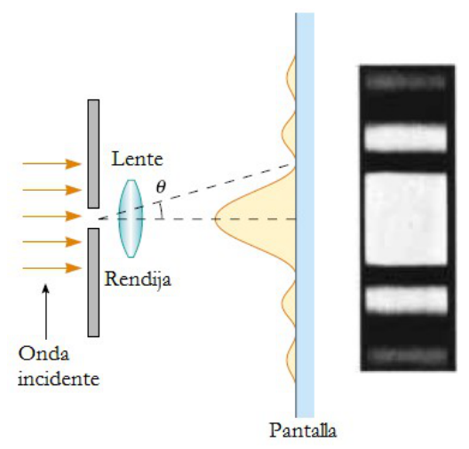
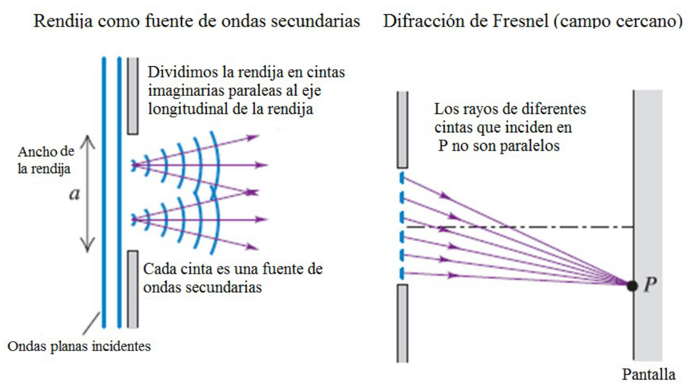
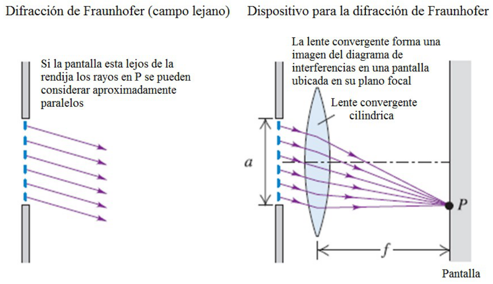

# Difracción de Fresnel y de Fraunhofer

> Fuente: `2019/3er Parcial/UT XIII - Interferencia y Difraccion 290616.ppt`,
> diapositivas 6, 7, 8. SHA-256:
> `12c4947f897a58508ce3794255b164f41d4356b0bb4bbad0e9d8314ef6eaf137`. Original
> archivado bajo2019; el nombre contiene290616, sin fecha de clase impresa.
> Copia normalizada con LibreOffice a PPTX/PDF; extracción MarkItDown y Poppler,
> cotejo visual de todas las diapositivas. No hay notas adicionales del
> presentador.

**Fresnel:** fuente y pantalla cercanas al obstáculo

**Fraunhofer:** fuente y pantalla lejanos al obstáculo

Fraunhofer: Los rayos de luz, luego de pasar por la rendija, son aproximadamente
paralelos.

## Rendija como fuente de ondas secundarias

Dividimos la rendija en cintas imaginarias paralelas al eje longitudinal de la
rendija.

Cada cinta es una fuente de ondas secundarias.

## Difracción de Fresnel (campo cercano)

Los rayos de diferentes cintas que inciden en P no son paralelos.

## Difracción de Fraunhofer (campo lejano)

Si la pantalla esta lejos de la rendija los rayos en P se pueden considerar
aproximadamente paralelos

## Dispositivo para la difracción de Fraunhofer

La lente convergente forma una imagen del diagrama de interferencias en una
pantalla ubicada en su plano focal
