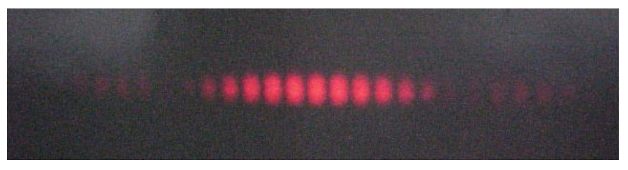
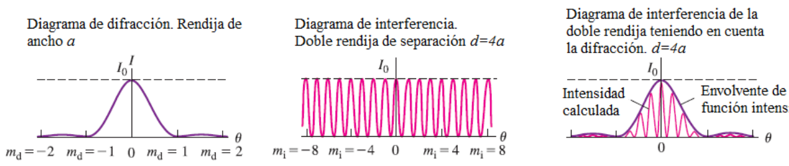
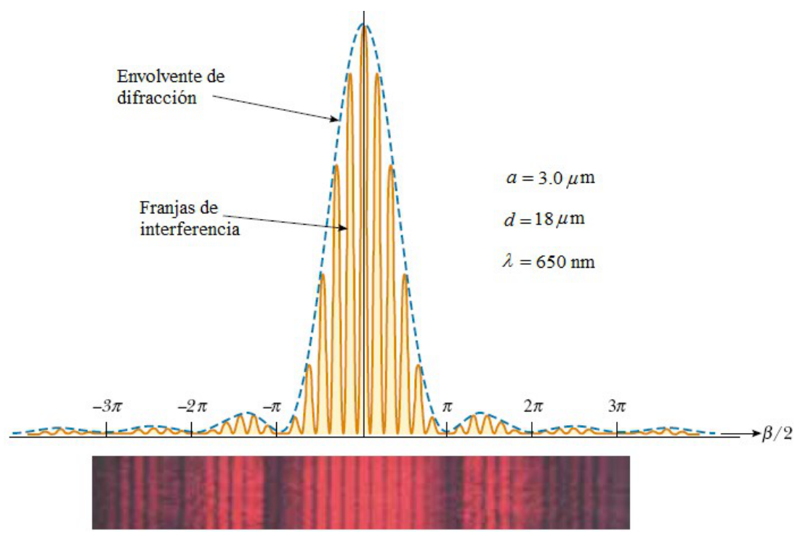
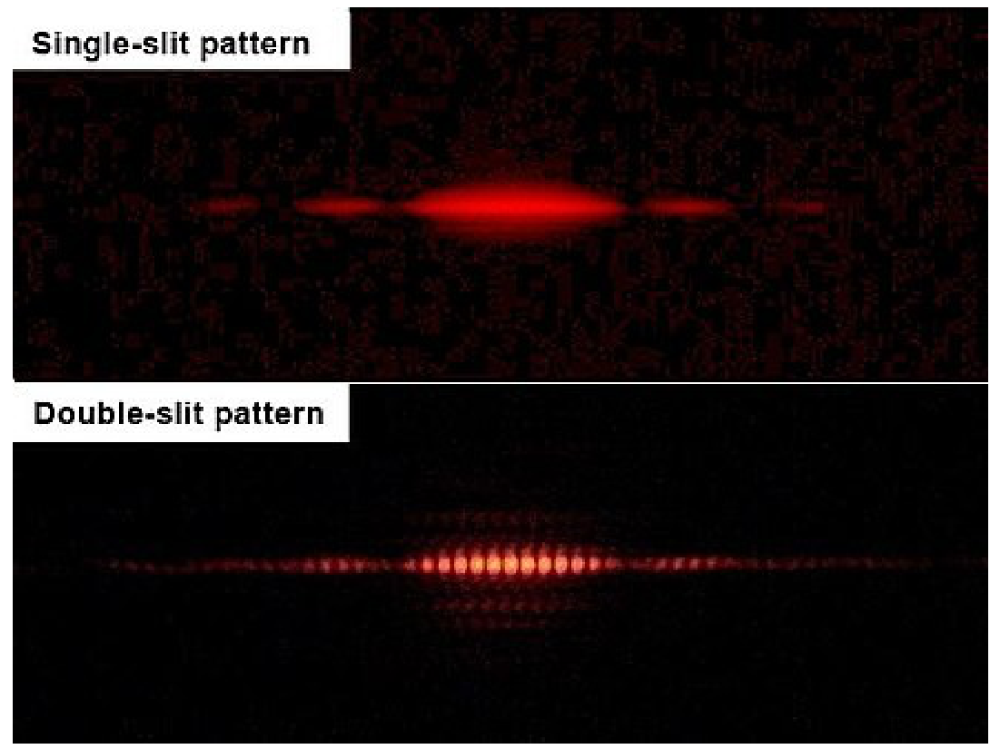

# Interferencias + Difracción para la doble rendija

> Fuente: `2019/3er Parcial/UT XIII - Interferencia y Difraccion 290616.ppt`,
> diapositivas 13, 14, 15, 16, 17, 18. SHA-256:
> `12c4947f897a58508ce3794255b164f41d4356b0bb4bbad0e9d8314ef6eaf137`. Original
> archivado bajo2019; el nombre contiene290616, sin fecha de clase impresa.
> Copia normalizada con LibreOffice a PPTX/PDF; extracción MarkItDown y Poppler,
> cotejo visual de todas las diapositivas. No hay notas adicionales del
> presentador.



Primero analizamos la interferencia sin considerar la extensión (ancho) de las
rendijas. Luego analizamos el fenómeno de difracción para una rendija debido a
su extensión finita. Ahora tendremos en cuenta el fenómeno de difracción e
interferencia para la rendija doble.

```math
I=I_0\cos^2(\phi/2)\frac{\sin^2(\beta/2)}{(\beta/2)^2}
```

con

```math
\begin{cases}
\phi=\dfrac{2\pi d}{\lambda}\sin(\theta)\\
\beta=\dfrac{2\pi a}{\lambda}\sin(\theta)
\end{cases}
```



## Termino de difracción

Diagrama de difracción. Rendija de ancho a

```math
I=I_0\frac{\sin^2(\beta/2)}{(\beta/2)^2}
```

```math
\beta=\frac{2\pi a}{\lambda}\sin(\theta)
```

## Termino de interferencia

Diagrama de interferencia. Doble rendija de separación $`d=4a`$

```math
I=I_0\cos^2(\phi/2)
```

```math
\phi=\frac{2\pi d}{\lambda}\sin(\theta)=\frac{8\pi a}{\lambda}\sin(\theta)
```

## Combinación

Diagrama de interferencia de la doble rendija teniendo en cuenta la difracción.
$`d=4a`$

```math
I=I_0\cos^2(\phi/2)\frac{\sin^2(\beta/2)}{(\beta/2)^2}
```

```math
\phi=\frac{8\pi a}{\lambda}\sin(\theta)
```

```math
\beta=\frac{2\pi a}{\lambda}\sin(\theta)
```



```math
a=3.0\,\mu\mathrm m,\qquad d=18\,\mu\mathrm m,\qquad\lambda=650\,\mathrm{nm}
```



## Fin tema13

## Observaciones de transcripción

Se conserva «Termino» sin tilde en los rótulos originales. Los valores del
ejemplo gráfico16 se transcriben sin resolver ni deducir otros datos.
