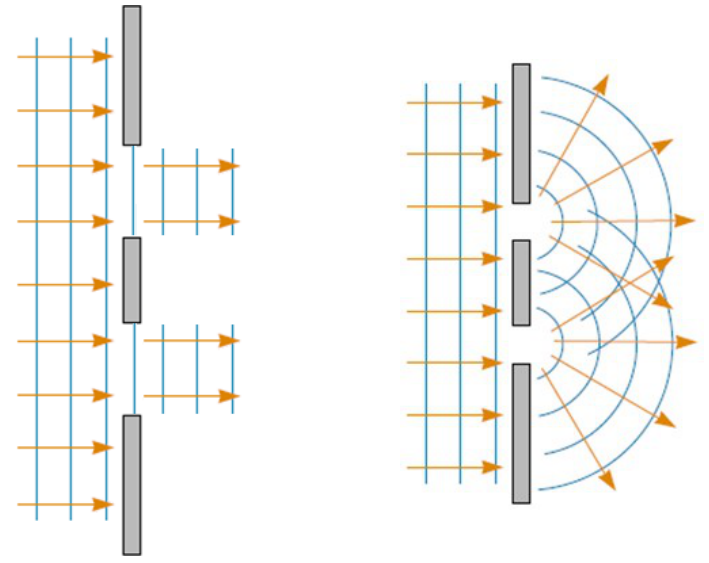
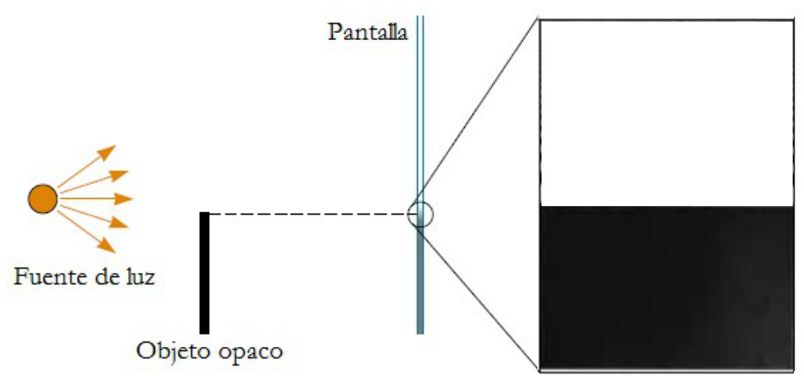
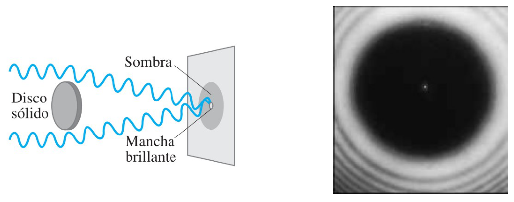
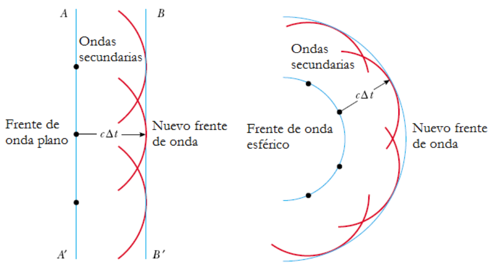
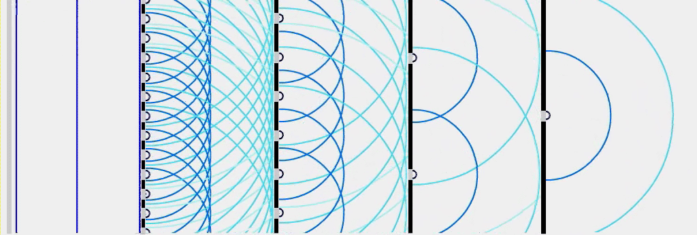
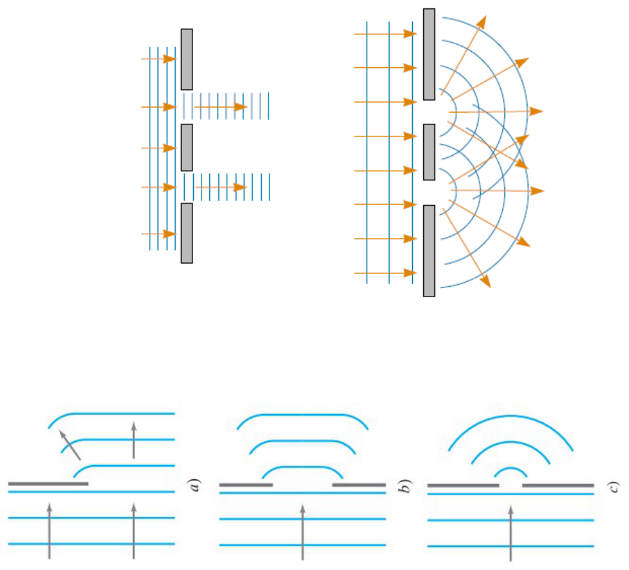

# Difracción y principio de Huygens

> Fuente: `2019/3er Parcial/UT XIII - Interferencia y Difraccion 290616.ppt`,
> diapositivas 1, 2, 3, 4, 5, 20. SHA-256:
> `12c4947f897a58508ce3794255b164f41d4356b0bb4bbad0e9d8314ef6eaf137`. Original
> archivado bajo2019; el nombre contiene290616, sin fecha de clase impresa.
> Copia normalizada con LibreOffice a PPTX/PDF; extracción MarkItDown y Poppler,
> cotejo visual de todas las diapositivas. No hay notas adicionales del
> presentador.

La difracción es el fenómeno que se produce cuando las ondas (mecánicas,
electromagnéticas o asociadas a partículas) alcanzan un obstáculo o abertura de
dimensiones comparables a su propia longitud de onda, y que se manifiesta en
forma de perturbaciones en la propagación de la onda, bien sea rodeando el
obstáculo, bien sea produciéndose una divergencia a partir de la abertura.

La difracción se produce en el obstáculo, lo que observamos en la pantalla es la
figura de interferencia que provoca el fenómeno de difracción.

## Difracción al iluminar una moneda

## Principio de Huygens

Todos los puntos de un frente de onda dado se toman como fuentes puntuales que
producen ondas esféricas secundarias que se propagan hacia adelante con la
velocidad característica de la onda en ese medio. Luego de un intervalo de
tiempo, la nueva posición del frente de onda es la superficie tangente a los
frentes de las ondas secundarias.

Animación incrustada en la diapositiva5:

## Figuras finales — diapositiva20

## Observaciones de transcripción

Se conserva el GIF incrustado de5, sin descargar la dirección externa que
aparece en su descripción. La20 contiene únicamente figuras y su número de
diapositiva; se conserva aunque esté después del cierre18.
