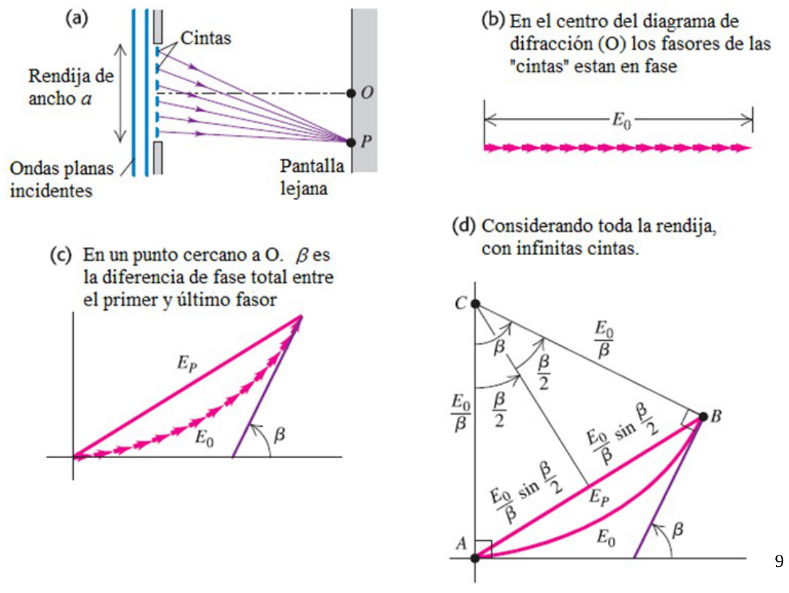
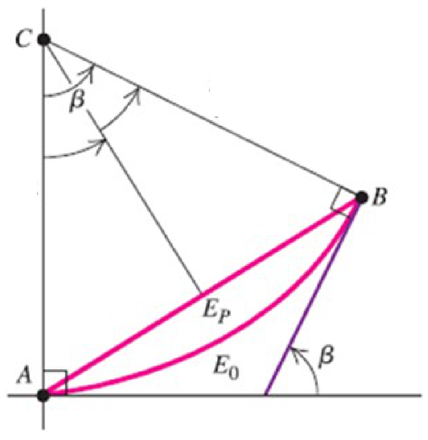
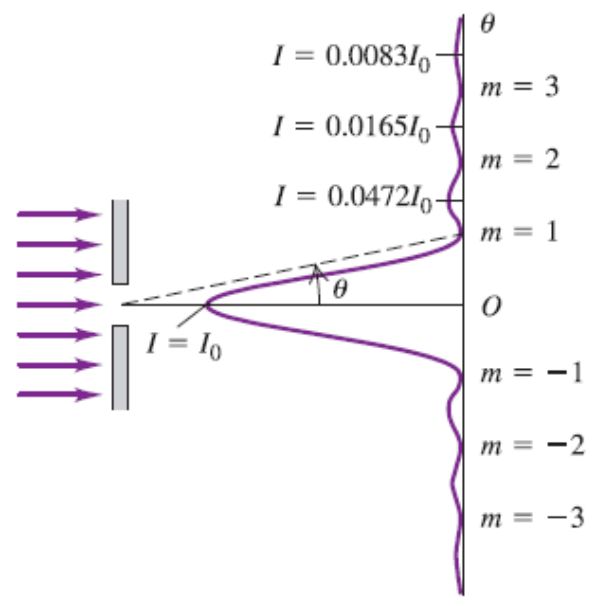

# Difracción por una rendija (Fraunhofer)

> Fuente: `2019/3er Parcial/UT XIII - Interferencia y Difraccion 290616.ppt`,
> diapositivas 9, 10, 11, 12. SHA-256:
> `12c4947f897a58508ce3794255b164f41d4356b0bb4bbad0e9d8314ef6eaf137`. Original
> archivado bajo2019; el nombre contiene290616, sin fecha de clase impresa.
> Copia normalizada con LibreOffice a PPTX/PDF; extracción MarkItDown y Poppler,
> cotejo visual de todas las diapositivas. No hay notas adicionales del
> presentador.



(a) Rendija de ancho a, ondas planas incidentes, cintas y pantalla lejana.

(b) En el centro del diagrama de difracción (O) los fasores de las "cintas"
están en fase

(c) En un punto cercano a O. $`\beta`$ es la diferencia de fase total entre el
primer y último fasor

(d) Considerando toda la rendija, con infinitas cintas.



```math
\text{arco}=\text{ángulo}\times\text{radio}
```

```math
E_p/2=(E_0/\beta)\mathop{\mathrm{sen}}\nolimits(\beta/2)
```

```math
E_0=\beta R\quad\Rightarrow\quad R=E_0/\beta
```

Amplitud

```math
E_p=E_0\frac{\mathop{\mathrm{sen}}\nolimits(\beta/2)}{(\beta/2)}
```

Intensidad

```math
I=E_p^2=E_0^2\frac{\mathop{\mathrm{sen}}\nolimits^2(\beta/2)}{(\beta/2)^2}=I_0\frac{\mathop{\mathrm{sen}}\nolimits^2(\beta/2)}{(\beta/2)^2}
```

```math
\frac{\lambda}{2\pi}=\frac{\Delta r}{\Delta\varphi}=\frac{a\sin(\theta)}{\beta}
\quad\Rightarrow\quad
\beta=\frac{2\pi}{\lambda}a\sin(\theta)
```



```math
I=I_0\frac{\mathop{\mathrm{sen}}\nolimits^2(\pi a\sin(\theta)/\lambda)}{(\pi a\sin(\theta)/\lambda)^2}
```

```math
E_p=E_0\frac{\mathop{\mathrm{sen}}\nolimits(\beta/2)}{(\beta/2)}
```

Franja oscura => $`I=0`$ => $`\beta`$ es múltiplo de $`2\pi`$

```math
\beta=\frac{2\pi}{\lambda}a\sin(\theta)=2m\pi
```

```math
\sin(\theta)=m\frac{\lambda}{a}\qquad(m=\pm1,\pm2,\pm3,\ldots)
```

Para determinar los máximos hay que derivar la intensidad con respecto a
$`\beta`$, igualar a cero y despejar $`\beta`$.

## Observaciones de transcripción

Se conservan la alternancia sen/sin, el subíndice p y la igualdad original
I=Ep², sin agregar factores físicos ni modificar la fuente.
