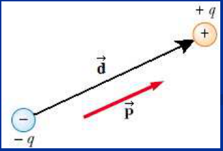
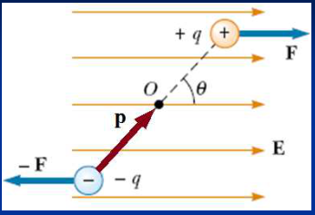
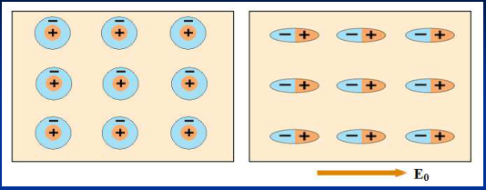
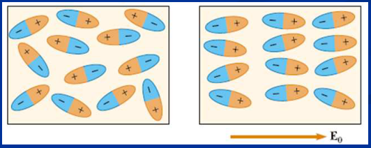
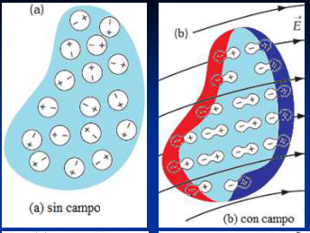
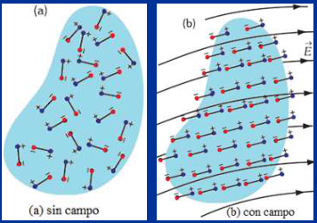

# Descripción macroscópica del comportamiento de los dieléctricos en presencia de campos electrostáticos externos

## Concepto de dipolo eléctrico. Vector momento dipolar

El dipolo eléctrico se define como la agrupación de dos cargas puntuales iguales
y de signo opuesto separadas por cierta distancia, generalmente del orden de las
dimensiones atómicas. Su comportamiento eléctrico esta determinado
fundamentalmente por la magnitud del momento dipolar p, definido como:

```math
\vec p=q\vec d
```



Donde q es el valor absoluto de una de las cargas eléctricas. El sentido del
vector p es de la carga negativa a la positiva.

## Dipolo en un campo E homogéneo



```math
\vec F=q\vec E
```

```math
\vec\tau=\vec d\times\vec F
```

```math
\vec\tau=\vec d\times q\vec E=q\vec d\times\vec E
```

```math
\vec\tau=\vec p\times\vec E
```

```math
\tau=dF\sin(\theta)=qdE\sin(\theta)=pE\sin(\theta)
```

El torque produce una rotación que tiende a alinear el dipolo con el campo
eléctrico

El trabajo que tenemos que realizar desde el exterior, para hacer girar al
dipolo en el interior del campo eléctrico, desde una posición inicial, en la que
el dipolo forma un ángulo θ₀ con el campo eléctrico, hasta que forme un ángulo
θ, se acumula en forma de energía potencial U en el sistema, es decir, en el
dipolo y en el campo eléctrico; su valor será:

```math
U=\int_{\theta_0}^\theta dW=\int_{\theta_0}^\theta\tau\,d\theta=\int_{\theta_0}^\theta pE\sin(\theta)\,d\theta
```

```math
U=pE\int_{\theta_0}^\theta\sin(\theta)\,d\theta=pE\left(\cos(\theta_0)-\cos(\theta)\right)
```

Solo son medibles diferencias de energía potencial. Si convenimos que U = 0 para
θ₀ = π/2 queda:

```math
U=-pE\cos(\theta)=-\vec p\cdot\vec E
```

## Dieléctrico no polar



## Dieléctrico polar





Dieléctrico no polar. a) Sin campo y b) con campo. El dieléctrico se polariza.
Se crea una densidad superficial de carga σₚ de polarización.



Dieléctrico polar. a) Sin campo y b) con campo. El dieléctrico se polariza. Los
dipolos permanentes se orientan parcialmente en la dirección del campo. Se crea
una densidad superficial de carga σₚ de polarización.

## Procedencia y observaciones de transcripción

- Original:
  `2019/1er Parcial/2018 PF UT III - Capacidad. Prop electr de la Materia.pptx.pdf`,
  páginas 20, 21, 22 de 26, dos diapositivas por página salvo el cierre.
- SHA-256: `ac23675b753c3d9349b89600ea349edcbc8dfe56058b3c78a09e873777616145`.
- Fecha impresa: 28/03/2018. Ubicación canónica: material 2019. No consta autor
  en estas páginas.
- Herramientas: PyMuPDF4LLM y Poppler para extracción; cotejo visual de texto,
  expresiones, tablas y figuras. Medios conservados mediante recorte/render
  PyMuPDF, excepto las dos imágenes de carga por batería extraídas directamente
  del PDF.
- Cubre las diapositivas 40–44. Se conserva el título «Descripción
  macroscópica», aunque la explicación use dipolos moleculares, y los límites de
  integración angular tal como aparecen.
