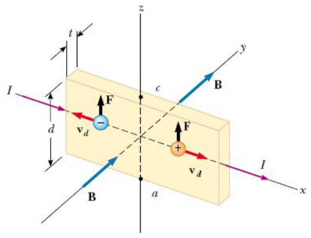
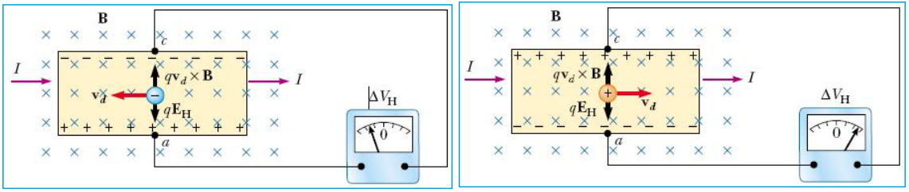
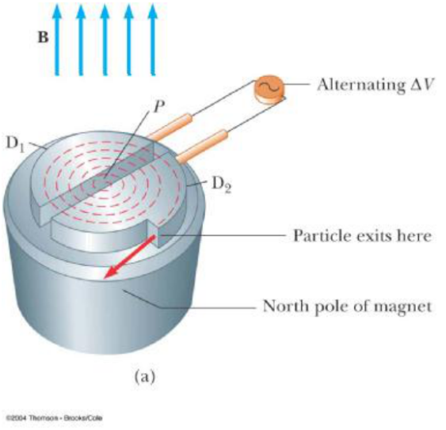

# Efecto Hall y ciclotrón

Unidad Temática V — Fuerzas Magnéticas sobre cargas y elementos de corriente

## EFECTO HALL

Cuando un conductor con corriente es colocado en un campo magnético, se genera
una diferencia de potencial en dirección perpendicular a la corriente y a B.
Este fenómeno fue observado por Edwin Hall (1855–1938) en 1879





```math
\begin{cases}\vec F_B=q\vec v_d\times\vec B\qquad F_B=qv_dB\\\vec F_E=q\vec E_{\mathrm{Hall}}\qquad F_E=qE_{\mathrm{Hall}}\end{cases}
```

En estado estacionario

```math
qv_dB=qE_{\mathrm{Hall}}\Rightarrow E_{\mathrm{Hall}}=v_dB
```

```math
\Delta V_{\mathrm{Hall}}=E_{\mathrm{Hall}}d=v_dBd
```

```math
v_d=\frac I{nqA}\quad\text{con }A=td\quad\text{area transversal}
```

```math
\Delta V_{\mathrm{Hall}}=\frac{IBd}{nqA}=\frac{IB}{nqt}=R_H\frac{IB}t
```

Coef. de Hall

```math
R_H=\frac1{nq}
```

Empleando esta formula podemos determinar B

## CICLOTRON

Dispositivo que se emplea para acelerar partículas cargadas a grandes
velocidades.



D1 y D2 recipientes semicirculares con diferencia de potencial ΔV alterna de
periodo T, igual al periodo de ciclotrón $`T=2\pi m/qB`$. Si R es el radio de
giro al emerger

```math
R=\frac{mv}{qB}\Rightarrow v=\frac{qBR}m
```

```math
Ec=\frac12mv^2=\frac12\left(\frac{q^2v^2}m\right)R^2
```

## Procedencia y observaciones de transcripción

- Original:
  `2019/2do Parcial/2019 UT V - Fuerzas Magnéticas sobre cargas y elementos de corriente.pdf`,
  páginas 24–26 de 42.
- SHA-256: `383fdb6f46e1627fbe65cf259b89a480bd4b4cc61821cbfc466fa3e4a63ceb29`.
  2019 corresponde al nombre del archivo; no consta fecha impresa en estas
  páginas.
- Herramientas: PyMuPDF4LLM, Poppler y recortes PyMuPDF; cotejo visual de todas
  las páginas, expresiones y figuras del tramo. Se conserva el contenido del
  original, sin resolver ejercicios vacíos.
- Se conserva v² en el segundo miembro de la energía del ciclotrón de página 26,
  aunque la relación anterior utilice B. No se cambia el símbolo ni se recalcula
  la expresión. Las etiquetas inglesas del esquema permanecen en la figura.
