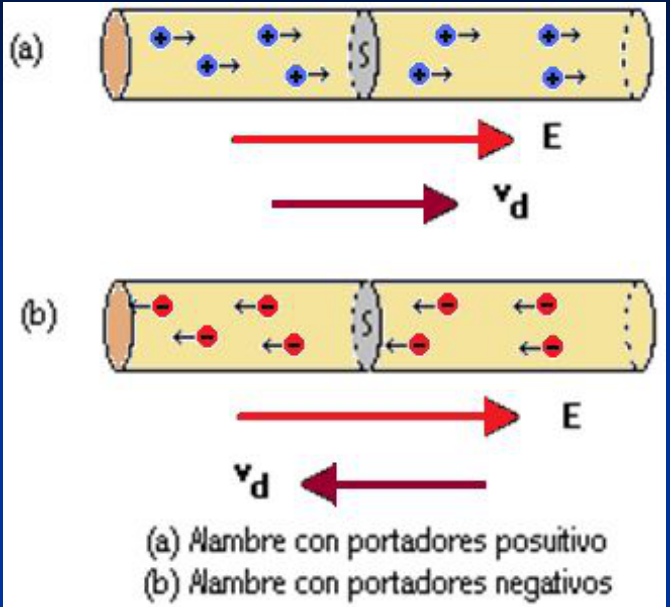
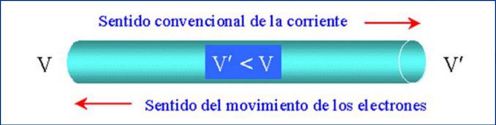

# Unidad Temática IV: Electrocinética

## CONTENIDOS

Corriente eléctrica. Intensidad de corriente. Densidad de corriente. Ecuación de
continuidad. Modelo clásico de un conductor. Conductividad y Resistividad. Ley
de Ohm. Resistencia eléctrica. Asociación de resistencias. Trasformación de
energía. Ley de Joule. Potencia eléctrica. Fuerza electromotriz. Circuitos
eléctricos. Leyes de Kirchhoff. Puente de Wheatstone. Circuito RC.

## OBJETIVOS DE LA UNIDAD

Que el alumno logre:

- Comprender y relacionar los conceptos de corriente, resistencia y diferencia
  de potencial (macroscópicos).
- Comprender y relacionar los conceptos de densidad de corriente, resistividad y
  campo eléctrico (microscópicos)
- Aplicar la ley de Ohm a situaciones problemáticas.
- Calcular la resistencia equivalente en asociaciones de resistores en serie y
  en paralelo.
- Calcular la energía eléctrica disipada por un resistor utilizando la ley de
  Joule.
- Reconocer las diferentes fuentes de fuerza electromotriz.
- Comprender y aplicar las leyes de Kirchhoff a circuitos de una y varias
  mallas.
- Reconocer y utilizar los dispositivos para la medición de corrientes,
  resistencias y diferencias de tensión en circuitos (multímetros).
- Analizar circuitos sencillos (RC) y plantear y resolver las ecuaciones
  diferenciales correspondientes.

## Corriente y Resistencia Eléctrica

- Analizaremos el movimiento de los portadores de carga, es decir el fenómeno de
  la conducción eléctrica.
- En electrostática, $`E=0`$ dentro de un conductor. Si mediante algún
  dispositivo mantenemos $`E\ne0`$ dentro de un conductor, los portadores de
  carga se moverán, estableciéndose una corriente de portadores, que denominamos
  corriente eléctrica.

## Corriente eléctrica



Si dQ es la carga que atraviesa la sección transversal S en el intervalo
infinitesimal de tiempo dt, se define:

```math
i:\frac{dQ}{dt}
```

Corriente eléctrica (escalar)

En el SI

```math
[i]=\frac{[Q]}{[t]}=\frac{\mathrm{Coulomb}}{\mathrm{segundo}}
```

```math
[i]=\frac C s=A=\mathrm{Ampere}
```

Submúltiplos:

```math
1\,\mathrm{mA}\ (\mathrm{miliampere})=1\bullet10^{-\,-3}\,A
```

```math
1\,\mu A\ (\mathrm{microampere})=1\bullet10^{-6}\,A
```

Benjamin Franklin fue el primero en asignar un sentido de circulación a la
corriente eléctrica en los conductores metálicos. Supuso que la electricidad
positiva (fluido) era la que se desplazaba por el interior del conductor. La
corriente eléctrica circularía del polo positivo al negativo. Más de un siglo
después la teoría atómica revelaba que los electrones son los portadores de
carga en los metales, y que el sentido real de la corriente resulta ser el
opuesto al asignado por Franklin. Por razones históricas y dado que en la
electrocinética el sentido de circulación de la corriente no tiene mayor
trascendencia, se sigue aceptando como sentido convencional el postulado por
Franklin. Sin embargo, en otras ramas de la física, como la electrónica, la
distinción entre ambos resulta importante.



## EFECTO DE LA CORRIENTE ELÉCTRICA EN EL CUERPO

| I en Ampere | Efectos |
| -- | -- |
| 0.001 | Se puede sentir |
| 0.005 | Doloroso |
| 0.010 | Contracciones musculares involuntarias (Espasmos) |
| 0.015 | Pérdida Control Muscular |
| 0.070 | Si pasa por el corazón, trastornos graves ( mortal si dura más de 1s) |

## Procedencia y observaciones de transcripción

- Original: `2019/1er Parcial/2017 UT IV - Electrocinética.ppt.pdf`, páginas 1,
  2, 3, 4, 5, 6, 7 de 55.
- SHA-256: `5593bcdeb59339b25f4dfee074beac1812300dcec491fb423777a4e776ba1399`.
- El nombre del archivo indica 2017; se conserva bajo 2019 por su ubicación
  canónica. No consta autor en estas páginas.
- Herramientas: PyMuPDF4LLM, PyMuPDF y Poppler; cotejo visual de texto,
  fórmulas, tablas y diagramas. Figuras originales conservadas por recorte y
  render.
- Se conserva el signo dos puntos en i: dQ/dt y el doble signo menos del
  exponente del miliampere, tal como se ven en la diapositiva 5. La tabla se
  transcribe como contenido del material, sin añadir interpretaciones.
