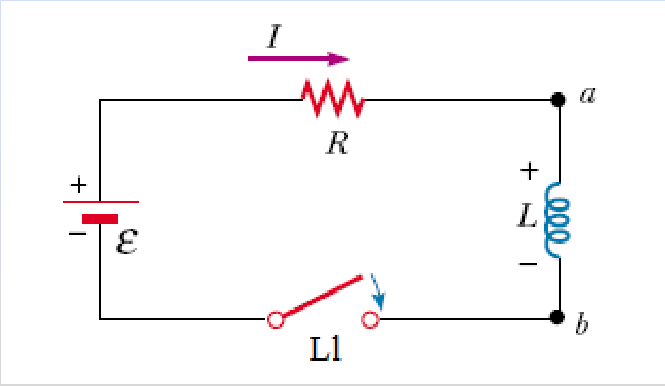

# Energía de la bobina y densidad magnética: versión Electromagnetismo

Unidad Temática VII — Electromagnetismo

## Energía almacenada en una bobina



En t=0 es I=0. Al cerrar L1

Diferencia de potencial en L

```math
V_{ab}=L\frac{dI}{dt}
```

La potencia consumida por L es

```math
P=IV_{ab}=IL\frac{dI}{dt}
```

La energía suministrada es

```math
U=\int dW=\int P\,dt=\int_0^I LI\,dI=\frac12LI^2
```

Energía almacenada en el inductor cuando circula una corriente I.

Así como se puede considerar que la energía almacenada en un capacitor reside en
el campo eléctrico entre sus placas, del mismo modo se puede considerar que la
energía en un inductor esta almacenada en su campo magnético.

Para expresar la energía en términos del campo magnético, usamos la inductancia
de un solenoide ideal

```math
L=\frac{\mu_0N^2A}{Long}
```

El campo magnético B en un solenoide se relaciona con la corriente mediante

```math
B=\frac{\mu_0NI}{Long}
```

```math
U=\frac12LI^2=\frac12\frac{\mu_0N^2A}{Long}\frac{B^2Long^2}{\mu_0^2N^2}
```

```math
U=\frac{B^2}{2\mu_0}(A\,Long)=\frac{B^2}{2\mu_0}Vol
```

Podemos considerar que esta energía reside en el volumen encerrado por los
devanados

Así la energía por unidad de volumen o densidad de energía es:

```math
u=\frac U{Vol}=\frac1{2\mu_0}B^2
```

Esta formula es valida para cualquier región del espacio donde exista un campo
magnético. Si esta presente un material ferromagnetico se sustituye μ0 por μ.

## Procedencia y observaciones de transcripción

- Original: `2019/2do Parcial/2019 UT VII Electromagnetismo.pdf`, páginas 44–45
  de 62. No consta fecha impresa; 2019 es del nombre del archivo.
- SHA-256: `eff3447774cadfcb2726a6caabbe8e257782276fce3e67dda465673d5ef67a6a`.
- Herramientas: PyMuPDF4LLM, Poppler y recortes PyMuPDF; páginas, expresiones y
  figuras del tramo cotejadas visualmente.
- Se conserva μ0 en el desarrollo de esta versión y su indicación final de
  sustituirlo por μ.
