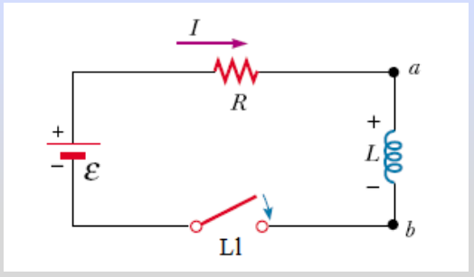

# Energía de una bobina y densidad de energía magnética

Unidad Temática VII — Electromagnetismo

## Energía almacenada en una bobina



En t=0 es I=0. Al cerrar Ll

Diferencia de potencial en L

```math
V_{ab}=L\frac{dI}{dt}
```

La potencia consumida por L es

```math
P=IV_{ab}=IL\frac{dI}{dt}
```

La energía suministrada es

```math
U=\int dW=\int P\,dt=\int_0^I LI\,dI=\frac12LI^2
```

Para el solenoide obtuvimos:

```math
B=\frac{\mu NI}{Long}\Rightarrow I=\frac{B\,Long}{\mu N}
```

```math
L=\frac{\mu N^2A}{Long}
```

```math
U=\frac12LI^2=\frac12\frac{\mu N^2A}{Long}\frac{B^2Long^2}{\mu^2N^2}=\frac{B^2}{2\mu}(A\,Long)=\frac{B^2}{2\mu}Vol
```

Densidad de energía magnética

```math
u=\frac U{Vol}=\frac1{2\mu}B^2
```

## Procedencia y observaciones de transcripción

- Original:
  `2019/2do Parcial/2019 UT VII - Fenómenos de Inducción Electromagnética.pdf`,
  páginas 48–49 de 67. Fecha impresa: 14/05/2019.
- SHA-256: `cbefa338a0f56f56079880a84f05a963257a6473febd8da50f944a67f2210a8f`.
- Herramientas: PyMuPDF4LLM, Poppler y recortes PyMuPDF; todas las páginas,
  expresiones y figuras del tramo cotejadas visualmente. Se conserva el
  desarrollo original.
